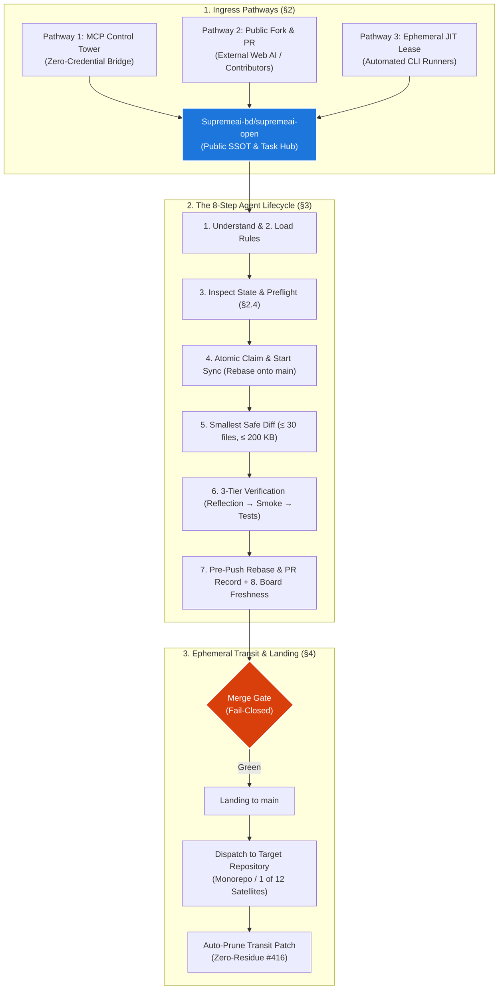

# SupremeAI — AGENTS.md

> **Agent Universal Constitution**  
> **Freedom:** Agent controls **HOW** to solve an assigned task inside its contract.  
> **Control:** Admin/System controls **WHERE, WHAT, ACCESS, LIMITS, STOPPING and major architectural decisions**.  
> **Canonical Rules:** [`AGENT_RULES.md`](./AGENT_RULES.md) · **Admin Work Budget:** ≤ 0.01% (Zero-Admin)

> [!NOTE]
> **Orientation for New AI Agents (Directory Mapping & Single Door):**  
> This repo (`supremeai-open`) contains mirror folders (`core/`, `command/`, `studio/`, `infrastructure/`, etc.). These are **NOT legacy duplicates**; they are the public transit surfaces for the 12 satellite repositories.  
> - **Never push directly to satellites:** Satellites enforce a strict 0 Issues / 0 PRs policy ([`FEDERATION_CHARTER.md`](./docs/FEDERATION_CHARTER.md)).  
> - **Code right here:** Make your edits inside this repository in the respective domain directory. Once your PR merges into `supremeai-open:main`, `landing.yml` automatically dispatches the commit to the target satellite repo.  
> - **Satellite Dispatch Invariants:**  
>   - **Domain Routing:** Code must touch the mirror folder (`studio/*` → `supremeai-studio`, `vscode/*` → `supremeai-vscode`, `api/*` / `gateway/*` → `supremeai-api`, etc.). Files in `docs/*` route *only* to monorepo `supremeai`. Work orders (`docs/work-orders/*`) are specs, not satellite code!  
>   - **Branch Prefix Rule:** PR branches must use standard naming (`feat/*`, `fix/*`, etc.). Branches prefixed with `bridge/*` trigger loop-prevention in `landing.yml` and intentionally skip satellite dispatch.

---

## 1. Visual Task Architecture (Federation Flow at a Glance)



---

## 2. Work Submission Pathways (Zero-Admin ≤ 0.01%)

| Pathway | Who & When | Mechanism |
|---|---|---|
| **1. MCP Control Tower (Primary)** | Claude, Cursor, Antigravity, Web bots | Zero-credential: tools provide context; proxy bot commits & opens PR. Endpoint: `https://supremeai-mcp-tower.onrender.com/mcp` |
| **2. Public Fork & PR** | External agents without credentials | Fork `supremeai-open`, push to fork, PR against `main`. Automated pipeline ports & verifies. |
| **3. Ephemeral JIT Lease** | CLI scripts / local automated runners | Maintainer-issued 1-hour lease tokens via the MCP Control Tower admin surface (no `credential_manager.py` exists in-repo); master keys never leave the vault (Rule U6). |

*U10 Rule: The loop is the permission. Never ask "should I proceed" when self-checkable preconditions pass.*

### MCP Tower tool-usage invariants (avoid argument/format errors)
- Tool names use **underscores** (`github_read_file`, `github_repo_tree`, `github_list_prs`, `github_workflow_runs`), never dots.
- Repo references accept **both** bare names (`supremeai-open`) and `owner/repo` (`Supremeai-bd/supremeai-open`) — both verified 2026-10-22 across `github_read_file`, `github_list_prs`, `github_workflow_runs`, `github_repo_tree` and `github_code_search`. If a tool answers "Invalid repo reference", retry with the `owner/repo` form.
- Code read/write tools are **role-gated + cloaked**: the core monorepo `supremeai` answers "Forbidden … (current role: 'agent')" to non-admin callers — only admin/supremeadmin may read it (verified 2026-10-22). Satellite repos including `supremeai-api` currently serve **reads** to `agent`-role callers; treat that as observed behavior, not a contract — handle "Forbidden"/"Repository not found" gracefully and never assume a cloak is absent.
- Code search is available via **`github_code_search`** (alias: `github_search_code`) across a specific repo (e.g. `repo: "supremeai-studio"`) or org-wide across `Supremeai-bd`.
- Test execution is not available via the tower (requires a separate runner) — by design.
- Bridge tools: `bridge_submit_patch` requires `taskId` (`bridge-YYYYMMDD-<slug>`), `summary`, `scopePaths` (1-30), `testsEvidence`, and `files` (each with `path`; `content` required for `full_file` mode, default). `work_claim` requires `issueNumber` (integer). `bridge_work_order`/`bridge_read_feedback` require `number` (issue number). `bridge_work_queue` accepts optional `limit`/`label`.

---

## 3. Role Preflight Invariants (৩-সেকেন্ড আত্ম-জিজ্ঞাসা)

যেকোনো কোড বা অ্যাকশনের পূর্বে প্রতিটি রোলের ৩-সেকেন্ড প্রি-ফ্লাইট চেক:
- **All Agents (Dual-Rebase Mandate):** কাজ শুরুর আগে `origin/main` থেকে রিবেস করে ব্রাঞ্চ খোলা হয়েছে তো? এবং পুশ করার ঠিক আগে রিবেস ও ৩-টিয়ার ভেরিফিকেশন ছাড়া পুশ করা সম্পূর্ণ নিষিদ্ধ।
- **All Agents (Path-Anchoring & Mirror Invariant):** ফাইল পাথ কি সঠিক ডোমেইন মিররে (`studio/*`, `gateway/*`, `core/*` ইত্যাদি) এঙ্কর করা? স্যাটেলাইট কোড ভুলেও রিপোজিটরির রুট-লেভেলে (`src/*`) প্যাচ করা হচ্ছে না তো? সাবমিট বা পুশের পূর্বে লোকাল চেক বাধ্যতামূলক: `python scripts/ci/boundary_sanitization_guard.py --files <paths>` (পাস করলেই কেবল সাবমিট বৈধ)।
- **Planner:** বিদ্যমান কোডে ৮০% আছে কি? নতুন জটিলতা ছাড়া কি পুরনো কোড রিইউজ করা যায়? (রুল §6)
- **Coder:** ইস্যু কি লাইভ `main`-এ সক্রিয়? ইস্যুতে সাজেস্ট করার চেয়ে সহজ ১-লাইনের সেরা কোনো বিকল্প আছে কি?
- **Auditor:** নিয়মলঙ্ঘন কি বর্তমান `main`-এ প্রমাণযোগ্য? এটি চিরতরে বন্ধে স্বয়ংক্রিয় সিআই গেট কী দেওয়া হচ্ছে?
- **CI Fixer:** রুট-কজ ঠিক হচ্ছে নাকি স্কিপ হ্যাক? লিনাক্স/উইন্ডোজ/ম্যাকে পোর্টেবল এবং < 5s ফাস্ট-পাথ সুরক্ষিত তো?
- **Human Eye:** এডমিন শ্রম ≤ ০.০১% অক্ষত তো? ওয়ান-টাইম ফিক্স না করে সিস্টেমে স্থায়ী নিয়ম শেখানো হচ্ছে কি?
- **3rd Party Platforms:** মাস্টার-কি সম্পূর্ণ আইসোলেটেড তো? সার্ভার স্লিপ হলেও কোল্ড-স্টার্ট রিট্রাই আছে তো?
- **All Agents (Non-Regression Mandate):** আমার কাজ কি বিদ্যমান কোনো ভালো কাজ, পারফরম্যান্স বা আর্কিটেকচার নষ্ট করছে? বিদ্যমান কোড অন্ধভাবে না মুছে কি এর ওপর সুরক্ষিতভাবে এক্সটেন্ড করা হয়েছে? (রুল P3)
- **Satellite-First (বাস্তব সুবিধা):** এই কাজ কি কোনো সক্রিয় স্যাটেলাইটে (studio, gateway, browser, vscode, core) পৌঁছাবে? শুধু ইন্টার্নাল টুলিং বা মনোরিপো-অনলি ফাইলে একা একা কাজ করা কঠোরভাবে নিষিদ্ধ।
- **Frontend / Studio (স্পিড ডকট্রিন):** পাবলিক ল্যান্ডিং পেজ (`/`) কি কোনো অথ-ব্লকার ছাড়াই < 1.0s লোড হচ্ছে? ভারী পেজগুলো (AIStudio, AdminShell, UserDashboard) কি `React.lazy()` দিয়ে কোড-স্প্লিট করা আছে? (রুল P9)

---

## 4. Universal Boundaries & Core Philosophy

### Agent Freedom vs Hard Boundaries
- **Agent decides:** Implementation inside declared scope, testing, smallest safe approach, evidence-backed optimizations.
- **Agent may NOT decide alone:** Major architecture changes, permission/boundary alterations, destructive ops, wide scope expansion (requires `ADMIN_DECISION` issue).
- **Hard Ordering:** **Start-of-Work Sync** (fetch/rebase `origin/main` before branch) · **No Claim → No Branch** (zero-credential `work_claim` tool or `<!-- atomic-claim -->` comment plane first) · **Pre-Push Rebase Guard** (0 behind `origin/main`) · **No Branch → No Push** (pre-push gate) · **Board Freshness Re-check (#4177)** before declaring done.

### Core Philosophy (The Law of Minimal Elegance — সব এজেন্টের মূলমন্ত্র)
- **Zero Over-Engineering:** কোনো ওভার-ইঞ্জিনিয়ারিং নয় — যেকোনো সমাধানকে কতটুকু সহজ অথচ চূড়ান্ত শক্তিশালী (Simple yet Powerful) করা যায়, সেটাই প্রতিটি এজেন্টের প্রথম এবং প্রধান লক্ষ্য।
- **Token & Context Efficiency:** ৭২৮ লাইনের কথা যদি মারমেইড গ্রাফ ও পাঞ্চি চেকলিস্টে ৮৮ লাইনে (৭০-৮০% রিডাকশন) প্রকাশ করা যায় যার কার্যকারিতা ১% কমবে না বরং টোকেন ও ক্ল্যারিটি বাঁচাবে—সেটাই হলো সুপ্রিমএআই স্ট্যান্ডার্ড।
- **Simple + effective > clever + complex.**
- **Existing work before new work.** (80% reuse rule; ১৭ লাইনে ৫টি রিপোর সমন্বয় প্রমাণ করেছে মিনিমালিজমের শক্তি)
- **Single-domain PRs.** One PR touches one federation target domain (e.g. `studio/*` OR `gateway/*`), never both in the same change — keeps patches small, testable, and avoids partial-landing drift across satellites. Cross-domain work is split into separate PRs.
- **Extend, Never Regress (পূর্ববর্তী শ্রেষ্ঠত্ব অক্ষত রাখা):** নতুন ফিচার বা ফিক্স যোগ করতে গিয়ে পেছনের কোনো অর্জিত পারফরম্যান্স, নিরাপত্তা, বা ইউজার এক্সপেরিয়েন্স নষ্ট করা সম্পূর্ণ নিষিদ্ধ। পূর্বের চেয়ে প্রমাণযোগ্যভাবে উৎকৃষ্ট (strictly superior) না হলে কোনো প্রতিষ্ঠিত কোড বা আর্কিটেকচারে হাত দেওয়া যাবে না।
- **Satellite-First Delivery Mandate.** All autonomous agent work must target active product satellites (`studio/*`, `gateway/*`, `browser/*`, `vscode/*`, `core/*`). Code touching exclusively internal tooling or monorepo-only transit surfaces (`infrastructure/*`, `scripts/*`) is strictly banned from autonomous PR creation without explicit admin authorization.
- **Issue validity before implementation.** (Never fix a ghost issue)
- **Evidence before action.** (Claims without proof are rejected)
- **System guards enforce boundaries; agents do not police themselves.**

---

## 5. Navigation Circle & Machine Enforcement

```text
Entry (AGENTS.md) → Rules (AGENT_RULES.md) → Task/Issue → Group/Domain → Verify Evidence → Landing
```

- **Canonical Check:** `python scripts/ci/issue_template_guard.py --self-test`
- **Board SSOT:** [`docs/FEDERATION_CHARTER.md`](./docs/FEDERATION_CHARTER.md) (#626) — one public task board; satellites hold 0 open issues/PRs. Audit: `python3 scripts/ci/satellite_board_guard.py --check`
- **14 Anchor Hub SSOT:** `python scripts/ci/federation_anchors.py --self-test` — strictly 14 persistent root hubs (#761 CI, #760 Bridge, 12 Domains); all tasks/failures are Sub-Issues.
- **Boundary & Surface Path SSOT:** `python scripts/ci/boundary_sanitization_guard.py --self-test` (and `--files <paths>`) — prevents root-level shadowing and unapproved surface leaks (#107, #508).
- **Frontend Performance SSOT:** `python scripts/ci/frontend_performance_guard.py --self-test` — code-splitting & zero-blocking landing doctrine (FCP < 1.0s).
- **Next:** Read [`AGENT_RULES.md`](./AGENT_RULES.md) for detailed role policies and gate definitions.
