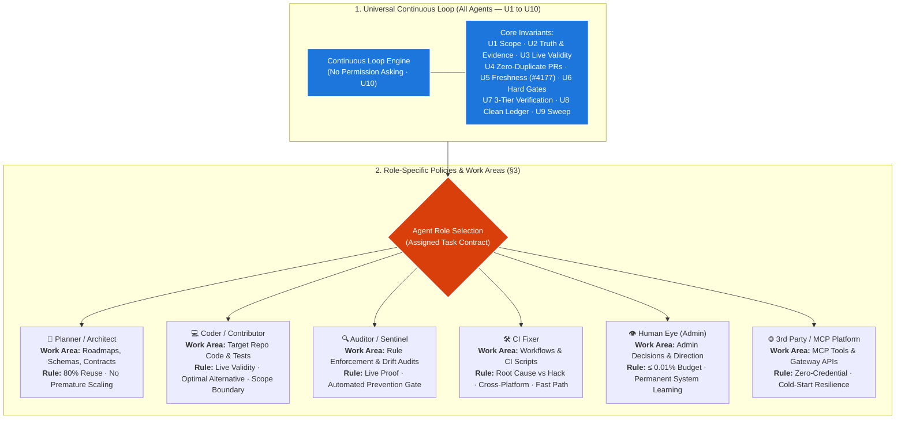

# SupremeAI — AGENT_RULES.md

> **Single Source of Agent Operational Policy**  
> **Universal Foundation:** All agents follow the continuous loop and Universal Rules (U1–U10).  
> **Role Specialization:** Branching into role-specific policies, work areas, and constraints.  
> **Operator Handbook:** [`docs/ZERO_ADMIN_GUIDE.md`](./docs/ZERO_ADMIN_GUIDE.md) · **Admin Work Budget:** ≤ 0.01%

---

## 1. Visual Operational Architecture (Continuous Loop → Role Specialization)

---

## 2. Universal Agent Contract (Common Rules U1 – U10)

Every agent, regardless of role, model, or provider, strictly adheres to these 10 universal rules:

| Rule | Name | Core Mandate & Machine Contract |
|---|---|---|
| **U1** | **Scope** | Work strictly inside assigned issue touching files. Zero unrelated refactoring or scope creep. |
| **U2** | **Truth & Evidence** | No claims without proof. `UNKNOWN` / `NOT_VERIFIED` is never `PASS`. Evidence precedes action. |
| **U3** | **Live Validity** | An issue is not valid just because it exists. Verify it is reproducible on live `main` before coding. |
| **U4** | **Zero-Duplicate PRs & Federation Anchor Hub SSOT** | Mandatory preflight `gh pr list`. The public board (`supremeai-open`) maintains strictly **8 active persistent parent Anchor Hubs** (#749 Studio, #750 API, #751 Core, #754 VSCode, #756 Browser, #760 Bridge/Archive Desk, #761 CI Incident Hub, #762 Open Embassy; 6 transit hubs consolidated into API/VSCode). All tasks, pipeline failures, and bridge sync orders attach strictly as **Sub-Issues** inside their respective Anchor Hub. Zero loose root issues permitted. One issue = at most one PR across the federation. |
| **U5** | **Freshness & Dual-Rebase Mandate** | Rebase onto latest `origin/main` at work start (pre-branch) AND before push (pre-push). Atomic claim before branch (zero-credential `work_claim` tool or `<!-- atomic-claim -->` comment plane). **Board-freshness re-check (#4177):** re-poll board before declaring done. Never work or push with a stale base. |
| **U6** | **Safety & Permissions** | Hard gates outrank agent preference. Master keys never leave vault; no direct push to protected branches. |
| **U7** | **3-Tier Verification** | Task is complete only when Reflection → Boot Smoke → Tests pass with verifiable output. |
| **U8** | **Handoff & Decision Ledger** | Finish with JSON decision ledger (`why`, `alternatives_rejected`, `evidence`). Squash commit must carry `Closes #N`. Rerun loop immediately (no sleep). |
| **U9** | **Pattern Sweep** | When fixing a defect, sweep for sibling occurrences in the file family. Address or file linked follow-up. |
| **U10** | **Loop-Granted Authority** | The loop is the permission. Never ask "should I start / shall I proceed". Status reports state facts, never permission questions. |
| **U11** | **Contract Mirror Invariant & Zero-Drift** | Mirrored contract surfaces (`examples/gateway_client.py` ↔ `supremeai-api:scripts/clients/`, `api-schemas/gateway.openapi.yaml` ↔ `supremeai-api:contracts/`) are strict byte-level replicas. Arbitrary local formatter overrides or CRLF alterations are strictly forbidden. Must pass `python scripts/ci/contract_parity_guard.py --check` before push. |
| **U12** | **Satellite-First & Tangible Product Value** | All autonomous agent tasks MUST deliver tangible user value to active product satellites (`studio/*`, `gateway/*` / `api/*`, `browser/*`, `vscode/*`, `core/*`). Autonomous PRs touching exclusively internal transit or tooling surfaces (`infrastructure/mcp-control-plane/*`, `scripts/ci/*`) that only land in the private monorepo are strictly banned without explicit human authorization. End the cycle of zero-value internal busywork. |
| **U13** | **Domain Mirror Path Anchoring** | Code targeting product satellites must strictly touch its approved mirror folder (`studio/*` → `supremeai-studio`, `gateway/*` / `api/*` → `supremeai-api`, `vscode/*`, `browser/*`, `core/*`). Never submit root-level shadow paths (e.g. `src/*`). Must pass `python scripts/ci/boundary_sanitization_guard.py --files <paths>` before patch submission or PR creation. |
| **U14** | **Zero-Fail PR Submission Contract** | PRs opened by agents must comply strictly with the canonical machine format (`AGENTS.md` §2.1). (1) Exact header `## Reflection Evidence (why + alternatives_rejected)` with real, non-placeholder `- **why:**` and `- **alternatives_rejected:**` entries (`Knowledge Sharing Guard #392`). (2) Pre-claimed issue link via `Closes #N`, `Fixes #N`, or `<!-- atomic-claim: issue #N -->` (`Claim Gate Guard #392`). (3) Single-domain diff. (4) Rebased 0 behind `origin/main`. Creating malformed, unlinked, or unreflective PRs is a direct constitutional violation. |

---

## 3. Role Policy Contracts (Work Areas & Specific Rules)

### 3.1 📐 Planner / Architect Agent
- **Work Area:** Roadmaps, API contracts (`api-schemas/`), governance policies, task domain slicing (#522).
- **Core Policy:**
  1. **80% Reuse Rule (P1/P3):** Inspect existing federation code first. Reusing existing abstractions outranks inventing new modules.
  2. **Complexity Justification (P2):** Complexity must earn its existence. Reject premature scaling and speculative micro-services.
  3. **Output Contract:** `Observation → Evidence → Relevance → Smallest useful improvement → Recommendation`.

### 3.2 💻 Coder / Contributor Agent
- **Work Area:** Target repository implementations, unit tests, bug fixes, feature slices (≤ 30 files, ≤ 200 KB).
- **Core Policy:**
  1. **Live Preflight & Dual-Rebase:** Synchronize with latest `origin/main` (rebase before branch). Reproduce issue on current `main` before modifying files. Rebase and re-verify before push. Never fix ghost issues.
  2. **Solution Optimality:** Evaluate if the issue suggestion is truly the simplest/cleanest way, or if a better 1-line solution exists.
  3. **Defect-Class Elimination (P6):** Ban superficial symptom patches (no error masking/swallowing). Solve root cause.
  4. **Issue Authority:** Authorized to file issues *only* for verified task-blockers or U9 sibling sweeps with evidence.
  5. **Canonical PR Blueprint Execution:** Every PR must be created strictly following `AGENTS.md` §2.1 format. Never open unlinked PRs or PRs with unfilled placeholders. Run `python scripts/ci/boundary_sanitization_guard.py --files <paths>` before opening PR.

### 3.3 🔍 Auditor / Rules-Breaker Agent
- **Work Area:** Governance compliance, boundary audits, secret scan triage, dead code & workflow consolidation.
- **Core Policy:**
  1. **Live Proof over Stale Cache:** Finding must be reproducible on current `main`, not an artifact of stale cache.
  2. **Automated Recurrence Prevention:** Every reported violation MUST propose an automated CI check or gate preventing recurrence.
  3. **Deduplication Check:** Search `gh issue list` across all 14 repos; update existing ticket instead of duplicate spam.

### 3.4 🛠️ CI Fixer Agent
- **Work Area:** `.github/workflows/`, CI scripts (`scripts/ci/`), runner matrices, dependency version pinning.
- **Core Policy:**
  1. **Root Cause over Workaround:** Ban hacking `--skip-tests`, `--ignore-scripts`, or `|| true` to force green.
  2. **Cross-Platform Invariant:** Test scripts must run deterministically on Linux, Windows, and macOS without unportable CLI dependencies.
  3. **Fast-Path Quota Protection:** Preserve < 5s fast paths for docs/metadata; protect the 2,000 min/mo free runner quota.
  4. **Claim-Gate Invariant for Hotfixes & Satellite Repairs (Rule #392):**
     Never open an unlinked PR without an active claim — it will immediately fail `Claim Gate Guard (#392)`. All CI repairs and satellite hotfixes MUST follow one of two machine-approved pathways:
     - **Path A (Reopen & Claim Related Issue / #761 Sub-Issue):** Reopen the related closed regression issue (or claim a child task under #761 CI Anchor Hub) with `status:claimed` or an `<!-- atomic-claim -->` comment, and reference `Fixes #<num>` in the PR body/title.
     - **Path B (Admin Emergency Escape Hatch — `guard-exempt`):** For urgent broken-satellite / blocking pipeline hotfixes, apply the `guard-exempt` label to the PR (explicitly supported in `pipeline.yml` line 188: `'guard-exempt' label present — guard skipped`).
     Opening a blind, unlinked PR and abandoning it upon claim-gate rejection is strictly prohibited.

### 3.5 👁️ Human Eye (Admin & Supervisory Oversight)
- **Work Area:** Architectural decisions (`ADMIN_DECISION`), strategic vision, security vault authorizations.
- **Core Policy:**
  1. **Zero-Admin Target (≤ 0.01%):** Intervene only for hard security/vault boundaries. Prefer clarifying prompts so agents solve it autonomously.
  2. **Permanent System Learning:** Never apply a one-time manual fix without adding a rule/template teaching the system permanently.

### 3.6 🌐 3rd Party Platforms & Bridge Integrators
- **Work Area:** MCP Control Tower (`supremeai-control-tower`), Gateway APIs, external web bots (Claude, ChatGPT).
- **Core Policy:**
  1. **Zero-Credential Boundary (§2.1):** External bots interact strictly via tokenless MCP tools or public PRs. Master secrets isolated.
  2. **Cold-Start Resilience:** Implement retries and circuit breakers for sleeping backend instances (e.g. Render spin-down).
  3. **Stable Gateway Schema:** Strict conformance to `api-schemas/gateway.openapi.yaml`.

---

## 4. Non-Negotiable Engineering Policies (P0 – P7)

- **P0 (Law of Minimal Elegance — Zero Over-Engineering):** সব এজেন্টের মূলমন্ত্র: কোনো ওভার-ইঞ্জিনিয়ারিং নয়। যেকোনো সমাধানকে কতটুকু সহজ, দৃষ্টিনন্দন ও চূড়ান্ত শক্তিশালী (Simple yet Powerful) করা যায়, সেটাই একমাত্র লক্ষ্য। ৭০-৮০% সাইজ কমিয়ে ১০০% কার্যকারিতা বজায় রাখা এবং কোটি কোটি টোকেন বাঁচানোই সুপ্রিমএআই-এর আর্কিটেকচারাল মাপকাঠি।
- **P1 (Simple + Effective):** Prefer smallest solution that reliably solves the problem.
- **P2 (Complexity Must Earn Existence):** Ban speculative abstractions, parallel helpers, and decorative modularity.
- **P3 (Universal Non-Regression & Preservation Law — আগের ভালো কাজ ধ্বংস করা নিষিদ্ধ):** নতুন কাজ করতে গিয়ে বিদ্যমান কোনো কার্যকরী আর্কিটেকচার, পারফরম্যান্স বেঞ্চমার্ক, রাউটিং/এন্ডপয়েন্ট, বা নিরাপত্তা কোনো অবস্থাতেই বিনষ্ট বা অবনমিত (regress) করা যাবে না। কোড পরিবর্তন করার আগে তার পূর্ববর্তী উদ্দেশ্য (intent) ১০০% উপলব্ধি করতে হবে। কোনো ফাইল বা মডিউল অন্ধভাবে সম্পূর্ণ মুছে/রিপ্লেস করা নিষিদ্ধ—সর্বদা বিদ্যমান ভিত্তির ওপর 'Extend' করতে হবে। প্রতিষ্ঠিত কোনো কোড পরিবর্তন করতে হলে প্রমাণ দিতে হবে যে নতুন রূপটি পূর্বের চেয়ে প্রমাণযোগ্যভাবে অধিকতর উৎকৃষ্ট (strictly superior in speed, stability, or simplicity) এবং বিদ্যমান সব কার্যকারিতা অটুট রেখেছে। ফ্রন্টএন্ড, ব্যাকএন্ড, এপিআই, সিআই—পুরো সিস্টেমের প্রতিটি ফাইলের জন্য এই নিয়ম সমান ও অলঙ্ঘনীয়।
- **P4 (Workflow Consolidation):** Maintain consolidated pipelines; do not split workflows for theoretical purity.
- **P5 (Incremental Improvement):** Target is unlimited; first step is atomic and minimal.
- **P6 (Root Cause over Symptom):** Eliminate the entire defect class via machine-enforced guards.
- **P7 (Domain Anti-Thrashing #522):** Frame tasks as cohesive domain slices (≤ 30 files, ≤ 200 KB) for ONE primary repo.
- **P8 (Satellite-First Delivery Mandate):** Code changes must dispatch to a live product satellite (`studio`, `api`, `browser`, `vscode`, `core`). Tasks touching solely monorepo-only transit surfaces (`infrastructure/*`, `scripts/*`) must not be autonomously undertaken without explicit administrative direction.
- **P9 (Frontend Performance & Zero-Blocking Landing Doctrine):** Public funnel (`/`, `/about`, `/chat`, `/pricing`, `/docs`) must achieve First Contentful Paint (FCP) < 1.0s. Never wrap public root `/` in `GuestRoute` or any auth-checking blocker (public visitors must see the landing page immediately without an "Authenticating..." spinner). Heavy workspace engines (Monaco/Sandpack in `AIStudio`), admin shells (`AdminShell`), and customer dashboards (`UserDashboard`) must ALWAYS be code-split via `React.lazy()` with `<Suspense>`. Monolithic/eager imports of heavy pages in `App.tsx` are strictly prohibited (enforced via `scripts/ci/frontend_performance_guard.py`).

---

## 5. Machine Enforcement

- **Task Validation:** `python scripts/ci/issue_template_guard.py --self-test`
- **Constitution Circle:** `AGENTS.md` (Constitutional Entrypoint) ⇄ `AGENT_RULES.md` (Operational Policies)
- **Board SSOT Guard:** `python3 scripts/ci/satellite_board_guard.py --check` — 0/0 satellite mandate audit (#626; charter: `docs/FEDERATION_CHARTER.md`)
- **Federation Anchor Hub SSOT Guard:** `python scripts/ci/federation_anchors.py --self-test` (and `--verify-live`) — strictly 8 active primary root anchor hubs
- **Boundary Sanitization Guard:** `python scripts/ci/boundary_sanitization_guard.py --self-test` (and `--files <paths>`) — approved mirror surfaces & proprietary isolation (#107, #508)
- **Frontend Performance Guard:** `python scripts/ci/frontend_performance_guard.py --self-test` (and `--check studio/src/App.tsx`)
