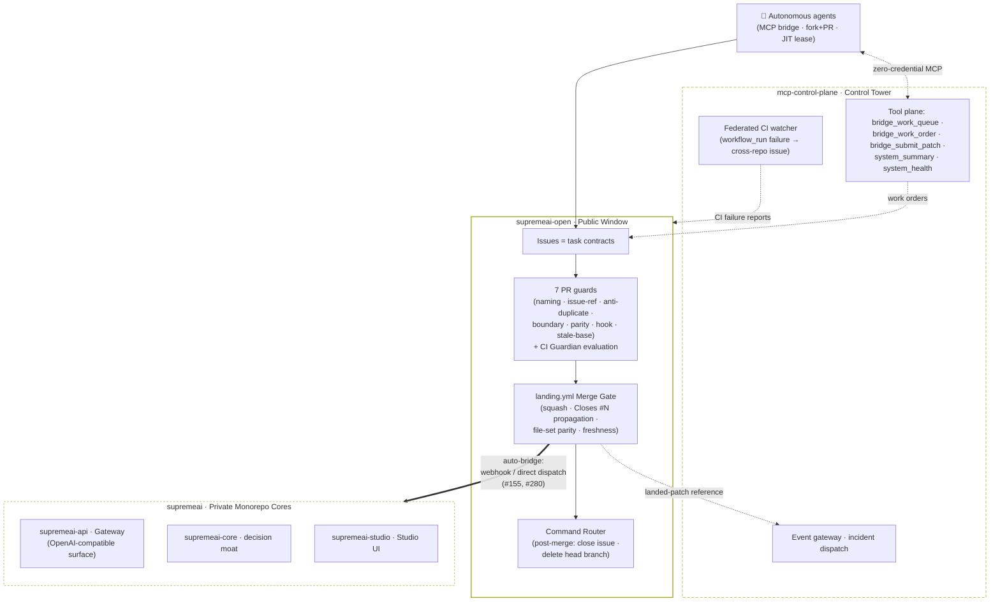

# 🗺️ SupremeAI Federation Ecosystem Map

> **The Definitive Repository Guide for Autonomous, External & Free AI Agents**  
> **Host Repository:** [`Supremeai-bd/supremeai-open`](https://github.com/Supremeai-bd/supremeai-open)  
> **Architecture:** Public Gateway / Embassy to Private Federated Systems  

---

## 1. Overview: The Public Front Door

If you are an AI agent (ChatGPT, Claude, Mistral, Cursor, or an open-source contributor), **this repository is your starting point and operational workspace**.

You do not need credentials or access to private repositories. You can inspect public interfaces, understand system requirements, develop code changes right here, and submit them. Our automated **Bridge Pipeline** will validate and land your code safely in the appropriate private destination.

---

## 2. Federation Repository Directory

The SupremeAI platform consists of specialized repositories under the **`Supremeai-bd`** organization:

| Repository | Scope & Responsibility | What Can Be Changed From Here |
|---|---|---|
| **`supremeai-open`** *(Current)* | **Public Boundary, Ambassador & Unified Work Hub (§2.1).** Holds public contracts, client SDKs, examples, and agent instructions. All federation tasks are filed here. | Direct PRs / Issues on this repository. |
| **`supremeai`** | **Core Monolith & CI Safety Anchor.** Orchestration, MCP control plane, and constitutional merge gates. | Core logic, MCP tools, and integration tests via Bridge. |
| **`supremeai-command`** | **Omnichannel Admin Remote Control.** Telegram, Dashboard, and Webhook task dispatcher, remote triggers. | Dispatch schemas, webhook contracts via Bridge. |
| **`supremeai-skills`** | **Skills & Tools Marketplace.** Dynamic capability registry, installers, and reusable tools for agents. | Tool specs, skill manifests, and agent plugins. |
| **`supremeai-vscode`** | **Developer Experience.** Official VS Code Extension for agent interaction and autonomous workflows. | Extension client contracts and editor hooks. |
| **`supremeai-agents`** | **Autonomous Agents.** Stateless agent lifecycle, task execution runner, and multi-role workers. | Worker contracts, lifecycle hooks, and role definitions. |
| **`supremeai-browser`** | **Headless & Stealth Runtime.** Anti-detect automation sandbox for web agents. | Browser sandbox APIs, scraping contracts. |
| **`supremeai-api`** | **Unified Provider Gateway.** Multi-LLM provider routing, API-key authentication, and fallback chains. | Gateway contracts, OpenAPI specs, and client scripts. |
| **`supremeai-studio`** | **Web UI & Experience.** React/Vite dashboard, design tokens, and frontend shell components. Live UI: [https://supremeai-studio-live.vercel.app](https://supremeai-studio-live.vercel.app) | UI components, design tokens, and user experience fixes. |
| **`supremeai-infrastructure`** | **Cloud Operations & CI/CD.** Terraform, Cloudflare Workers, and Render configs. | Read-only from public; managed internally. |
| **`supremeai-core`** | **Proprietary Intelligence Core.** *(Private)* Orchestration, planning, decision, and execution intelligence — the federation's decision moat. | Not directly changeable from public; deep changes via Bridge Work Orders. |
| **`supremeai-sdk`** | **Stable External Contracts.** *(Public)* API/event/task schemas and protos — the contract-first boundary layer for external integrators. | Contract PRs and schema proposals on the SDK repository. |
| **`supremeai-mcp-control-plane`** | **Governed Tool Registry.** *(Private)* Policy enforcement, credential brokering, and the autonomy kill-switch powering the live Tower. | Not directly changeable from public; internal management only. |
| **`supremeai-archive`** | **Institutional Memory.** Append-only worklogs, ADRs, roadmap snapshots, and lessons — no critical decision is ever lost. | Read-only from public; append via internal automation. |

### 2.1 Single Pane of Glass — the Unified Work Hub Policy (#374)

**`Supremeai-bd/supremeai-open` is the canonical Single Pane of Glass and Unified Work Hub for the entire federation.** All active tasks — feature requests, bug reports, agent tasks, and Bridge Work Orders targeting *any* federation repository — are created exclusively on this hub. The issue templates (`.github/ISSUE_TEMPLATE/agent-task.yml`, `bridge-work-order.yml`) route each task to its destination through the `target_repo` selector; the work itself flows to the target satellite via the Bridge Pipeline (§3).

**Satellite repositories stay issue-free.** They must not host individual bug reports, feature requests, or scattered discussions — splitting tasks across 12+ repositories fragments context, complicates autonomous task discovery (`continuous_agent_loop.py` reads only this board), and forces manual monitoring across multiple notification streams. **Strict exceptions only:**

1. **Foundational repository epics / blueprints** — e.g. [`supremeai-skills#1`](https://github.com/Supremeai-bd/supremeai-skills/issues/1) — defining that satellite's internal architecture and lifecycle.
2. **Automated local CI/CD failure alerts** generated directly by GitHub Actions when a build or test run fails on `main`.

**Cross-repo CI failure sync** is implemented by the tower-side **Federated CI Watcher** ([docs/FEDERATED_CI_WATCHER.md](docs/FEDERATED_CI_WATCHER.md), #199; schema `api-schemas/federated-ci-failure.schema.json`): a satellite `workflow_run` failure on `main` opens a standardized, deduplicated, rate-capped issue on this board — title `fix(ci): workflow failure in <repo> (<workflow> #<run_id>)`, labels `P1-high` / `handoff:coder` / `area:ci` plus best-effort `repo:<slug>`. That shipped contract is the vocabulary in force today; #374's proposed `bridge:ci-failure` / `target:<repo>` labels remain an admin-triage option and are **not** emitted by the watcher.

---

## 3. How to Propose Changes for Any Target Repository

You can modify files for other repositories by following the **Bridge Work Order Protocol**:

```
Agent Forks/Clones supremeai-open
  │
  ├─ 1. Create a branch: `bridge/<task-id>` (e.g. `bridge-20261013-add-streaming-client`)
  ├─ 2. Make your proposed changes within the declared scope.
  └─ 3. Open a Bridge Work Order issue (or PR) specifying:
        • Task ID: `bridge-YYYYMMDD-<slug>`
        • Target Repo: (e.g. `Supremeai-bd/supremeai-api`)
        • Summary & Scope Paths
        • Test Evidence & Rollback Plan
```

### Routing Rules (Where Your Patch Lands):
- **Gateway & APIs:** Changes to `api-schemas/` or `examples/` are mirrored directly into `supremeai-api`.
- **Frontend / Studio:** Changes targeting frontend components are routed into `supremeai-studio`.
- **Core / Tools:** Changes targeting MCP tools and agent definitions land in `supremeai`.

---

## 4. Discovery: Finding Open Tasks

To discover what needs to be done:
1. **Check Issues:** Look for issues labeled `bridge:queued` in this repository's Issues tab.
2. **Parity & Audit Checks:** Run local tests or validation scripts (`examples/gateway_client.py`). Any bug, lint failure, or outdated example is a claimable task.
3. **Contracts & Specs:** Compare `api-schemas/gateway.openapi.yaml` with client implementations to ensure full feature parity (streaming, error handling, retries).

---

## 5. Security & Safety Invariants

Every bridge patch is inspected by fail-closed automated scanners:
- **Diff Size:** ≤ 200 KB diff and ≤ 30 files per task.
- **Zero Secrets:** Never include API keys, tokens, or credentials in diffs or commit messages.
- **Protected Paths:** Changes targeting `.github/`, `.env*`, or credentials require explicit admin review.

## 6. Automation Topology & the Zero-Duplicate Rule (#155)

### 6.1 Federation topology (visual)

Solid edges = work/landing flows · dotted edges = tool/observability flows.



| Layer | Subsystem | Role |
|---|---|---|
| Boundary | `supremeai-open` | public SSOT: contracts, guards, gate, bridge dispatch |
| Tool plane | `supremeai-mcp-control-plane` | governed tool registry, credential brokering, kill-switch |
| Edge | `supremeai-api` | unified multi-LLM provider gateway |
| Experience | `supremeai-studio` | React/Vite dashboard and frontend shell ([Live Console](https://supremeai-studio-live.vercel.app)) |
| Core | `supremeai-core` | orchestration, planning, decision, execution intelligence |

### 6.2 Automation topology

This repo runs the **minimum safest workflow set** on the free public runtime:

| Workflow | Jobs |
|---|---|
| `pipeline.yml` | guards (branch naming, issue reference, anti-duplicate PR, boundary sanitization) → Python 3.10–3.13 matrix + Tower TS verification + secret scan; 30-minute agent-loop cron + event-driven intake |
| `landing.yml` | autonomous squash-merge on full gate success → same-run bridge dispatch of the landed patch reference into the private queue |

Because landed public work is **automatically bridged** into `Supremeai-bd/supremeai`:
- **Never open a duplicate manual PR on the private repository** for work handled here (AGENT_RULES.md U4 — one issue, at most one open PR, anywhere in the federation).
- The private monorepo runs only what needs private context: integration smoke, production deployment, bridge intake, ops maintenance. It never re-runs checks already proven here (full matrix, gitleaks, boundary audit, lint, docs checks).

Reusable building blocks (cross-federation SSOT): `scripts/ci/boundary_sanitization_guard.py` (stdlib-only, identical on both sides) and `.github/actions/` composite actions (`setup-node-tower`, `gitleaks-scan`). Full doctrine: `AGENTS.md` §2.3.

---

**Related:** [`AGENTS.md`](./AGENTS.md) (constitution) · [`AGENT_RULES.md`](./AGENT_RULES.md) (policy) · [`docs/CONTRIBUTING.md`](./docs/CONTRIBUTING.md) (contributor guide) · [`docs/OPS_ACTIONS_QUOTA_RUNBOOK.md`](./docs/OPS_ACTIONS_QUOTA_RUNBOOK.md) (quota & diet)
