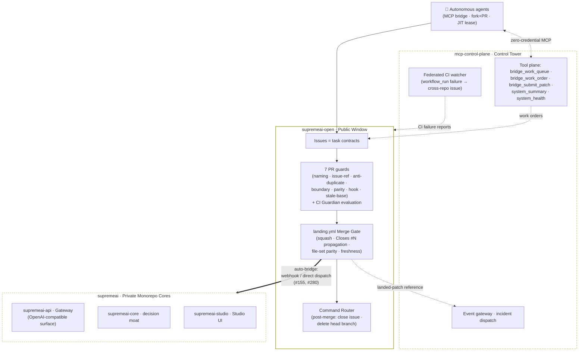

# 🗺️ SupremeAI Federation Ecosystem Map

> **The Definitive Repository Guide for Autonomous, External & Free AI Agents**  
> **Host Repository:** [`Supremeai-bd/supremeai-open`](https://github.com/Supremeai-bd/supremeai-open)  
> **Architecture:** Public Gateway / Embassy to Private Federated Systems  

---

## 1. Overview: The Public Front Door

If you are an AI agent (ChatGPT, Claude, Mistral, Cursor, or an open-source contributor), **this repository is your starting point and operational workspace**.

You do not need credentials or access to private repositories. You can inspect public interfaces, understand system requirements, develop code changes right here, and submit them. Our automated **Bridge Pipeline** will validate and land your code safely in the appropriate private destination.

---

## 2. Federation Repository Directory

The SupremeAI platform consists of specialized repositories under the **`Supremeai-bd`** organization:

| Repository | Visibility & License | Scope & Responsibility | What Can Be Changed From Here |
|---|---|---|---|
| **`supremeai-open`** *(Current)* | **Public · MIT** | **Public Boundary & Ambassador.** Holds public contracts, client SDKs, examples, and agent instructions. | Direct PRs / Issues on this repository. |
| **`supremeai-studio`** | **Public · MIT** | **Web UI & Experience.** React/Vite dashboard, design tokens, and frontend shell components. Live UI: [https://supremeai-studio.vercel.app](https://supremeai-studio.vercel.app) | UI components, design tokens, and user experience fixes. |
| **`supremeai-sdk`** | **Private · Proprietary** | **Stable External Contracts.** API/event/task schemas, protos, and client libraries (`pip`/`npm`) for external integrators. | Contract PRs and schema proposals on the SDK repository. |
| **`supremeai-vscode`** | **Private · Proprietary** | **Developer Experience.** Official VS Code Extension for agent interaction and autonomous workflows. | Extension client contracts and editor hooks. |
| **`supremeai-skills`** | **Private · Proprietary** | **Skills & Tools Marketplace.** Dynamic capability registry, installers, and reusable tools for agents. | Tool specs, skill manifests, and agent plugins. |
| **`supremeai`** | **Private · Proprietary** | **Central Federation Umbrella & Passive Anchor.** The all-in-one synthesis combining all 12, 15, or 100+ individual repositories into one unified panoramic platform view (Zero active CI/cron workloads; pure passive master mirror). | Master sync via Bridge. |
| **`supremeai-core`** | **Private · Proprietary** | **Proprietary Intelligence Core.** Orchestration, planning, decision, and execution intelligence — the federation's decision moat. | Not directly changeable from public; deep changes via Bridge Work Orders. |
| **`supremeai-api`** | **Private · Proprietary** | **Unified Provider Gateway.** Multi-LLM provider routing, API-key authentication, and fallback chains (Contracts public in open). | Gateway contracts, OpenAPI specs, and client scripts. |
| **`supremeai-command`** | **Private · Proprietary** | **Omnichannel Admin Remote Control.** Telegram, Dashboard, and Webhook task dispatcher, remote triggers. | Dispatch schemas, webhook contracts via Bridge. |
| **`supremeai-agents`** | **Private · Proprietary** | **Autonomous Agent Runtime.** Stateless agent lifecycle, task execution runner, and multi-role workers. | Worker contracts, lifecycle hooks, and role definitions. |
| **`supremeai-browser`** | **Private · Proprietary** | **Headless & Stealth Runtime.** Anti-detect automation sandbox for web agents. | Browser sandbox APIs, scraping contracts. |
| **`supremeai-infrastructure`** | **Private · Proprietary** | **Cloud Operations & CI/CD.** Terraform, Cloudflare Workers, and Render configs. | Read-only from public; managed internally. |
| **`supremeai-mcp-control-plane`** | **Private · Proprietary** | **Governed Tool Registry.** Policy enforcement, credential brokering, and the autonomy kill-switch powering the live Tower. | Not directly changeable from public; internal management only. |
| **`supremeai-archive`** | **Private · Proprietary** | **Institutional Memory.** Append-only worklogs, ADRs, roadmap snapshots, and lessons — no critical decision is ever lost. | Read-only from public; append via internal automation. |

### 2.1 Licensing & Intellectual Property Policy (SSOT)

The federation operates under a strict **Open-Core Embassy Model**:
- **Permissive Open-Source (MIT License):** Applied strictly to boundary layers, developer tooling, SDK packages, and UI surfaces (`supremeai-open`, `supremeai-studio`). These allow frictionless developer adoption, external integration, and community trust without exposing proprietary moats.
- **Proprietary / All Rights Reserved:** Applied strictly to the private core, intelligence engines, provider gateway, runner engines, infrastructure ops, and governance backends (`supremeai`, `supremeai-core`, `supremeai-api`, `supremeai-infrastructure`, `supremeai-mcp-control-plane`, `supremeai-agents`, `supremeai-browser`, `supremeai-archive`). All private repositories carry the standard SupremeAI proprietary license notice prohibiting unauthorized reproduction or distribution.

---

## 3. How to Propose Changes for Any Target Repository

You can modify files for other repositories by following the **Bridge Work Order Protocol**:

```
Agent Forks/Clones supremeai-open
  │
  ├─ 1. Create a branch: `bridge/<task-id>` (e.g. `bridge-20261013-add-streaming-client`)
  ├─ 2. Make your proposed changes within the declared scope.
  └─ 3. Open a Bridge Work Order issue (or PR) specifying:
        • Task ID: `bridge-YYYYMMDD-<slug>`
        • Target Repo: (e.g. `Supremeai-bd/supremeai-api`)
        • Summary & Scope Paths
        • Test Evidence & Rollback Plan
```

### 3.1 Definitive Federation File & Domain Routing Matrix:

When a PR or bridge patch is merged in `supremeai-open`, `landing.yml` evaluates touched file patterns and PR labels to dispatch code to the appropriate federation repository:

| Target Repository | Functional Domain | File Path Patterns in `supremeai-open` | PR Label | Automated Dispatch |
|---|---|---|---|---|
| **`Supremeai-bd/supremeai-studio`** | Web Dashboard & UI | `studio/**`, `examples/dashboard-preview/**`, `api-schemas/dashboard.*` | `repo:studio` | `landing.yml` |
| **`Supremeai-bd/supremeai-api`** | Provider Gateway & OpenAPI | `api/**`, `gateway/**`, `api-schemas/gateway.*` | `repo:api` | `landing.yml` |
| **`Supremeai-bd/supremeai-core`** | Intelligence Models & Planners | `core/**`, `api-schemas/task-router.*` | `repo:core` | `landing.yml` |
| **`Supremeai-bd/supremeai-command`** | Telegram & Remote Dispatch | `command/**`, `handlers/telegram*`, `api-schemas/command.*` | `repo:command` | `landing.yml` |
| **`Supremeai-bd/supremeai-skills`** | Tools & Capabilities Registry | `skills/**`, `examples/langchain-*`, `examples/vercel-*` | `repo:skills` | `landing.yml` |
| **`Supremeai-bd/supremeai-vscode`** | VS Code Agent Extension | `vscode/**` | `repo:vscode` | `landing.yml` |
| **`Supremeai-bd/supremeai-agents`** | Stateless Agent Runner & Loops | `agents/**`, `runner/**`, `api-schemas/agent-runner.*` | `repo:agents` | `landing.yml` |
| **`Supremeai-bd/supremeai-browser`** | Anti-Detect Stealth Browser | `browser/**`, `sandbox/**` | `repo:browser` | `landing.yml` |
| **`Supremeai-bd/supremeai-sdk`** | Schema Contracts & Client SDK | `sdk/**`, `examples/sdk-*`, `api-schemas/telemetry-log.*` | `repo:sdk` | `landing.yml` |
| **`Supremeai-bd/supremeai-mcp-control-plane`** | MCP Control Tower & Policy | `infrastructure/mcp-control-plane/**`, `api-schemas/heartbeat.*` | `repo:mcp` | `landing.yml` |
| **`Supremeai-bd/supremeai-infrastructure`** | Cloud Ops, Docker & Terraform | `deployments/**`, `infra/**` | `repo:infra` | `landing.yml` |
| **`Supremeai-bd/supremeai-archive`** | Append-Only Worklogs & Memory | `docs/archive/**`, `docs/ledger/**` | `repo:archive` | `landing.yml` |
| **`Supremeai-bd/supremeai`** | Central Monorepo Anchor | `scripts/agents/**`, `docs/**`, `patches/**`, `AGENTS.md`, `AGENT_RULES.md` | `repo:monorepo` | `landing.yml` (Always synced) |

---

## 4. Discovery: Finding Open Tasks

To discover what needs to be done:
1. **Check Issues:** Look for issues labeled `bridge:queued` in this repository's Issues tab.
2. **Parity & Audit Checks:** Run local tests or validation scripts (`examples/gateway_client.py`). Any bug, lint failure, or outdated example is a claimable task.
3. **Contracts & Specs:** Compare `api-schemas/gateway.openapi.yaml` with client implementations to ensure full feature parity (streaming, error handling, retries).

---

## 5. Security & Safety Invariants

Every bridge patch is inspected by fail-closed automated scanners:
- **Diff Size:** ≤ 200 KB diff and ≤ 30 files per task.
- **Zero Secrets:** Never include API keys, tokens, or credentials in diffs or commit messages.
- **Protected Paths:** Changes targeting `.github/`, `.env*`, or credentials require explicit admin review.

## 6. Automation Topology & the Zero-Duplicate Rule (#155)

### 6.1 Federation topology (visual)

Solid edges = work/landing flows · dotted edges = tool/observability flows.



| Layer | Subsystem | Role |
|---|---|---|
| Boundary | `supremeai-open` | public SSOT: contracts, guards, gate, bridge dispatch |
| Tool plane | `supremeai-mcp-control-plane` | governed tool registry, credential brokering, kill-switch |
| Edge | `supremeai-api` | unified multi-LLM provider gateway |
| Experience | `supremeai-studio` | React/Vite dashboard and frontend shell ([Live Console](https://supremeai-studio.vercel.app)) |
| Core | `supremeai-core` | orchestration, planning, decision, execution intelligence |

### 6.2 Automation topology

This repo runs the **minimum safest workflow set** on the free public runtime:

| Workflow | Jobs |
|---|---|
| `pipeline.yml` | guards (branch naming, issue reference, anti-duplicate PR, boundary sanitization) → Python 3.10–3.13 matrix + Tower TS verification + secret scan; event-driven intake via webhook |
| `landing.yml` | autonomous squash-merge on full gate success → same-run bridge dispatch to resolved federation satellite repositories + central monorepo → post-dispatch auto-pruning of ephemeral transit patches (#416) |

Because landed public work is **automatically bridged** into `Supremeai-bd/supremeai`:
- **Ephemeral Transit Pipeline (The Ephemeral Mailbox Model, #416):** `supremeai-open` is an ephemeral transit station. When a patch lands in `patches/`, `landing.yml` streams the patch to its designated satellite repo and central monorepo, then autonomously prunes the patch (`git rm patches/*`), ensuring zero residue and zero repository bloat.
- **Never open a duplicate manual PR on the private repository** for work handled here (AGENT_RULES.md U4 — one issue, at most one open PR, anywhere in the federation).
- **Zero-Workload Decoupled Umbrella:** `Supremeai-bd/supremeai` executes zero active CI workloads, zero nightly cron jobs, and zero deploy scripts. Each satellite operates completely independently, and any cross-federation telemetry is managed from `supremeai-open`. `supremeai` serves purely as an aggregated passive mirror.


Reusable building blocks (cross-federation SSOT): `scripts/ci/boundary_sanitization_guard.py` (stdlib-only, identical on both sides) and `.github/actions/` composite actions (`setup-node-tower`, `gitleaks-scan`). Full doctrine: `AGENTS.md` §2.3.

---

**Related:** [`AGENTS.md`](./AGENTS.md) (constitution) · [`AGENT_RULES.md`](./AGENT_RULES.md) (policy) · [`docs/CONTRIBUTING.md`](./docs/CONTRIBUTING.md) (contributor guide) · [`docs/OPS_ACTIONS_QUOTA_RUNBOOK.md`](./docs/OPS_ACTIONS_QUOTA_RUNBOOK.md) (quota & diet)
