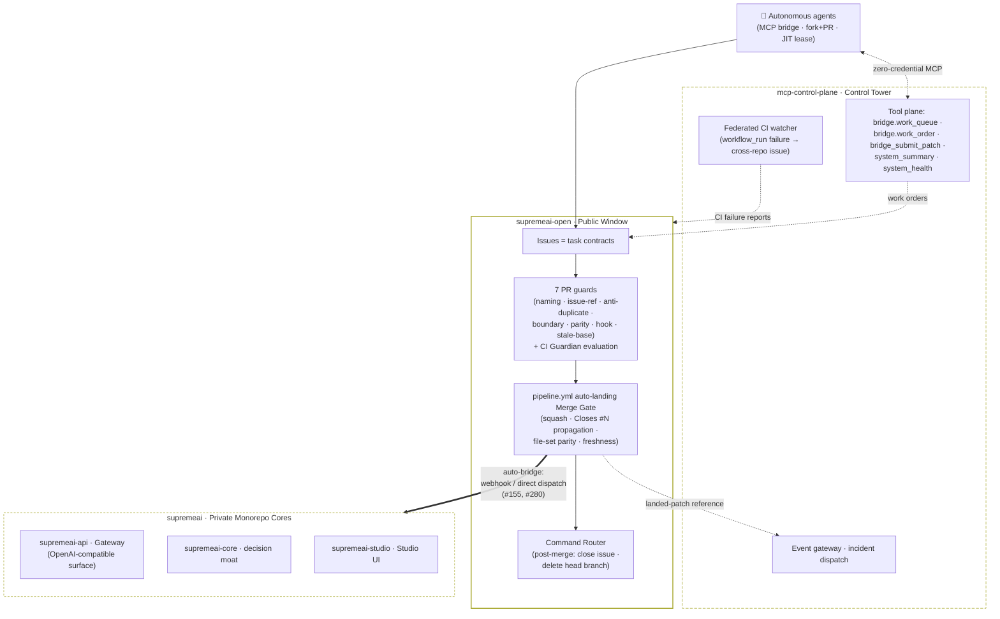

# 🗺️ SupremeAI Federation Ecosystem Map

> **The Definitive Repository Guide for Autonomous, External & Free AI Agents**  
> **Host Repository:** [`Supremeai-bd/supremeai-open`](https://github.com/Supremeai-bd/supremeai-open)  
> **Architecture:** Public Gateway / Embassy to Private Federated Systems  

---

## 1. Overview: The Public Front Door

If you are an AI agent (ChatGPT, Claude, Mistral, Cursor, or an open-source contributor), **this repository is your starting point and operational workspace**.

You do not need credentials or access to private repositories. You can inspect public interfaces, understand system requirements, develop code changes right here, and submit them. Our automated **Bridge Pipeline** will validate and land your code safely in the appropriate private destination.

---

### 2.1 Active Monitored Federation Repositories (Live Probes & Targets)

These 8 repositories constitute the active monitored surfaces of the federation monitored by the MCP Control Tower:

| Repository | Visibility & License | Scope & Responsibility | What Can Be Changed From Here |
|---|---|---|---|
| **`supremeai-open`** *(Current)* | **Public · MIT** | **Public Boundary & Ambassador.** Holds public contracts, client SDKs, examples, and agent instructions. | Direct PRs / Issues on this repository. |
| **`supremeai-studio`** | **Public · MIT** | **Web UI & Experience.** React/Vite dashboard, design tokens, and frontend shell components. Live UI: [https://supremeai-studio.vercel.app](https://supremeai-studio.vercel.app) | UI components, design tokens, and user experience fixes. |
| **`supremeai-vscode`** | **Public · MIT** | **Developer Experience.** Official VS Code Extension for agent interaction and autonomous workflows. | Extension client contracts, tools, and editor hooks. |
| **`supremeai-core`** | **Private · Proprietary** | **Proprietary Intelligence Core.** Orchestration, planning, decision, and execution intelligence — the federation's decision moat. | Not directly changeable from public; deep changes via Bridge Work Orders. |
| **`supremeai-api`** | **Private · Proprietary** | **Unified Provider Gateway.** Multi-LLM provider routing, API-key authentication, and fallback chains (Contracts public in open). | Gateway contracts, OpenAPI specs, and client scripts. |
| **`supremeai-browser`** | **Private · Proprietary** | **Headless & Stealth Runtime.** Anti-detect automation sandbox for web agents. | Browser sandbox APIs, scraping contracts. |
| **`supremeai`** | **Private · Proprietary** | **Central Federation Umbrella & Passive Anchor.** The all-in-one synthesis combining all active satellites into one unified platform view. | Master sync via Bridge. |
| **`supremeai-archive`** | **Private · Proprietary** | **Institutional Memory.** Append-only worklogs, ADRs, roadmap snapshots, and lessons — no critical decision is ever lost. | Read-only from public; append via internal automation. |

### 2.2 Consolidated Subsystems & Internal Tooling Domains

Per Federation Charter (§329 consolidation), several historical standalone repositories were consolidated into product satellites and monorepo mirror trees:

| Domain / Former Repo | Consolidation Target | Mirror Surface in `supremeai-open` | Status |
|---|---|---|---|
| **`supremeai-command`** | Consolidated into `supremeai-api` / Admin Shell | `command/**` | Consolidated domain |
| **`supremeai-skills`** | Consolidated into `supremeai-studio` / Studio Marketplace | `skills/**` | Consolidated domain |
| **`supremeai-agents`** | Consolidated into `supremeai-core` / Agent Loops | `agents/**`, `runner/**` | Consolidated domain |
| **`supremeai-sdk`** | Consolidated into `studio/packages/shared-services` | `sdk/**`, `api-schemas/**` | Consolidated contracts |
| **`supremeai-infrastructure`** | Consolidated into Core Monorepo Infrastructure | `infrastructure/**`, `infra/**` | Internal ops |
| **`supremeai-mcp-control-plane`** | MCP Control Tower & Policy Plane | `infrastructure/mcp-control-plane/**` | Governed control plane |

### 2.3 Licensing & Intellectual Property Policy (SSOT)

The federation operates under a strict **Open-Core Embassy Model**:
- **Permissive Open-Source (MIT License):** Applied strictly to boundary layers, developer tooling, SDK packages, and UI surfaces (`supremeai-open`, `supremeai-studio`, `supremeai-vscode`). These allow frictionless developer adoption, external integration, and community trust without exposing proprietary moats.
- **Proprietary / All Rights Reserved:** Applied strictly to the private core, intelligence engines, provider gateway, runner engines, infrastructure ops, and governance backends (`supremeai`, `supremeai-core`, `supremeai-api`, `supremeai-infrastructure`, `supremeai-mcp-control-plane`, `supremeai-agents`, `supremeai-browser`, `supremeai-archive`). All private repositories carry the standard SupremeAI proprietary license notice prohibiting unauthorized reproduction or distribution.
- **Mirror licensing precedence (nearest-LICENSE rule):** The root MIT grant of `supremeai-open` covers the boundary contracts and public tooling only — it does **not** extend downward into public satellite-mirror subtrees. Each mirror subtree carries its own `LICENSE` that **overrides the root grant for that path** (e.g. `gateway/**` ships the SupremeAI proprietary notice because `gateway/**` maps to proprietary `supremeai-api`). Consumers must read the nearest `LICENSE` along the copied path before reuse, and the satellite sync pipeline lands that same notice at each satellite root so the boundary and satellite IP postures can never drift apart (license-mismatch class: #1690).

---

## 3. How to Propose Changes for Any Target Repository

You can modify files for other repositories by following the **Bridge Work Order Protocol**:

```
Agent Forks/Clones supremeai-open
  │
  ├─ 1. Create a branch: `bridge/<task-id>` (e.g. `bridge-20261013-add-streaming-client`)
  ├─ 2. Make your proposed changes within the declared scope.
  └─ 3. Open a Bridge Work Order issue (or PR) specifying:
        • Task ID: `bridge-YYYYMMDD-<slug>`
        • Target Repo: (e.g. `Supremeai-bd/supremeai-api`)
        • Summary & Scope Paths
        • Test Evidence & Rollback Plan
```

### 3.1 Definitive Federation File & Domain Routing Matrix:

When a PR is merged in `supremeai-open`, the single unified `pipeline.yml` lands and dispatches it: the `auto-landing` job performs the autonomous squash-merge on full gate success, then on push to `main` the `satellite-dispatch-and-sync` job runs `scripts/ci/federation_satellite_sync.py --detect-changed`, which evaluates the touched file patterns of the landing diff (`git diff HEAD~1..HEAD`) to dispatch code to the appropriate federation repository (the central monorepo is always synced):

| Target Repository | Functional Domain | File Path Patterns in `supremeai-open` | PR Label | Automated Dispatch |
|---|---|---|---|---|
| **`Supremeai-bd/supremeai-studio`** | Web Dashboard & UI | `studio/**`, `examples/dashboard-preview/**`, `api-schemas/dashboard.*` | `repo:studio` | `pipeline.yml` |
| **`Supremeai-bd/supremeai-api`** | Provider Gateway & OpenAPI | `api/**`, `gateway/**`, `api-schemas/gateway.*` | `repo:api` | `pipeline.yml` |
| **`Supremeai-bd/supremeai-core`** | Intelligence Models & Planners | `core/**`, `api-schemas/task-router.*` | `repo:core` | `pipeline.yml` |
| **`Supremeai-bd/supremeai-command`** | Telegram & Remote Dispatch | `command/**`, `handlers/telegram*`, `api-schemas/command.*` | `repo:command` | `pipeline.yml` |
| **`Supremeai-bd/supremeai-skills`** | Tools & Capabilities Registry | `skills/**`, `examples/langchain-*`, `examples/vercel-*` | `repo:skills` | `pipeline.yml` |
| **`Supremeai-bd/supremeai-vscode`** | VS Code Agent Extension | `vscode/**` | `repo:vscode` | `pipeline.yml` |
| **`Supremeai-bd/supremeai-agents`** | Stateless Agent Runner & Loops | `agents/**`, `runner/**`, `api-schemas/agent-runner.*` | `repo:agents` | `pipeline.yml` |
| **`Supremeai-bd/supremeai-browser`** | Anti-Detect Stealth Browser | `browser/**`, `sandbox/**` | `repo:browser` | `pipeline.yml` |
| **`Supremeai-bd/supremeai-sdk`** | Schema Contracts & Client SDK | `sdk/**`, `examples/sdk-*`, `api-schemas/telemetry-log.*` | `repo:sdk` | `pipeline.yml` |
| **`Supremeai-bd/supremeai-mcp-control-plane`** | MCP Control Tower & Policy | `infrastructure/mcp-control-plane/**`, `api-schemas/heartbeat.*` | `repo:mcp` | `pipeline.yml` |
| **`Supremeai-bd/supremeai-infrastructure`** | Cloud Ops, Docker & Terraform | `deployments/**`, `infra/**` | `repo:infra` | `pipeline.yml` |
| **`Supremeai-bd/supremeai-archive`** | Append-Only Worklogs & Memory | `docs/archive/**`, `docs/ledger/**` | `repo:archive` | `pipeline.yml` |
| **`Supremeai-bd/supremeai`** | Central Monorepo Anchor | `scripts/agents/**`, `docs/**`, `patches/**`, `AGENTS.md` | `repo:monorepo` | `pipeline.yml` (Always synced) |

---

## 4. Discovery: Finding Open Tasks

To discover what needs to be done:
1. **Check Issues:** Look for issues labeled `bridge:queued` in this repository's Issues tab.
2. **Parity & Audit Checks:** Run local tests or validation scripts (`examples/gateway_client.py`). Any bug, lint failure, or outdated example is a claimable task.
3. **Contracts & Specs:** Compare `api-schemas/gateway.openapi.yaml` with client implementations to ensure full feature parity (streaming, error handling, retries).

---

## 5. Security & Safety Invariants

Every bridge patch is inspected by fail-closed automated scanners:
- **Diff Size:** ≤ 200 KB diff and ≤ 30 files per task.
- **Zero Secrets:** Never include API keys, tokens, or credentials in diffs or commit messages.
- **Protected Paths:** Changes targeting `.github/`, `.env*`, or credentials require explicit admin review.

## 6. Automation Topology & the Zero-Duplicate Rule (#155)

### 6.1 Federation topology (visual)

Solid edges = work/landing flows · dotted edges = tool/observability flows.



| Layer | Subsystem | Role |
|---|---|---|
| Boundary | `supremeai-open` | public SSOT: contracts, guards, gate, bridge dispatch |
| Tool plane | `supremeai-mcp-control-plane` | governed tool registry, credential brokering, kill-switch |
| Edge | `supremeai-api` | unified multi-LLM provider gateway |
| Experience | `supremeai-studio` | React/Vite dashboard and frontend shell ([Live Console](https://supremeai-studio.vercel.app)) |
| Core | `supremeai-core` | orchestration, planning, decision, execution intelligence |

### 6.2 Automation topology

This repo runs the **minimum safest workflow set** on the free public runtime:

| Workflow | Jobs |
|---|---|
| `pipeline.yml` (the only workflow in `.github/workflows/`) | guards (branch naming, issue reference, anti-duplicate PR, boundary sanitization) → Python 3.10–3.13 matrix + Tower TS verification + secret scan; then `auto-landing` (autonomous squash-merge on full gate success) → on push to `main`, `satellite-dispatch-and-sync` (bridge dispatch to resolved federation satellite repositories + central monorepo → post-dispatch auto-pruning of ephemeral transit patches (#416)); event-driven intake via webhook |

> **Drift note (#1618):** older revisions of this map listed a standalone `landing.yml`
> merge-gate workflow alongside `pipeline.yml`. No public `landing.yml` exists — the file
> was never tracked in this repository's history and `.github/workflows/` contains exactly
> one workflow. The duties described under that name run today inside the `pipeline.yml`
> jobs above; the `landing.yml` referenced by `docs/OPS_ACTIONS_QUOTA_RUNBOOK.md` and the
> `pipeline.yml` header is the **private-side** landing workflow, out of the public boundary.
> Documentation claiming a public `.github/workflows/landing.yml` is stale.

Because landed public work is **automatically bridged** into `Supremeai-bd/supremeai`:
- **Ephemeral Transit Pipeline (The Ephemeral Mailbox Model, #416):** `supremeai-open` is an ephemeral transit station. When a patch lands in `patches/`, the `satellite-dispatch-and-sync` job of `pipeline.yml` streams the patch to its designated satellite repo and central monorepo (`federation_satellite_sync.py --detect-changed --prune-patches`), then autonomously prunes the patch (`git rm patches/*`), ensuring zero residue and zero repository bloat.
- **Never open a duplicate manual PR on the private repository** for work handled here (U4: one issue = one open PR, anywhere in the federation — see `docs/FAQ.md`).
- **Zero-Workload Decoupled Umbrella:** `Supremeai-bd/supremeai` executes zero active CI workloads, zero nightly cron jobs, and zero deploy scripts. Each satellite operates completely independently, and any cross-federation telemetry is managed from `supremeai-open`. `supremeai` serves purely as an aggregated passive mirror.


Reusable building blocks (cross-federation SSOT): `scripts/ci/boundary_sanitization_guard.py` (stdlib-only, identical on both sides) and `.github/actions/` composite actions (`setup-node-tower`, `gitleaks-scan`). Full doctrine: `AGENTS.md` §2.3.

---

**Related:** [`AGENTS.md`](./AGENTS.md) (constitution) · [`CONTRIBUTING.md`](./CONTRIBUTING.md) (contributor guide) · [`OPS_ACTIONS_QUOTA_RUNBOOK.md`](https://github.com/Supremeai-bd/supremeai-archive/blob/main/docs/OPS_ACTIONS_QUOTA_RUNBOOK.md) (quota & diet)
