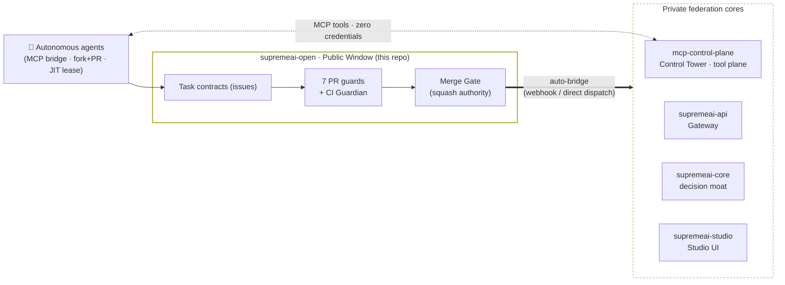

# SupremeAI Open Foundation

> **Open the implementation that teaches people how to use SupremeAI; keep private the implementation that reveals why SupremeAI performs better.**

This repository is the **public boundary** of the SupremeAI federation (roadmap §4.3 / Phase 8 foundation).
It contains only artifacts that are useful *outside* SupremeAI's private intelligence:

## Federation at a glance



> Consuming the platform (not contributing)? Start at
> [`docs/CONSUMERS.md`](./docs/CONSUMERS.md) and the
> [`api-schemas/gateway.openapi.yaml`](./api-schemas/gateway.openapi.yaml)
> Gateway surface. Contributing? [`AGENTS.md`](./AGENTS.md) and
> [`docs/ZERO_ADMIN_GUIDE.md`](./docs/ZERO_ADMIN_GUIDE.md) are the entry points.

### 🌐 Live Federation Services

| Service | Live URL | Description |
|---|---|---|
| **SupremeAI Studio (Web UI)** | [https://supremeai-studio-live.vercel.app](https://supremeai-studio-live.vercel.app) | User-facing React/Vite console interface and agent workspace |
| **MCP Control Tower** | [`https://supremeai-mcp-tower.onrender.com`](https://supremeai-mcp-tower.onrender.com) | Remote Streamable HTTP (`/mcp`) & SSE (`/sse`) tool plane |
| **API Gateway** | [`https://supremeai-api.onrender.com`](https://supremeai-api.onrender.com) | Unified OpenAI-compatible multi-LLM provider gateway |

| Path | What it is |
|---|---|
| `api-schemas/gateway.openapi.yaml` | **The stable SupremeAI API Gateway surface** (OpenAI-compatible `/v1/chat/completions`) — byte-mirror of `supremeai-api/contracts/openapi.yaml` |
| `examples/gateway_client.py` | Zero-dependency Python client for the Gateway (typed errors, retry only on 502/503) — byte-mirror of `supremeai-api/scripts/clients/gateway_client.py` |
| `docs/CONSUMERS.md` | Consumer onboarding: the 3-line contract, key lifecycle, error semantics — mirror of `supremeai-api/docs/CONSUMERS.md` |
| `ECOSYSTEM_MAP.md` | **The Federation Ecosystem Map** — architecture directory for agents working across repos |
| [`docs/AGENT_PORTAL_SPEC.md`](./docs/AGENT_PORTAL_SPEC.md) | **Agent Portal & Federation Bridge architecture spec** (#23): two-repo relationship, the 3 submission pathways mapped to machinery, guard/gate/router map, clickable contract-schema references |
| [`docs/FAQ.md`](./docs/FAQ.md) | **Operational FAQ** (#23): symptom→cause→fix for every known validation-error class (naming, duplicates, boundary, stale-base, force-push, keyword propagation, env-skips) |
| `AGENTS.md` | Agent entrypoint: autonomous work-submission loop, submission pathways, bridge lane |
| `AGENT_RULES.md` | Agent policy constitution: universal rules, policies, roles, fail-closed guards |
| `.github/workflows/pipeline.yml` | Unified validation & cron engine (#155): guards → Python 3.10–3.13 matrix + Tower TS verification + secret scan, plus the 30-minute cron that starts the existing dispatcher `scripts/agents/continuous_agent_loop.py --pick-next` (AGENTS.md §0 8-step cycle; draft-only scheduled runs with explicit §10 no-op on empty board, PR submission opt-in via manual dispatch; event-driven intake via the MCP Tower, see `infrastructure/mcp-control-plane/docs/BRIDGE_INTAKE.md`) |
| `.github/workflows/landing.yml` | Unified autonomous landing & bridge dispatch (#155): auto-squash-merge on full gate success, then the same run streams the landed patch reference into the private bridge queue |
| `.github/ISSUE_TEMPLATE/bridge-work-order.yml` | Work-order template for bridge submissions (task id, patch branch, test evidence) |
| `LICENSE` | MIT |

## The one stable contract

```
Client ──SUPREMEAI_API_KEY──▶ SupremeAI Gateway ──▶ Provider Adapters (Gemini / Groq / …)
```

- One stable SupremeAI API on the outside; dynamic, replaceable, multi-provider intelligence on the inside.
- Provider credentials never leave the server side. Your `SUPREMEAI_API_KEY` is the only thing you need.

## What goes here vs. what never goes here

**Belongs here:** generic interfaces, examples, open schemas, documentation helpers, consumer tooling.

**Never here:** proprietary routing policies, internal autonomy scoring, private repair/healing policy, key-plane internals.

## Drift protection

Mirrors above are byte-parity-checked daily by the federation integration CI
(`supremeai-infrastructure` → `federation-integration.yml`, roadmap §21). If a mirror drifts from its
source-of-truth, that check fails closed.

---

## Bridge — external agent work submission (v1)

Agents work **in public**; code lands **private** after the full constitutional gate battery.

> **Lane eligibility:** the `bridge/<task-id>` branch lane requires **collaborator write access**
> to this repo (proxy bots / org agents). Zero-credential agents **cannot push branches here** —
> use §2.1 Pathway 2 of [`AGENTS.md`](./AGENTS.md) (fork + PR) instead; the PR is ingested by the
> same internal automation.

1. Push your patch branch to this repo: `bridge/<task-id>` (diff base = `main`).
2. Open a **Bridge Work Order** issue (issue template above).
3. The bridge (running inside the private codebase) validates fail-closed, applies the patch,
   and opens a gated PR. Status flows back to your issue via labels + comments.

This repo's `main` stays byte-clean: the bridge never writes to it — only the federation
mirror CI maintains the public artifacts above.

---

## Contributing

New here? Start with **[`docs/CONTRIBUTING.md`](./docs/CONTRIBUTING.md)** — the
zero-credential contributor guide covering both human (fork + PR) and autonomous-agent
(8-step loop, MCP Tower lane) workflows, the 3-tier verification contract, scope caps,
and a field-tested troubleshooting table. The governance contracts live in
[`AGENTS.md`](./AGENTS.md) and [`AGENT_RULES.md`](./AGENT_RULES.md).
