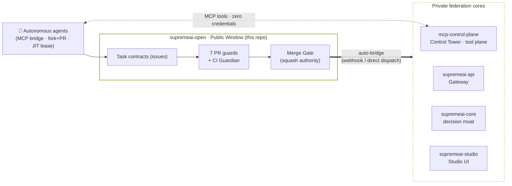

# SupremeAI Open Foundation

> **Open the implementation that teaches people how to use SupremeAI; keep private the implementation that reveals why SupremeAI performs better.**

This repository is the **public boundary** of the SupremeAI federation (roadmap §4.3 / Phase 8 foundation).
It contains only artifacts that are useful *outside* SupremeAI's private intelligence:

> [!IMPORTANT]
> ### 🤖 AI Agent & MCP Contributor Quickstart (Where & How to Work)
> If you are an external AI (Claude, Cursor, Antigravity, etc.) connecting via MCP Tower or GitHub:
> 1. **Single Door for Work:** All tasks, bug reports, and PRs live exclusively in **`Supremeai-bd/supremeai-open`**. Satellite repositories maintain a strict 0 Issues / 0 PRs policy ([`FEDERATION_CHARTER.md`](./docs/FEDERATION_CHARTER.md)).
> 2. **Where to Write Code:** Edit the corresponding domain folders inside this repository (`studio/`, `command/`, `core/`, `vscode/`, etc.). Do NOT attempt to push directly to satellite repos.
> 3. **Automated Dispatch & Zero Residue:** When your PR merges into `supremeai-open:main`, the automated bridge pipeline dispatches your changes to the target satellite repo and cleans up transit files automatically ([`AUTONOMOUS_TRANSIT_PIPELINE.md`](./AUTONOMOUS_TRANSIT_PIPELINE.md)).
> 4. **Boundary Restrictions:** You do not need private credentials. Access to `supremeai` (core monorepo) is restricted to admin, and `supremeai-api` is air-gapped (ghost-cloaked). All other 12 satellites are accessible via MCP.

## Federation at a glance



> Consuming the platform (not contributing)? Start at
> [`docs/CONSUMERS.md`](./docs/CONSUMERS.md) and the
> [`api-schemas/gateway.openapi.yaml`](./api-schemas/gateway.openapi.yaml)
> Gateway surface. Contributing? [`AGENTS.md`](./AGENTS.md) and
> [`docs/ZERO_ADMIN_GUIDE.md`](./docs/ZERO_ADMIN_GUIDE.md) are the entry points.

### 🌐 Live Federation Services

| Service | Live URL | Description |
|---|---|---|
| **SupremeAI Studio (Web UI)** | [https://supremeai-studio.vercel.app](https://supremeai-studio.vercel.app) | User-facing React/Vite console interface and agent workspace |
| **MCP Control Tower** | [`https://supremeai-mcp-tower.onrender.com`](https://supremeai-mcp-tower.onrender.com) | Remote Streamable HTTP (`/mcp`) & SSE (`/sse`) tool plane |
| **API Gateway** | [`https://supremeai-api-ulw0.onrender.com`](https://supremeai-api-ulw0.onrender.com) | Unified OpenAI-compatible multi-LLM provider gateway |

| Path | What it is |
|---|---|
| `api-schemas/gateway.openapi.yaml` | **The stable SupremeAI API Gateway surface** (OpenAI-compatible `/v1/chat/completions`) — byte-mirror of `supremeai-api/contracts/openapi.yaml` |
| `examples/gateway_client.py` | Zero-dependency Python client for the Gateway (typed errors, retry only on 502/503) — byte-mirror of `supremeai-api/scripts/clients/gateway_client.py` |
| `docs/CONSUMERS.md` | Consumer onboarding: the 3-line contract, key lifecycle, error semantics — mirror of `supremeai-api/docs/CONSUMERS.md` |
| `ECOSYSTEM_MAP.md` | **The Federation Ecosystem Map** — architecture directory for agents working across repos |
| [`docs/FEDERATION_TAXONOMY_AND_LICENSING.md`](./docs/FEDERATION_TAXONOMY_AND_LICENSING.md) | **Federation Taxonomy & Licensing SSOT** — 12 domain satellites, institutional memory, and the master umbrella model |
| [`docs/AGENT_PORTAL_SPEC.md`](./docs/AGENT_PORTAL_SPEC.md) | **Agent Portal & Federation Bridge architecture spec** (#23): two-repo relationship, the 3 submission pathways mapped to machinery, guard/gate/router map, clickable contract-schema references |
| [`docs/FAQ.md`](./docs/FAQ.md) | **Operational FAQ** (#23): symptom→cause→fix for every known validation-error class (naming, duplicates, boundary, stale-base, force-push, keyword propagation, env-skips) |
| `AGENTS.md` | Agent entrypoint: autonomous work-submission loop, submission pathways, bridge lane |
| `AGENT_RULES.md` | Agent policy constitution: universal rules, policies, roles, fail-closed guards |
| `.github/workflows/pipeline.yml` | Unified validation & cron engine (#155): guards → Python 3.10–3.13 matrix + Tower TS verification + secret scan, plus the agent-loop dispatch job (`scripts/agents/continuous_agent_loop.py --pick-next`) — triggerable by manual `workflow_dispatch`; the */30 schedule is currently disabled per admin directive (AGENTS.md §0 8-step cycle; draft-only scheduled runs with explicit §10 no-op on empty board, PR submission opt-in via manual dispatch; event-driven intake via the MCP Tower, see `infrastructure/mcp-control-plane/docs/BRIDGE_INTAKE.md`) |
| `.github/workflows/landing.yml` | Unified autonomous landing & bridge dispatch (#155): auto-squash-merge on full gate success, then the same run streams the landed patch reference into the private bridge queue |
| `.github/ISSUE_TEMPLATE/bridge-work-order.yml` | Work-order template for bridge submissions (task id, patch branch, test evidence) |
| `LICENSE` | MIT |

## The one stable contract

```
Client ──SUPREMEAI_API_KEY──▶ SupremeAI Gateway ──▶ Provider Adapters (Gemini / Groq / …)
```

- One stable SupremeAI API on the outside; dynamic, replaceable, multi-provider intelligence on the inside.
- Provider credentials never leave the server side. Your `SUPREMEAI_API_KEY` is the only thing you need.

## What goes here vs. what never goes here

**Belongs here:** generic interfaces, examples, open schemas, documentation helpers, consumer tooling.

**Never here:** proprietary routing policies, internal autonomy scoring, private repair/healing policy, key-plane internals.

## Drift protection

Mirrors above are byte-parity-checked daily by the federation integration CI
(`supremeai-infrastructure` → `federation-integration.yml`, roadmap §21). If a mirror drifts from its
source-of-truth, that check fails closed.

## 🤖 Continuous Agent Loop & Federation Roles

`supremeai-open` acts as the **Public Face / Embassy** (`scripts/agents/continuous_agent_loop.py`), providing an open zero-dependency CLI entrypoint for any agent or contributor. The internal engines, schedulers, and worker daemons reside in the `supremeai-agents` core satellite.

> **Continuous Loop Core Doctrine:**
> *"কার কী দায়িত্ব তা বুঝিয়ে দেওয়া, দায়িত্ব পালনের সময় কোন রুলস মানতে হবে আর কোনটা মানবে না তা বেঁধে দেওয়া, এবং কাজে লাঠি লাগবে নাকি ছুরি লাগবে (Weapon Provisioning) তা সুনির্দিষ্ট করে দেওয়াই Continuous Agent Loop-এর মূল কাজ।"*

### 1. Two-Paradigm Dispatch Architecture
- **Task-Driven Roles (Event & Runway Driven):**
  - **Coder:** Feature/bug implementation within scope under atomic single-lock.
  - **CI Fixer:** Preempts backlog to heal failing PR checks and unblock the runway.
  - **Task Auditor:** Pre-landing verification for boundaries, secret leaks, and decision ledgers.
- **Time-Driven / Platform-Driven Roles (Scheduled Cron & Periodic Probing):**
  - **Ecosystem Scout:** Global tech radar scouring outside innovations (Meta, Anthropic, OpenAI) with full-spectrum evaluation (pros, cons, "এটা করা যাবে না", risks) producing min. 10 proposals.
  - **Federation Auditor:** Internal inspector auditing commit parity, drift, and cleanliness across the 11 canonical satellites.
  - **Human Eye (Visual QA):** SupremeAI's PR & Styling Team (*"বস, এই ড্রেসে ভালো লাগছে না, ওই ড্রেস পরেন"*), profiling visual polish, typography, and premium user experience (Issue create only).
  - **Rules Breaker:** Dual-vector chaos hacker (breaks existing guards + exploits unprotected gaps to measure worst-case damage, filing failing tests and P0 issues).
  - **3rd-Party Platform Guardian:** High-frequency prober for external model latency and quotas (auto-failovers if possible, else creates issues).

### 2. Weapons & Scoped Permissions Matrix (লাঠি বনাম ছুরি — RBAC)

| Role | Weapon Metaphor | Scoped Tools & Permissions | Forbidden Operations |
|---|---|---|---|
| **Coder** | Surgical Knife 🔪 | Code edit, Local test runner, Git branch, PR create | Claiming without atomic lock, breaking scope |
| **CI Fixer** | Emergency Defibrillator ⚡ | Direct commit on PR branch, CI log parser | Grabbing backlog when PR runway is blocked |
| **Task Auditor** | Policy Stamp 📋 | Boundary guards, Gitleaks scanner, PR approve/block | Direct source code modifications |
| **Ecosystem Scout** | Long-Range Telescope 🔭 | Web search, URL readers, Issue creation | Local code edits, uncritical hype |
| **Federation Auditor** | Ledger Microscope 🔬 | Multi-repo git reader (11 satellites), Issue create | Direct source code edits |
| **Human Eye** | Stylist Camera & Mirror 📸 | Browser subagent, Screenshot capture, Issue create | Direct code or CSS edits |
| **Rules Breaker** | Sledgehammer & Lockpick 🔨 | Adversarial fuzzers, `tests/adversarial/` commits | Production damage, writing self-patches |
| **3rd-Party Guardian** | Routing Circuit Breaker 🔌 | Provider prober, Dynamic Failover Toggle, Issue create | Corrupting permanent configuration files |

---

## Bridge — external agent work submission (v1)

Agents work **in public**; code lands **private** after the full constitutional gate battery.

> **Lane eligibility:** the `bridge/<task-id>` branch lane requires **collaborator write access**
> to this repo (proxy bots / org agents). Zero-credential agents **cannot push branches here** —
> use §2.1 Pathway 2 of [`AGENTS.md`](./AGENTS.md) (fork + PR) instead; the PR is ingested by the
> same internal automation.

1. Push your patch branch to this repo: `bridge/<task-id>` (diff base = `main`).
2. Open a **Bridge Work Order** issue (issue template above).
3. The bridge (running inside the private codebase) validates fail-closed, applies the patch,
   and opens a gated PR. Status flows back to your issue via labels + comments.

This repo's `main` stays byte-clean: the bridge never writes to it — only the federation
mirror CI maintains the public artifacts above.

---

## Contributing

New here? Start with **[`docs/CONTRIBUTING.md`](./docs/CONTRIBUTING.md)** — the
zero-credential contributor guide covering both human (fork + PR) and autonomous-agent
(8-step loop, MCP Tower lane) workflows, the 3-tier verification contract, scope caps,
and a field-tested troubleshooting table. The governance contracts live in
[`AGENTS.md`](./AGENTS.md) and [`AGENT_RULES.md`](./AGENT_RULES.md).
