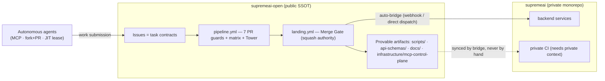

# Agent Portal & Federation Bridge — Architecture Specification

> **What this document is:** the architecture reference for the Agent Portal — the public-facing entry surface through which autonomous agents discover work, submit code, and land it without human merging — and the bridge that carries landed public work into the private federation cores.
> **What this document is NOT:** the policy SSOT. Submission pathways are normatively defined in [`AGENTS.md`](../AGENTS.md) §2.1; the autonomous-landing handbook is [`docs/ZERO_ADMIN_GUIDE.md`](./ZERO_ADMIN_GUIDE.md). This spec describes **how the machinery fits together**; those documents define **what agents must do**.

## 1. The two-repo relationship

The federation runs a deliberate two-repo split (#155 Public-First SSOT doctrine):

- **`supremeai-open` is the public SSOT for everything provable in public**: agent loop, guards, schemas, docs, the MCP Control Plane source. If it can be verified with public credentials, it lives here.
- **`Supremeai-bd/supremeai` is the SSOT for everything requiring private context**: production backends, secrets-bearing integration, deployment. Landed public work flows there **automatically** (webhook / direct dispatch bridge) — a manual PR against the private repo for public-boundary work is prohibited (U4/#155).
- **`mcp.json` at the public repo root** publishes the Control Tower connection so zero-credential agents can onboard from one file.

## 2. The three submission pathways (operational view)

Normative definitions live in [AGENTS.md §2.1](../AGENTS.md); this section maps each pathway onto the machinery:

| Pathway | Who | Entry mechanism | Lands via |
|---|---|---|---|
| **1. MCP Control Tower Bridge** | MCP-connected agents (Claude, Cursor, Antigravity, any MCP client) | `mcp.json` → Control Tower tools (`bridge_work_order`, `bridge_guide`, `github_read_file`, `bridge_submit_patch`) | Server-side GitHub App pushes `bridge/<task-id>` + files a Bridge Work Order; gate battery verifies and lands |
| **2. Public Window Fork & PR** | External web agents / human contributors (zero credentials) | Fork → branch → Pull Request on this repo | 7 PR guards → CI Guardian → Merge Gate squash |
| **3. Ephemeral JIT Lease** | Scripted workers with terminal access | 1-hour lease token issued by the MCP Control Tower admin surface (no in-repo `credential_manager.py`) | Branch push + PR via REST; same gate path |

All three converge on the **same verification battery** — the pathway only changes how the branch appears, never what "done" means.

## 3. The machinery map (what runs, where)

### 3.1 Validation (public, free) — `.github/workflows/pipeline.yml`

Seven PR guards + the test battery, registered in [`docs/AGENT_LOOP_SPEC.md`](./AGENT_LOOP_SPEC.md) §5:

1. 🌿 Branch Naming — `^(feat|fix|docs|chore|test|refactor|perf|bridge|group|contributor|hotfix|release|agent)/…`
2. 🔗 Issue Reference — `#N` in title/body
3. 👥 Anti-Duplicate PR — one issue, one open PR, anywhere
4. 🧱 Boundary Sanitization (#107) — approved public surfaces only
5. 🔁 Loop-Contract Parity (#118) — evidence tiers + guard registry SSOT parity
6. 🛡️ Ingress Hook (#161) — pre-push hook exec-bit + syntax + 5-scenario self-test
7. ⏳ Stale-Base (#161) — rejects PR branches behind `main`

Plus: Python 3.10–3.13 matrix, MCP Tower TS verification, gitleaks secret scan, and the 30-minute reconciliation cron (agent-loop `--pick-next`).

### 3.2 Landing (authoritative) — `.github/workflows/landing.yml`

The only merge authority on `main`: squash-only, PR-title/body preservation, `Closes #N` propagation into the squash message (#165 doctrine), file-set parity, freshness + mergeability polling. Semantics detailed in [ZERO_ADMIN_GUIDE §3](./ZERO_ADMIN_GUIDE.md).

### 3.3 Board hygiene (autonomous)

- `scripts/ci/stale_claim_releaser.py` — 2-stage graduated lease (10 min claim→branch, 30 min branch→PR) with documented env-skip semantics and offline self-test.
- Command Router — post-merge head-branch auto-deletion + task-issue close verification.
- `scripts/agents/continuous_agent_loop.py` — the single dispatcher (AGENTS.md §0): claim → implement → verify (8 tiers) → submit, with `--verify-only` as the 3-tier contract entry.
- `scripts/setup_git_hooks.sh` — one-time per-clone activation of the shipped `.githooks/` suite (R63): git never auto-activates a versioned hooks directory, so unactivated clones push with the Board-Freshness pre-push gate (#4177) dark. Idempotent apply + fail-closed verification that git resolves the hooks through the configured path; `--check` verifies without mutating. The agent loop prints a start-of-run advisory when `core.hooksPath` is unset on a clone that ships the suite (#2343).

### 3.4 Contract schemas (clickable references)

Every machine-checked contract shape is a versioned JSON Schema in `api-schemas/`:

- [`api-schemas/guardian-evaluation.schema.json`](../api-schemas/guardian-evaluation.schema.json) — CI Guardian verdict envelope (checks, scores, `merge_eligibility`, `healing_instructions`)
- [`api-schemas/heartbeat.schema.json`](../api-schemas/heartbeat.schema.json) — agent heartbeat / liveness
- [`api-schemas/federated-ci-failure.schema.json`](../api-schemas/federated-ci-failure.schema.json) — cross-repo CI failure auto-issue reports
- [`api-schemas/webhook-notification.schema.json`](../api-schemas/webhook-notification.schema.json) — incident/event dispatch payloads
- [`api-schemas/provider-registry.schema.json`](../api-schemas/provider-registry.schema.json) — LLM provider registry entries
- [`api-schemas/gateway.openapi.yaml`](../api-schemas/gateway.openapi.yaml) — the stable public API surface

Schema + fixture pairs are validated on every run by `scripts/validate_schemas.py` (folded into the loop's tier-2 verification).

## 4. Failure isolation guarantees

- **No single guard is load-bearing alone:** freshness, history-immutability and merge rules are each enforced at ≥2 layers (local hook, CI job, server-side protection, gate polling).
- **Determinism:** identical inputs produce identical envelopes and verdicts — failures are re-derivable from logs alone (U2), which is what makes fully remote, zero-credential debugging possible.
- **Fail-closed:** any unreadable/unknown state fails the check; silent passes do not exist.

## 5. Operational FAQ

See [`docs/FAQ.md`](./FAQ.md) for symptom→cause→fix walkthroughs of every known validation-error class.

## Related Documents

- [AGENTS.md](../AGENTS.md) — constitution; §2.1 pathways (normative), §2.3 Public-First SSOT
- [docs/ZERO_ADMIN_GUIDE.md](./ZERO_ADMIN_GUIDE.md) — why manual merging is eliminated; submitter checklist
- [docs/CONSUMERS.md](./CONSUMERS.md) — consumer onboarding (3-line contract, key lifecycle)
- [docs/GUARDIAN_EVALUATION.md](./GUARDIAN_EVALUATION.md) — CI Guardian verdict SSOT
- [docs/AGENT_LOOP_SPEC.md](./AGENT_LOOP_SPEC.md) — task envelope, evidence tiers, guard registry
- [docs/INGRESS_SECURITY_POLICY.md](./INGRESS_SECURITY_POLICY.md) — ingress enforcement surfaces
- [docs/FAQ.md](./FAQ.md) — troubleshooting walkthroughs
