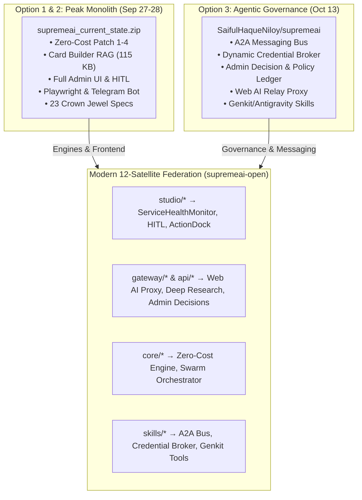
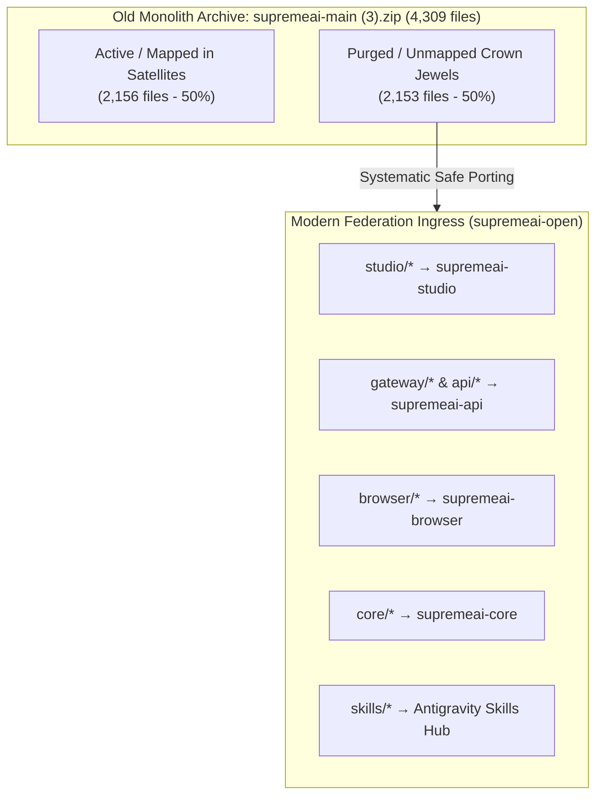
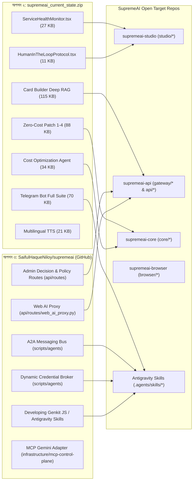

# 💎 SupremeAI Crown Jewels Inventory & Restoration Blueprint

> **ডকুমেন্ট পরিচিতি:** তিনটি প্রধান ঐতিহাসিক স্ন্যাপশট:
> 1. `supremeai-main (3).zip` (২৭ সেপ্টেম্বর ২০২৬)
> 2. `f:\supremeai_current_state.zip` (২৮ সেপ্টেম্বর ২০২৬)
> 3. `github.com/SaifulHaqueNiloy/supremeai` (১৩ অক্টোবর ২০২৬ — রিমোট গিট রিপোজিটরি)
> 
> এদের তুলনামূলক অডিট, প্রতিটি সোর্সের বিশেষ শক্তি এবং এই ৩টি উৎস থেকে কী কী শ্রেষ্ঠ ফিচার বর্তমান ১২-স্যাটেলাইট ফেডারেশন কোডবেসে পুনরুদ্ধার করা উচিত তার সুনির্দিষ্ট অ্যাকশন ব্লুপ্রিন্ট।

---

## ১. ৩-উৎস তুলনামূলক অডিট (The 3-Option Comparative Audit)

আমরা তিনটি ঐতিহাসিক সোর্স এবং বর্তমান লাইভ কোডবেস (`supremeai-open`, `supremeai-api`, `supremeai-studio`, `supremeai-core`, ইত্যাদি)-এর মধ্যে সমন্বিত ফাইল-লেভেল অডিট পরিচালনা করেছি:

| মাপকাঠি | অপশন ১: `supremeai-main (3).zip` | অপশন ২: `supremeai_current_state.zip` | অপশন ৩: `SaifulHaqueNiloy/supremeai` (GitHub) |
|---|---|---|---|
| **তারিখ ও সময়** | ২৭ সেপ্টেম্বর ২০২৬, ১৭:২৭ | ২৮ সেপ্টেম্বর ২০২৬, ০৬:৫৫ | **১৩ অক্টোবর ২০২৬, ২১:৪৩ (সর্বশেষ)** |
| **মোট ফাইল সংখ্যা** | ৪,৩০৯টি | ৪,৩০৯টি | ৪,২৮০টি |
| **অনন্য/নতুন ফাইল** | বেসলাইন | ৪,২৫১টি ফাইলে পরিমার্জন | **৫৪৭টি সম্পূর্ণ নতুন আর্কিটেকচারাল ফাইল** |
| **মূল চরিত্র ও ফোকাস** | প্রাথমিক মনোলিথ কোডবেস | **পিক মনোলিথ:** জিরো-কস্ট ইঞ্জিন, আরএজি, ওয়ান-ক্লিক টুলস ও ফ্রন্টএন্ড অ্যাডমিন স্যুট | **ম্যাচিউর গভর্ন্যান্স:** এআই এজেন্ট মেসেজিং বাস (A2A), পলিসি লেজার, অ্যাডমিন জাস্টিফিকেশন ও এমসিপি কন্ট্রোল টাওয়ার |
| **লাইভ রিপোতে মিসিং** | ২,১৫৩টি ফাইল | ২,১৫৯টি ফাইল | **১৪০টি অত্যন্ত গুরুত্বপূর্ণ গভর্ন্যান্স ফাইল** |

আমরা সরাসরি ২৭ সেপ্টেম্বর ২০২৬-এর গোল্ড-স্ট্যান্ডার্ড আর্কাইভ `supremeai-main (3).zip` ফাইলটি আনপ্যাক করে বর্তমান সক্রিয় রিপোজিটরিগুলোর (`supremeai-open`, `supremeai`, `supremeai-api`, `supremeai-studio`, `supremeai-vscode`, `supremeai-browser`, `supremeai-core`) সাথে ফাইল-টু-ফাইল ক্রস-ভেরিফিকেশন সম্পন্ন করেছি।

### ১.২ পরিসংখ্যানগত সত্য (Audit Verification Numbers)
- **মোট পরীক্ষিত পুরনো ফাইল:** ৪,৩০৯টি
- **বর্তমান রিপোতে অক্ষত বা স্যাটেলাইটে স্থানান্তরিত:** ২,১৫৬টি
- **বর্তমান কোডবেসগুলোতে অনুপস্থিত (Truly Missing / Purged):** **২,১৫৩টি ফাইল** (যার মোট আকার প্রায় ৩০ মেগাবাইট সোর্স কোড)

> [!IMPORTANT]
> এই ২,১৫৩টি ফাইলের মধ্যে কোনো জাঙ্ক বা ডেড কোড নয়—বরং শত শত কাজের এআই এজেন্ট, জিরো-কস্ট ইঞ্জিন, টেলিগ্রাম বট, প্লে-রাইট অটোমেশন, এডমিন হেলথ মনিটর এবং ২৩টি মাস্টার আর্কিটেকচার ব্লুপ্রিন্ট রয়েছে যা সুপ্রিমএআই-এর সবচেয়ে মূল্যবান সম্পদ।

---

## ২. অনুপস্থিত ক্রাউন জুয়েলস সম্পদের পূর্ণাঙ্গ তালিকা (The Master Crown Jewels)

---

### অর্গান ১: স্পেশালাইজড অটোনোমাস এআই এজেন্টস (`backend/agents/` — ৩৮টি ফাইল, ৪৭৮ KB)
এই এজেন্টগুলো স্বয়ংক্রিয় ব্যাকগ্রাউন্ড কাজ পরিচালনার জন্য সম্পূর্ণ তৈরি অবস্থায় ছিল:

| ফাইলের নাম | সাইজ | কারিগরি কাজ ও উপযোগিতা |
|---|---|---|
| `infrastructure/cost_optimization_agent.py` | ৩৪.২ KB | মাল্টিক্লাউড এবং এলএলএম টোকেন খরচ কমানোর স্বয়ংক্রিয় অটোনোমাস এজেন্ট। |
| `infrastructure/performance_tuning_agent.py` | ২৯.৬ KB | সার্ভার রেসপন্স টাইম, পিজিবাউন্সার পুল এবং মেমোরি টিউনিং এজেন্ট। |
| `ux/accessibility_agent.py` | ২৮.৩ KB | ইউজার ইন্টারফেসের WCAG 2.1 এক্সেসিবিলিটি স্বয়ংক্রিয়ভাবে অডিট ও ফিক্স করে। |
| `infrastructure/disaster_recovery_agent.py` | ২৬.৮ KB | ক্লাউড সার্ভিস ফেইল করলে স্বয়ংক্রিয় ব্যাকআপ রিস্টোর ও রি-রুট মেকানিজম। |
| `data_trend_anomaly_agent.py` | ২৪.৫ KB | ডাটাবেস ট্রাফিক ও ইউজার বিহেভিয়ারে অস্বাভাবিক বিচ্যুতি শনাক্তকারী। |
| `infrastructure/auto_scaling_agent.py` | ২৩.৭ KB | লোডের ওপর ভিত্তি করে সার্ভার ইনস্ট্যান্স ডাইনামিক স্কেলিং এজেন্ট। |
| `user_retention_risk_agent.py` | ২৩.৪ KB | ইউজার ড্রপ-অফ বা মন্থর গতি বিশ্লেষণ করে রিটেনশন রিস্ক চিহ্নিতকারী। |
| `code_vulnerability_scanner_agent.py` | ১৭.৪ KB | পাইথন/টাইপস্ক্রিপ্ট সোর্স কোডে ওডব্লুএএসপি নিরাপত্তা ত্রুটি স্ক্যানার। |
| `domain/bangla_nlp_agent.py` | ৮.৮ KB | বাংলা টেক্সট প্রসেসিং, ট্রান্সলিটারেশন ও সেন্টিমেন্ট অ্যানালাইসিস এজেন্ট। |
| `evolution_agents/multi_agent_collaboration_agent.py` | ৭.৯ KB | জটিল সমস্যা সমাধানে একাধিক এজেন্টকে একসাথে জুড়ে দেওয়ার এজেন্ট। |

---

### অর্গান ২: কোর ইন্টেলিজেন্স ও জিরো-কস্ট ইঞ্জিন (`backend/core/` — ৩৫৮টি ফাইল, ৩.৫১ MB)
1. **`zero_cost_architecture/zero_cost_patch_phase1_4.py` (৮৫.৭ KB):**
   - ক্লাউড বিল $০-এ নামিয়ে আনার ফেজ ১ থেকে ফেজ ৪-এর কমপ্লিট কোর লজিক।
2. **`competitive_kit.py` (৬৫.১ KB):**
   - প্রতিযোগী বাণিজ্যিক এআই প্ল্যাটফর্মগুলোর সাথে সুপ্রিমএআই-এর ফিচার সমতা ও বেঞ্চমার্কিং কিট।
3. **`resilience/circuit_breaker.py` (৩৪.৩ KB):**
   - বাহ্যিক কোনো এপিআই (যেমন: ওপেনএআই বা রেন্ডার) ডাউন হলে সিস্টেমকে বাঁচিয়ে রাখার অটো-সার্কিট ব্রেকার।
4. **`llm/llm_gateway/completion.py` (৩৪.৪ KB) & `llm/advanced_model_router.py` (৩২.২ KB):**
   - ইন্টেলিজেন্ট এলএলএম গেটওয়ে—কোটা শেষ হলে অন্য ফ্রি মডেলের ক্যাস্কেডিং ও স্মার্ট রাউটিং।
5. **`self_evolution/auto_skill_creator.py` (২৭.৮ KB):**
   - ব্যবহারকারীর দৈনন্দিন কাজ বিশ্লেষণ করে স্বয়ংক্রিয়ভাবে নতুন নতুন টুল/স্কিল তৈরি করার সেলফ-লার্নিং ইঞ্জিন।
6. **`orchestration/swarm_orchestrator.py` (২৭.৪ KB):**
   - ডাইনামিক মাল্টি-এজেন্ট সোয়ার্ম কোঅর্ডিনেশন।
7. **`security/secret_vault.py` (৪০.৪ KB) & `injections/sql_prevention.py` (২৫.৯ KB):**
   - রিয়েল-টাইম ক্রেডেনশিয়াল মাস্কিং এবং এসকিউএল ইনজেকশন প্রোটেকশন লেয়ার।
8. **`cache/multi_layer_cache.py` (২৮.৪ KB) & `redis_manager.py` (৩৮.৮ KB):**
   - L1/L2 লোকাল মেমোরি + রেডিস কম্বাইনড মাল্টিলেয়ার ক্যাশ।

---

### অর্গান ৩: প্রোডাকশন অটোমেশন টুলস ও রিলে (`backend/tools/` — ১১৪টি ফাইল, ১.০৩ MB)
1. **`media/multilingual_tts.py` (২০.৫ KB):**
   - বহুভাষিক টেক্সট-টু-স্পিচ (TTS) অডিও ইঞ্জিন (বাংলা ও ইংরেজি উভয় ভাষায় স্পষ্ট উচ্চারণ)।
2. **`social/telegram_bot/` (৭০+ KB — ৪টি পূর্ণাঙ্গ মডিউল):**
   - `conversations.py`, `handler.py`, `updates.py`, `admin_handlers.py` — হিউম্যান-ইন-দ্য-লুপ (HITL) সহ সরাসরি টেলিগ্রামের মাধ্যমে এজেন্ট কন্ট্রোল ও নোটিফিকেশন সিস্টেম।
3. **`browser/playwright_browser_agent.py` (৩৭.৫ KB):**
   - হেডলেস প্লে-রাইট ব্রাউজার ড্রাইভার, যা স্বয়ংক্রিয়ভাবে ওয়েব ব্রাউজ ও ডাটা এক্সট্র্যাক্ট করতে পারে।
4. **`security_tools/multi_account_rotator.py` (৪৪.১ KB):**
   - বিভিন্ন প্রোভাইডারের একাধিক ফ্রি একাউন্টকে সিকোয়েন্সিয়ালি রোটেট করে সীমাহীন কোটা নিশ্চিত করার টুল।
5. **`code/diagram_to_architecture.py` ও `image_to_code.py` (২৯.৮ KB):**
   - সিস্টেম ডায়াগ্রাম বা ইউআই স্কেচের ছবি দেখে সরাসরি রিয়্যাক্ট বা পাইথন কোড জেনারেট করার ইঞ্জিন।
6. **`knowledge/card_builder.py` (১১৪.৯ KB — `current_state` এ পরিবর্ধিত):**
   - ডিপ আরএজি নলেজ কার্ড জেনারেটর, যা ডকুমেন্ট থেকে স্বয়ংক্রিয় কিউএ ও নলেজ গ্রাফ তৈরি করে।
7. **`knowledge/local_search_rag.py` & `knowledge_base_indexer.py` (৩১.০ KB):**
   - ইন্টারনাল ডকস ও কোডবেস লোকাল ভেক্টর সার্চের মাধ্যমে দ্রুত খুঁজে পাওয়ার আরএজি ইঞ্জিন।
8. **`social/viral_referral_engine.py` (১৬.৫ KB):**
   - প্লাটফর্ম গ্রোথের জন্য ভাইরাল রেফারেল ট্র্যাকিং ও রেওয়ার্ড ডিস্ট্রিবিউশন ইঞ্জিন।

---

### অর্গান ৩.১: `supremeai_current_state.zip` এ থাকা বিশেষ বাড়তি ফিচারসমূহ (Exclusive Additions)
`supremeai-main (3).zip` এর পরবর্তী ১৩ ঘণ্টায় এই ফাইলে যেসব অনন্য পরিবর্ধন হয়েছিল:
1. **n8n ওয়ার্কফ্লো অটোমেশন মাস্টার প্ল্যান (`docs/plans/features/n8n_workflow_automation_master_plan.md` — ২৭.৯ KB):**
   - ওপেন সোর্স n8n ইঞ্জিন দিয়ে সেলফ-হোস্টেড অটোমেশন ও ওয়েবহুক পাইপলাইন আর্কিটেকচার।
2. **মাল্টি-টেন্যান্ট রোল ও স্লট অ্যাকুইজিশন (`scripts/agents/acquire_role_slot.py` — ১৯.৭ KB):**
   - একাধিক ক্লায়েন্ট ও এজেন্টের মধ্যে কনকারেন্ট টাস্ক স্লট নিরাপদে বণ্টন ও রোটেশন লজিক।
3. **সেন্টিনেল মরফিক স্কিমা ও ডাটাবেস বাগফিক্স (`alembic_migrations/versions/`):**
   - `cfe7c95dbee2_add_sentinel_morphic_schema.py` (৬৭.৮ KB) এবং `k1l2m3n4o5p6_fix_downgrade_upgrade_table_swap.py` (৭৮.৩ KB) — টেবিল ডাউনগ্রেড/আপগ্রেডের গুরুতর সোয়াপ বাগফিক্স।
4. **সুপাবেজ ক্লায়েন্ট কানেকশন পুলিং ও রিট্রাই (`backend/database/supabase_client.py` — ৮০.৪ KB):**
   - ক্লাউড ড্রপআউট হলেও ব্যাকঅফ রিট্রাই ও রেডিস কানেকশন ফলব্যাক সমৃদ্ধ আপগ্রেডেড ক্লায়েন্ট।

---

### অর্গান ৪: ব্যাকএন্ড এপিআই রাউটস (`backend/api/routes/` — ১৯০টি ফাইল, ১.৪৪ MB)
1. **`deep_research.py` (৩১.২ KB):**
   - ডিপ রিসার্চ এআই এজেন্ট এন্ডপয়েন্ট (একাধিক সোর্স থেকে তথ্য সংগ্রহ ও সিনথেসিস)।
2. **`ci_dashboard_api.py` (২৭.২ KB):**
   - লাইভ সিআই/সিডি পাইপলাইন হেলথ এবং ওয়ার্কফ্লো মনিটরিং ব্যাকএন্ড।
3. **`billing_api.py` (২৫.৭ KB):**
   - স্ট্রাইপ বিলিং, ওয়ালেট ক্রেডিট এবং ট্রানজ্যাকশন লেজার হ্যান্ডলার।
4. **`stream_chat_sse.py` (১৯.৩ KB):**
   - সার্ভার-সেন্ট ইভেন্টস (SSE) এর মাধ্যমে হাই-স্পিড স্ট্রিমিং চ্যাট এপিআই।
5. **`session_takeover.py` (১৯.৬ KB):**
   - হিউম্যান-ইন-দ্য-লুপ প্রোটোকল: স্বয়ংক্রিয় এজেন্ট আটকে গেলে এডমিন যেন সেশনের নিয়ন্ত্রণ নিতে পারেন।
6. **`browser/_crown_jewel.py` (১৭.৭ KB):**
   - ব্রাউজার অটোমেশনের সেন্ট্রাল হাব রাউট।
7. **`prompt_templates.py` (২৩.৫ KB) & `slash_commands.py` (২১.৮ KB):**
   - ফ্রন্টএন্ড চ্যাটের জন্য স্ল্যাশ কমান্ড ও প্রম্পট লাইব্রেরি ব্যাকএন্ড।

---

### অর্গান ৫: অ্যাডভান্সড ফ্রন্টএন্ড ইউআই কম্পোনেন্টস (`frontend/src/` — ৪৮টি ফাইল, ২৭২ KB)
1. **`components/admin/infra/ServiceHealthMonitor.tsx` (২৬.৭ KB):**
   - লাইভ মাইক্রোসার্ভিস, ডাটাবেস ও ক্লাউড রানারের রিয়েল-টাইম হেলথ মনিটর।
2. **`components/admin/AdminDashboardHome.tsx` (২১.০ KB):**
   - সুপ্রিমএআই-এর পূর্ণাঙ্গ অ্যাডমিন কমান্ড সেন্টার।
3. **`components/dashboard/HumanInTheLoopProtocol.tsx` (১১.০ KB) & `HITLModal.tsx`:**
   - এজেন্টের ক্রিটিক্যাল ডিসিশনে মানুষের সম্মতি নেওয়ার জন্য ভিজ্যুয়াল মডাল।
4. **`components/dashboard/ActionDock.tsx` ও `LivingActionDock.tsx` (১৫.৫ KB):**
   - ম্যাকওএস-স্টাইল ডায়নামিক ফ্লোটিং বটম অ্যাকশন ডক।
5. **`components/AgentStateShaderBackground.tsx` (৭.৭ KB):**
   - এজেন্টের বর্তমান মুড ও কাজের ওপর ভিত্তি করে পরিবর্তিত হওয়া প্রিমিয়াম 3D শ্যাডার ক্যানভাস।
6. **`components/dashboard/LiveSimulator.tsx` (৭.১ KB):**
   - মোবাইল এবং ব্রাউজার প্রিভিউ লাইভ রান করার সিমুলেটর।
7. **`components/admin/ScreencastViewer.tsx` (৬.৫ KB):**
   - হেডলেস ব্রাউজারে কী ঘটছে তা লাইভ ভিডিও স্ট্রিমে দেখার স্ক্রিনকাস্ট ভিউয়ার।

---

### অর্গান ৬: ক্রাউন জুয়েল মাস্টার স্পেসিফিকেশন সিরিজ (`docs/plans/crown_jewel_series/` — ২৩টি ফাইল)
এই ২৩টি আর্কিটেকচারাল স্পেক ভবিষ্যতে বড় আপগ্রেডের গাইড হিসেবে তৈরি করা হয়েছিল:
- `MODULE_01_MEMORY_POWER_UP.md` — মেম০ স্টাইল পারসিস্টেন্ট মেমোরি
- `MODULE_02_ORCHESTRATION_CORE_POWER_UP.md` — মাল্টি-এজেন্ট ডায়নামিক অর্কেস্ট্রেশন
- `MODULE_03_LLM_GATEWAY_POWER_UP.md` — জিরো-কস্ট এলএলএম ফলব্যাক ও টোকেন বাজেট
- `MODULE_04_BROWSER_AUTOMATION_POWER_UP.md` — প্লে-রাইট ডিপ ওয়েব অটোমেশন
- `MODULE_05_SELF_EVOLUTION_POWER_UP.md` — কোড সেলফ-হিলিং ও অটোমেটেড প্যাচিং
- `MODULE_10_FRONTEND_TIER_S_WIRING_POWER_UP.md` — স্টুডিও ইউআই ওয়্যারিং
- `MODULE_15_SECURITY_ORGAN_POWER_UP.md` — ৩০-ক্যাটাগরি সিকিউরিটি শিল্ড
- `MODULE_19_I18N_BENGALI_ADAPTER_POWER_UP.md` — পূর্ণাঙ্গ বাংলা অ্যাডাপ্টার
- `MODULE_23_KNOWLEDGE_BASE_DOCS_POWER_UP.md` — নলেজ বেস ও আরএজি ইঞ্জিন

---

## ৩. গোল্ডেন ট্রায়াড রিস্টোরেশন ম্যাট্রিক্স (The 3-Source Restoration Matrix)

আমরা ৩টি সোর্স থেকে প্রতিটি ফিচারকে তার **সর্বোত্তম সংস্করণ (Best Version)** নির্বাচন করে ফেডারেশনের নির্দিষ্ট স্যাটেলাইটে ম্যাপ করেছি:

### ৩.১ সোর্স-ভিত্তিক পুনরুদ্ধার চেকলিস্ট (Specific Restoration Attribution)

| ক্যাটাগরি | কোন অপশন থেকে আনা হবে? | ফাইলের সঠিক পাথ | টার্গেট ফেডারেশন সারফেস |
|---|---|---|---|
| **A2A মেসেজিং বাস** | **অপশন ৩ (GitHub)** | `scripts/agents/a2a_messaging_bus.py` | `supremeai-open:scripts/agents/` |
| **অ্যাডমিন ডিসিশন লেজার** | **অপশন ৩ (GitHub)** | `backend/api/routes/admin_decisions.py`, `admin_policies.py` | `supremeai-open:gateway/service/` |
| **ওয়েব এআই রিলে প্রক্সি** | **অপশন ৩ (GitHub)** | `backend/api/routes/web_ai_proxy.py` | `supremeai-open:gateway/service/` |
| **ডায়নামিক ক্রেডেনশিয়াল ব্রোকার** | **অপশন ৩ (GitHub)** | `scripts/agents/dynamic_credential_broker.py` | `supremeai-open:scripts/agents/` |
| **Antigravity Genkit Skills** | **অপশন ৩ (GitHub)** | `.agents/skills/developing-genkit-js/` | `supremeai-open:.agents/skills/` |
| **সার্ভিস হেলথ মনিটর ইউআই** | **অপশন ২ (Current State)** | `frontend/src/components/admin/infra/ServiceHealthMonitor.tsx` | `supremeai-open:studio/src/components/admin/` |
| **হিউম্যান-ইন-দ্য-লুপ (HITL) মডাল** | **অপশন ২ (Current State)** | `frontend/src/components/dashboard/HumanInTheLoopProtocol.tsx` | `supremeai-open:studio/src/components/dashboard/` |
| **ডিপ আরএজি কার্ড বিল্ডার** | **অপশন ২ (Current State)** | `tools/knowledge/card_builder.py` | `supremeai-open:core/tools/` |
| **টেলিগ্রাম বট কমপ্লিট স্যুট** | **অপশন ২ (Current State)** | `backend/tools/social/telegram_bot/` | `supremeai-open:scripts/bots/` |
| **জিরো-কস্ট ইঞ্জিন ফেজ ১-৪** | **অপশন ২ (Current State)** | `backend/core/zero_cost_architecture/zero_cost_patch_phase1_4.py` | `supremeai-open:core/resilience/` |
| **মাল্টিলিঙ্গুয়াল টিটিএস (বাংলা+ইংরেজি)**| **অপশন ২ (Current State)** | `backend/tools/media/multilingual_tts.py` | `supremeai-open:skills/multilingual_tts/` |
| **কস্ট অপ্টিমাইজেশন এজেন্ট** | **অপশন ২ (Current State)** | `backend/agents/infrastructure/cost_optimization_agent.py` | `supremeai-open:core/agents/` |

---

## ৪. নিরাপত্তা ও নন-রিগ্রেশন অঙ্গীকার (Rule P3 Compliance)

> [!CAUTION]
> **নন-রিগ্রেশন নীতি (Non-Regression Mandate):**  
> পুরনো কোড ফিরিয়ে আনার সময় বর্তমান অর্জিত গতি (<১.০ সেকেন্ড ল্যান্ডিং লোড, ব্যর্থতাহীন সিআই পাইপলাইন এবং পরিষ্কার টাইপস্ক্রিপ্ট টাইপস) নষ্ট করা যাবে না। প্রতিটি ক্রাউন জুয়েল মডিউল `python scripts/ci/boundary_sanitization_guard.py` দিয়ে টেস্ট পাস করার পরেই কেবল যুক্ত করা হবে।

---

## ৫. ইউনিফাইড মাস্টার আর্কাইভ মার্জ রিপোর্ট (The Unified Goldmine Archive)

অক্টোবর ২৪, ২০২৬-এ `F:\supremeai-crown-jewels-vault` এবং `F:\old zip\New folder`-কে সফলভাবে একত্রিত (Merge) করা হয়েছে:

- **ইউনিফাইড মাস্টার লোকেশন:** `F:\old zip\New folder`
- **মোট সংগৃহীত ফাইল:** ৩,২৫৪টি ফাইল (সম্পূর্ণ আন-কম্প্রেসড ও ইনডেক্সড)
- **অন্তর্ভুক্ত ক্রাউন জুয়েলস:**
  1. `tools/knowledge/card_builder.py` (১১৫ KB ডিপ আরএজি ইঞ্জিন)
  2. `docs/plans/architecture/` (জিরো-ডাউনটাইম ও মাল্টি-টেন্যান্ট মাস্টার প্ল্যান)
  3. `backend/api/routes/browser/_crown_jewel.py` ও `admin_*.py` রাউটস
  4. `.agents/skills/developing-genkit-js/` (২০টি সম্পূর্ণ এআই এজেন্ট স্কিল ও রেফারেন্স)
  5. `infrastructure/mcp-control-plane/` (জেমিনি অ্যাডাপ্টার ও টুল এক্সপোজার স্পেক)
  6. `scripts/agents/` (A2A মেসেজিং বাস, ক্রেডেনশিয়াল ম্যানেজার ও ওয়াচডগ)
- **ইনডেক্স ও ম্যানিফেস্ট:** `F:\old zip\New folder\MANIFEST.md` এবং `CROWN_JEWELS_VAULT_INDEX.md` আপডেট করা হয়েছে।

