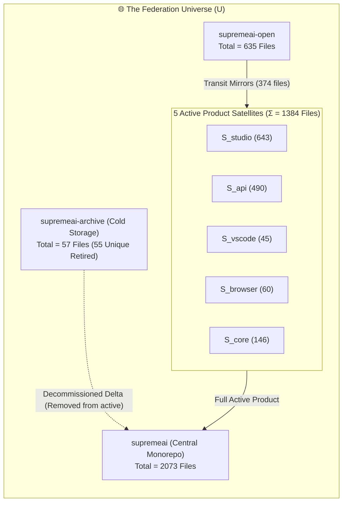
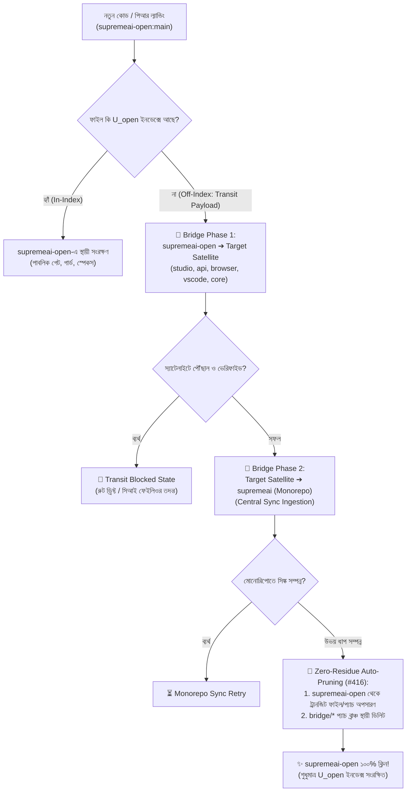
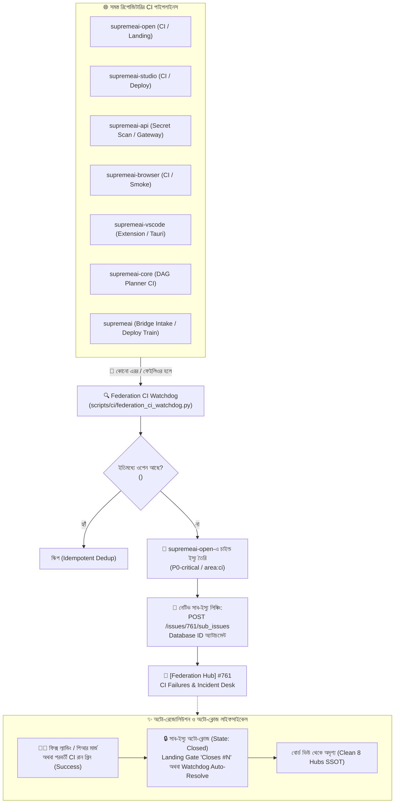
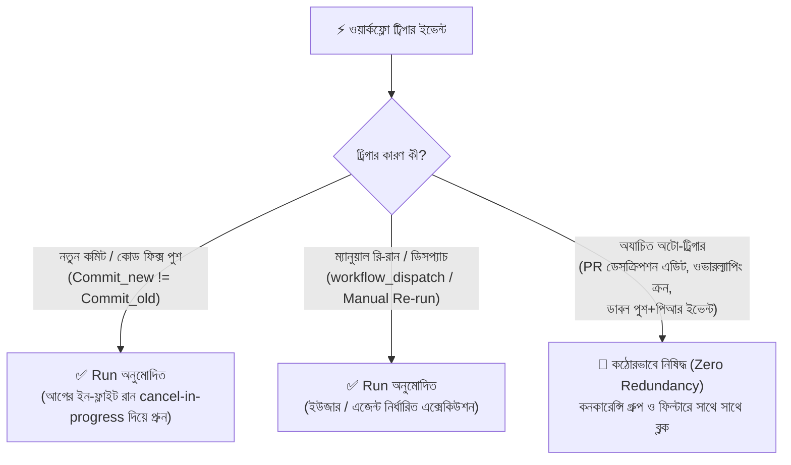

# 📐 SupremeAI Federation — Mathematical Repository Model & Set Inventory

> **Document Type:** Mathematical SSOT & Federation Set Inventory  
> **Date:** 2026-10-24  
> **Status:** Canonically Formulated  
> **Federation SSOT:** [`FEDERATION_CHARTER.md`](./FEDERATION_CHARTER.md) & [`AGENTS.md`](../AGENTS.md)

---

## 1. Mathematical Formulation (গাণিতিক মডেল)

ফেডারেশন আর্কিটেকচারকে সেট থিওরি (Set Theory)-র আলোকে নিখুঁত সমীকরণ দিয়ে সংজ্ঞায়িত করা হলো:



---

### সমীকরণ ১: `supremeai-open`-এর নিজস্ব ইউনিক ফাইল ($U_{\text{open}}$)

`supremeai-open` রিপোজিটারি দুটি সেটের যোগফল:
1. **$T_{\text{transit}}$ (Transit Mirror Files):** যে ফাইলগুলো স্যাটেলাইট রিপোগুলোর মিরর সারফেস (যেমন `studio/*`, `gateway/*`, `browser/*`, ইত্যাদি)। পিআর মার্জ হলে এগুলো স্যাটেলাইটে ল্যান্ড করে।
2. **$U_{\text{open}}$ (Personal / Unique Open Files):** পাবলিক ফ্রন্ট ডোর, সিআই গেট গার্ডস, টাস্ক বোর্ড ও কনস্টিটিউশনের নিজস্ব ফাইল। এগুলো স্যাটেলাইটে যাবে না এবং থাকা নিষিদ্ধ।

$$\mathbf{Open} = T_{\text{transit}} \cup U_{\text{open}} \quad \text{where } T_{\text{transit}} \cap U_{\text{open}} = \emptyset$$

$$\mathbf{|Open|} = 635$$
$$\mathbf{|T_{\text{transit}}|} = 374 \quad (\text{studio: 52, gateway: 35, mcp: 181, browser: 51, vscode: 44, core: 9, contracts: 2})$$
$$\mathbf{|U_{\text{open}}|} = |Open| - |T_{\text{transit}}| = 635 - 374 = \mathbf{261 \text{ files}}$$

---

### সমীকরণ ২: ফুল প্রোডাক্ট সমীকরণ ($\text{SupremeAI}_{\text{full}}$)

ফেডারেশনের ৫টি সক্রিয় প্রোডাক্ট স্যাটেলাইটের সমন্বিত লাইভ কোডবেজ:

$$\mathbf{S_{\text{active}}} = S_{\text{studio}} \cup S_{\text{api}} \cup S_{\text{vscode}} \cup S_{\text{browser}} \cup S_{\text{core}}$$

এবং সেন্ট্রাল মোনোরিপো হলো এই ৫টি স্যাটেলাইটের একত্রিত আমব্রেলা + সেন্ট্রাল অর্কেস্ট্রেশন ও শেয়ার্ড রিসোর্সেস:

$$\mathbf{SupremeAI_{\text{monorepo}}} = \left(\bigcup_{i \in \text{domains}} S_i\right) \cup \Omega_{\text{shared}} \cup \Pi_{\text{apps}} \cup \Gamma_{\text{tools}}$$

যেখানে:
* $\Omega_{\text{shared}}$ = শেয়ার্ড প্যাকেজেস (`packages/design-tokens`, `packages/core-infrastructure`)
* $\Pi_{\text{apps}}$ = সেন্ট্রাল মনিটরিং ও অ্যাডমিন অ্যাপস (`apps/mission-control`, `apps/docs`)
* $\Gamma_{\text{tools}}$ = ডিস্ট্রিবিউটেড ক্লায়েন্ট ও অর্কেস্ট্রেশন স্ক্রিপ্টস (`client/supreme-node`, `scripts/`)

---

### সমীকরণ ৩: কোল্ড স্টোরেজ / আর্কাইভ সমীকরণ ($\mathbf{Archive}$)

`supremeai-archive` হলো একটি অ্যাপেন্ড-অনলি কোল্ড স্টোরেজ। এটি সক্রিয় কোডবেজের অংশ নয়; বরং ৬টি সক্রিয় স্যাটেলাইট এবং সেন্ট্রাল মোনোরিপো থেকে ইতিপূর্বে **স্থায়ীভাবে মুছে ফেলা (decommissioned/retired)** ফাইলগুলোর সংরক্ষণাগার:

$$\mathbf{Archive} = \Delta_{\text{retired}} \cup \{\text{README.md, LICENSE}\}$$

$$\Delta_{\text{retired}} \cap \mathbf{S_{\text{active}}} = \emptyset \quad \text{and} \quad \Delta_{\text{retired}} \cap \mathbf{SupremeAI_{\text{monorepo}}} = \emptyset$$

$$\mathbf{|Archive|} = 57 \text{ files}$$
$$\mathbf{|\Delta_{\text{retired}}|} = 55 \text{ files (শুধুমাত্র আর্কাইভে সংরক্ষিত)}$$

---

## 2. $U_{\text{open}}$: `supremeai-open`-এর নিজস্ব ইউনিক ফাইল ইনডেক্স (২৬১টি ফাইল)

এই ২৬১টি ফাইল শুধুমাত্র `supremeai-open`-এর অভ্যন্তরীণ পরিচালনা, টাস্ক গভার্নেন্স ও সিকিউরিটি গেটের জন্য নির্ধারিত। এগুলো স্যাটেলাইট রিপোতে **থাকার কথা নয়**:

| ক্যাটাগরি | ফাইলের সংখ্যা | বিবরণ ও মূল কম্পোনেন্টস |
|---|---|---|
| **১. সেন্ট্রাল পলিসি ও কনস্টিটিউশন (`/`)** | ১৩ | `AGENTS.md`, `AGENT_RULES.md`, `ECOSYSTEM_MAP.md`, `ARCHITECTURE_PLAN.md`, `AUTONOMOUS_TRANSIT_PIPELINE.md`, `README.md`, `LICENSE`, `ruff.toml`, `.gitignore`, `.gitattributes`, `.gitleaks.toml`, `.gitleaksignore`, `.pre-commit-config.yaml` |
| **২. পাবলিক ডকস ও গভার্নেন্স (`docs/`)** | ৮৩ | `docs/FEDERATION_CHARTER.md`, `docs/FEDERATED_CI_WATCHER.md`, `docs/ZERO_ADMIN_GUIDE.md`, `docs/HEARTBEAT_PROTOCOL.md`, `docs/CI_PIPELINES_AUDIT_REPORT.md`, `docs/work-orders/*` (সমস্ত স্পেক ও পাবলিক অর্ডার্স) |
| **৩. সিআই গেট ও ট্রানজিট গার্ডস (`scripts/`)** | ৫৬ | `scripts/ci/federation_satellite_sync.py`, `scripts/ci/contract_parity_guard.py`, `scripts/ci/satellite_board_guard.py`, `scripts/ci/admin_sovereignty_guard.py`, `scripts/ci/deploy_preflight_guard.py`, `scripts/agents/*`, `scripts/tower/*` |
| **৪. কনস্টিটিউশন ও গেট টেস্টস (`tests/`)** | ৪৪ | `tests/test_constitution_freshness.py`, `tests/test_test_parity_guard.py`, `tests/test_gateway_shield.py`, `tests/test_s12_nightly_train.py`, `tests/test_self_healing_reporter.py` |
| **৫. সেন্ট্রাল স্কিমা ও ফিক্সচার্স (`api-schemas/`)** | ১৮ | `api-schemas/context-assembly.schema.json`, `dashboard.schema.json`, `federated-ci-failure.schema.json`, `heartbeat.schema.json`, `rate-limit.schema.json`, `task-router.schema.json`, `telemetry-log.schema.json`, `fixtures/*` |
| **৬. পাবলিক ইন্টিগ্রেশন এক্সাম্পলস (`examples/`)** | ১৮ | `examples/langchain-*`, `examples/vercel-*`, `examples/streaming_chat.py`, `examples/sdk-*` |
| **৭. পাবলিক ওয়ার্কফ্লো অটোমেশন (`.github/`)** | ১৫ | `.github/workflows/landing.yml`, `pipeline.yml`, `satellite-board-audit.yml`, `federation-ci-watchdog.yml`, `kaggle-learning.yml`, issue & PR templates |
| **৮. অটোনোমাস স্কিলস (`.agents/skills/`)** | ৮ | `.agents/skills/devtools-audit/*` (স্কিল ম্যানিফেস্ট, অডিট কোড ও স্ক্রিপ্টস) |
| **৯. গিটহুকস (`.githooks/`)** | ৩ | `.githooks/commit-msg`, `pre-commit`, `pre-push` |
| **১০. এজ প্রক্সি কনফিগ (`infrastructure/`)** | ৩ | `infrastructure/cloudflare-studio-proxy/wrangler.toml`, `package.json`, `src/index.js` |
| **সর্বমোট $U_{\text{open}}$** | **২৬১** | **১০০% আইসোলেটেড ও নিজস্ব ইউনিক ফাইল** |

---

## 3. $S_{\text{active}}$: ৫টি সক্রিয় স্যাটেলাইট রিপোজিটারি (১৩৮৪টি ফাইল)

সক্রিয় কোডের সমাহার যা লাইভ প্রোডাকশনে এক্সিকিউট হয়:

| স্যাটেলাইট রিপো | ভূমিকা | লাইভ প্ল্যাটফর্ম | ফাইল সংখ্যা | কভারেজ |
|---|---|---|---|---|
| **`supremeai-studio`** | ইউজার ড্যাশবোর্ড ও ক্লায়েন্ট ওয়েব UI | Vercel | ৬৪৩ | UI Components, Design Tokens, Pages, Storybook, Tests |
| **`supremeai-api`** | ইউনিফাইড গেটওয়ে, MCP টুলস ও ব্যাকএন্ড | Render | ৪৯০ | Multi-LLM Routing, FastMCP Server, Alembic DB, Services |
| **`supremeai-core`** | ডেসিশন ইঞ্জিন, প্ল্যানার ও মোয়াট | Render | ১৪৬ | DAG Planner, State Machine, Context Synthesizer, Memory |
| **`supremeai-browser`** | হেডলেস স্টিলথ অটোমেশন ও ব্রাউজার | Render | ৬০ | Stealth Drivers, Playwright Sandbox, Anti-detect harness |
| **`supremeai-vscode`** | ডেভেলপার এক্সটেনশন ও ক্লায়েন্ট হাব | Marketplace | ৪৫ | VS Code Extension, Desktop Tauri App, Mobile Capacitor |
| **মোট সক্রিয় প্রোডাক্ট কোড** | | | **১৩৮৪** | **Active Federation Surface** |

---

## 4. $\mathbf{Archive}$: রিটায়ার্ড ও ডিকমিশনড ফাইলের পূর্ণাঙ্গ তালিকা (৫৫টি ইউনিক ফাইল)

এই ৫৫টি ফাইল সক্রিয় ৬টি স্যাটেলাইট এবং সেন্ট্রাল মোনোরিপো থেকে ইতিমধ্যে ক্লিন/রিমুভ করা হয়েছে, এবং এগুলো শুধুমাত্র `supremeai-archive`-এ চিরতরে সংরক্ষিত:

### ক. হিস্টোরিক্যাল ADRs (আর্কিটেকচার ফ্রিজ রেকর্ডস — ৭টি ফাইল)
1. `adrs/ADR-001-core-freeze.md`
2. `adrs/ADR-002-tier3-deferred.md`
3. `adrs/ADR-003-main-repo-freeze-best-of.md`
4. `adrs/ADR-004-topology-clarification.md`
5. `adrs/ADR-005` (`topology-v3-private-archive-live-federation.md`)
6. `adrs/ADR-006-federation-split-policy-agent-maintenance.md`
7. `adrs/ADR-007-topology-v4-open-core-private-live.md`

### খ. লিগ্যাসি স্পেসিফিকেশনস (পুরনো সিস্টেম ব্লুপ্রিন্ট — ১১টি ফাইল)
8. `legacy-specs/AIBRAIN-01-MASTER_AGENT_SPECIFICATION.md`
9. `legacy-specs/AIBRAIN-02-AGENT-SYSTEM-2.0-MASTER-PLAN.md`
10. `legacy-specs/ARCH-10` (`UNIVERSAL-ENGINE-MASTER-PLAN` / `STAGING-RULE-ENGINE` / `BATCH-TRAIN-RED-TEAM.md`)
11. `legacy-specs/FRONTEND_DASHBOARD_MASTER_PLAN_V1.md`
12. `legacy-specs/GOVERNED_MULTI_AGENT_DECISION_ARCHITECTURE.md`
13. `legacy-specs/ISSUE_PRIORITY_POLICY.md`
14. `legacy-specs/MULTI_PLATFORM_AGENT_WORKSPACE_PLAN.md`
15. `legacy-specs/MULTI_PLATFORM_WORKSPACE_IMPLEMENTATION_ROADMAP.md`
16. `legacy-specs/OPS-09` (`POST-GROUP-JANITOR-AND-HYGIENE-PROTOCOL.md`)
17. `legacy-specs/README.md`
18. `legacy-specs/RISK_TIERED_AUTONOMOUS_SAFETY_PIPELINE.md`

### গ. মাস্টার ও সিস্টেম ডকস (পূর্বে অ্যাক্টিভ ছিল এমন ডকস — ১৯টি ফাইল)
19. `docs/master_docs/AGENT_SLOT_REGISTRY.yaml`
20. `docs/master_docs/ARCH-02-SYSTEM_OVERVIEW_AND_FLOWS.md`
21. `docs/master_docs/ARCH-03-DATA_AND_STORAGE_PLAN.md`
22. `docs/master_docs/ARCH-05-MASTER_ROADMAP_AND_DECISIONS.md`
23. `docs/master_docs/ARCH-06-MODULES_AND_PROVIDERS_MAP.md`
24. `docs/master_docs/ARCH-GAP-01-DECISION-GAP-ANALYSIS.md`
25. `docs/master_docs/BACKEND-01-API_REFERENCE_AND_CONTRACTS.md`
26. `docs/master_docs/BACKEND-07-MICROSERVICES_AND_PLUGINS.md`
27. `docs/master_docs/DEVOPS-01-PURE_CLOUD_INFRASTRUCTURE.md`
28. `docs/master_docs/FRONTEND-01-DESIGN_SYSTEM_AND_TOKENS.md`
29. `docs/master_docs/INTEG-01-MCP_INTEGRATION_HANDBOOK.md`
30. `docs/master_docs/INTEG-06-VSCODE_EXTENSION_AND_IDE.md`
31. `docs/master_docs/OPS-01-TESTING_STRATEGY_AND_TIERS.md`
32. `docs/master_docs/OPS-04-OPERATIONAL_RUNBOOKS_AND_TASKS.md`
33. `docs/master_docs/OPS-05-PR-HELPER-LIFECYCLE.md`
34. `docs/master_docs/OPS-08-SUPREMEAI-RUNTIME-WORK-PROCESS.md`
35. `docs/master_docs/PRODUCTION_CERTIFICATION.md`
36. `docs/master_docs/SCRIPTS_CONSOLIDATION_MASTER.md`
37. `docs/master_docs/SEC-01-30_CATEGORY_SECURITY_MATRIX.md`

### ঘ. অডিট এভিডেন্স ও রিপোর্টস (৭টি ফাইল)
38. `docs/audit_reports/module_wiring_audit.json`
39. `docs/audit_reports/route_client_inventory.json`
40. `docs/audit_reports/route_client_inventory.md`
41. `docs/audits/evidence/2026-10-01/defect_scan_report.json`
42. `docs/audits/evidence/2026-10-01/defect_scan_summary.txt`
43. `docs/ledger/task-outcomes.jsonl`
44. `worklogs/worklog.md`

### ঙ. রিলিজ প্ল্যান ও টারবলস (১১টি ফাইল)
45. `docs/plans/ARCH-LIVING-PIPELINE-01-IMPL.md`
46. `docs/plans/architecture/SUPREMEAI_REPOSITORY_SEPARATION_AND_EVOLUTION_ROADMAP.md`
47. `legacy-specs/lessons_2026-10.md`
48. `lessons/INDEX.md`
49. `lessons/lessons_2026-10.md`
50. `prepared/v4/open-projection.yml`
51. `prepared/v4/schedule-diet-patch.md`
52. `roadmap-snapshots/2026-10-07-supremeai-roadmap-FROZEN.md`
53. `tarballs/external-docs-export-2026-09-29.tar.gz`
54. `tarballs/legacy-docs-2026-09-29.tar.gz`
55. `tarballs/legacy-docs-phase2-2026-09-29.tar.gz`

---

## 5. ২-ধাপের ক্যাসকেডিং ব্রিজ ট্রানজিট ও জিরো-রেসিডিউ লাইফসাইকেল (2-Step Cascading Bridge Lifecycle)



---

### ৫.১. দ্য ইনডেক্স ইনভেরিয়েন্ট ও ট্রানজিট ব্লক নীতি (Index Invariant & Blocked State Law)

`supremeai-open`-এ অবস্থিত যেকোনো ফাইল $f$ কঠোরভাবে দুটি অবস্থার যেকোনো একটিতে থাকবে:

$$\forall f \in \mathbf{Open}, \quad f \in U_{\text{open}} \oplus f \in T_{\text{transit}}$$

1. **অন-ইনডেক্স ($f \in U_{\text{open}}$):** এটি `supremeai-open`-এর নিজস্ব ব্যক্তিগত ফাইল (সেকশন ২-এ তালিকাভুক্ত ২৬১টি ফাইল)। এটি কখনো কোনো স্যাটেলাইটে যাবে না, স্থায়ীভাবে ওপেন রিপোতেই থাকবে।
2. **অফ-ইনডেক্স ($f \notin U_{\text{open}}$):** এটি ট্রানজিট কোড ($f \in T_{\text{transit}}$)। এটি ব্রিজ দিয়ে অবশ্যই কোনো না কোনো স্যাটেলাইট রিপোতে যেতে হবে।
3. **🚨 দ্য প্রবলেম স্টেট রুল (Blocked Problem State):**  
   যদি কোনো ফাইল $U_{\text{open}}$ ইনডেক্সের বাইরে থাকে অথচ এখনো `supremeai-open`-এ পড়ে রয়েছে—**তার মানে কোনো ত্রুটি বা বাধার কারণে (যেমন CI ফেইলিওর, রুট ড্রিফ্ট, পাথ মিসম্যাচ) সেটি এখনও স্যাটেলাইটে পৌঁছাতে পারেনি!** প্রতিটি আন-ইনডেক্সড ফাইল একটি অসম্পূর্ণ/আটকে থাকা ট্রানজিট নির্দেশ করে।

---

### ৫.২. ২-ধাপের ক্যাসকেডিং ট্রানজিট ও প্রুনিং সমীকরণ (Mathematical Equations)

যেকোনো অফ-ইনডেক্স ট্রানজিট ফাইল $f \in T_{\text{transit}}$ এর ট্রানজিট পথ:

$$\text{ধাপ ১ (Open } \to \text{Satellite):} \quad \text{Bridge}_1(f) \implies f \in S_i \quad (i \in \{\text{studio, api, browser, vscode, core}\})$$
$$\text{ধাপ ২ (Satellite } \to \text{Monorepo):} \quad \text{Bridge}_2(f) \implies f \in SupremeAI_{\text{monorepo}}$$

#### প্রুনিং শর্ত (Zero-Residue Activation Condition #416):
উভয় ধাপ সফলভাবে সম্পন্ন হওয়ার ভেরিফিকেশন কন্ডিশন:

$$\mathbf{VerifiedCompleted}(f) = (f \in S_i) \land (f \in SupremeAI_{\text{monorepo}}) = \mathbf{TRUE}$$

যখন $\mathbf{VerifiedCompleted}(f) == \mathbf{TRUE}$ হবে, তখন সাথে সাথে সিস্টেম স্বয়ংক্রিয়ভাবে দুটি কাজ সম্পাদন করবে:
1. **ট্রানজিট ফাইল অপসারণ:** $\mathbf{Open}_{\text{clean}} \leftarrow \mathbf{Open} \setminus \{f\}$
2. **প্যাচ ব্রাঞ্চ অপসারণ:** $\mathbf{Branches}_{\text{clean}} \leftarrow \mathbf{Branches} \setminus \{\text{bridge/}*\}$

এর ফলে `supremeai-open` সম্পূর্ণরূপে অবশিষ্টমুক্ত (Zero-Residue) থাকবে এবং সবসময় কেবল তার নিজস্ব ২৬১টি ইউনিক ফাইলে সংকুচিত থাকবে:

$$\mathbf{Open}_{\text{steady}} = U_{\text{open}} \quad (\text{Zero Residue, Zero In-flight Drift})$$

---

## 6. ফেডারেশন-ওয়াইড সিআই পাইপলাইন ওয়াচডগ ও ৮টি অ্যাঙ্কর হাব সাব-ইস্যু আর্কিটেকচার (CI Watchdog & 8 Anchor Hubs)



---

### ৬.১. ক্রস-রিপো সিআই ফেইলিওর ক্যাপচার ও সেন্ট্রাল ইনজেশন

ফেডারেশনের যেকোনো রিপোজিটারিতে যখনই কোনো GitHub Actions ওয়ার্কফ্লো বা পাইপলাইনে এরর/ফেইলিওর (Conclusion: `failure`) ঘটে:
1. **সেন্ট্রাল ওয়াচডগ পোলিং (`scripts/ci/federation_ci_watchdog.py`):** প্রতি ১৫ মিনিট পরপর এবং প্রতিটি `landing.yml` রান শেষে ওয়াচডগ পুরো ফেডারেশনের রিপোজিটারিগুলো স্ক্যান করে।
2. **আইডেমপোটেন্ট ডিডুপ্লিকেশন:** প্রতিটি ফেইলিওরের বডিতে একটি সুনির্দিষ্ট মার্কার স্ট্যাম্প করা হয়:
   ```html
   <!-- MIRROR_RUN: Supremeai-bd/{repo}/actions/runs/{run_id} -->
   ```
   একই ফেইলিওরের জন্য একাধিক ডুপ্লিকেট ইস্যু কখনোই তৈরি হতে পারে না।
3. **স্বয়ংক্রিয় প্যারামিটারাইজেশন:** ইস্যুটি স্বয়ংক্রিয়ভাবে `P0-critical`, `status:unclaimed`, `status:runway`, `area:ci`, এবং সংশ্লিষ্ট রিপো লেবেল (`repo:api`, `repo:studio` ইত্যাদি) পায়।

---

### ৬.২. ৮টি পারসিস্টেন্ট প্রি-ফিক্সড অ্যাঙ্কর হাব (The 8 Persistent Anchor Hubs SSOT)

`supremeai-open`-এর পাবলিক বোর্ডে কোনো বিচ্ছিন্ন বা প্যারেন্টহীন (loose) রুট ইস্যু রাখা সম্পূর্ণ নিষিদ্ধ। সমস্ত টাস্ক ও সিআই ফেইলিওর নির্ধারিত **৮টি রুট অ্যাঙ্কর হাবের** অধীনে সাব-ইস্যু হিসেবে থাকতে হবে:

| # | অ্যাঙ্কর হাব # | হাবের নাম ও দায়িত্ব | কোন সাব-ইস্যু যুক্ত হবে |
|---|---|---|---|
| **১** | **#761** | `[Federation Hub] 🚨 CI Pipeline Failures & Incident Desk` | **যেকোনো রিপোর সমস্ত CI পাইপলাইন ব্রেকডাউন/এরর (Watchdog mirrored)** |
| **২** | **#760** | `[Federation Hub] 🌉 Bridge Transit, Orders & Rejections Desk` | সমস্ত ব্রিজ ট্রানজিট অর্ডার, প্যাচ ডিস্ট্রিবিউশন ও রিজেকশন ইস্যু |
| **৩** | **#749** | `[Anchor Hub] Supremeai-bd/supremeai-studio` | স্টুডিও ওয়েব UI, ড্যাশবোর্ড ও ক্লায়েন্ট ফ্রন্টএন্ড ফিচার/বাগ |
| **৪** | **#750** | `[Anchor Hub] Supremeai-bd/supremeai-api` | গেটওয়ে, FastMCP সার্ভার, রুট ড্রিফ্ট ও ব্যাকএন্ড API টাস্ক |
| **৫** | **#751** | `[Anchor Hub] Supremeai-bd/supremeai-core` | ইন্টেলিজেন্স কোর, DAG প্ল্যানার ও ডেসিশন ইঞ্জিন টাস্ক |
| **৬** | **#754** | `[Anchor Hub] Supremeai-bd/supremeai-vscode` | VS Code এক্সটেনশন, ডেস্কটপ (Tauri) ও মোবাইল ক্লায়েন্ট টাস্ক |
| **৭** | **#756** | `[Anchor Hub] Supremeai-bd/supremeai-browser` | স্টিলথ ব্রাউজার, স্যান্ডবক্স ও হেডলেস অটোমেশন টাস্ক |
| **৮** | **#762** | `[Anchor Hub] Supremeai-bd/supremeai-open` | পাবলিক টাস্ক বোর্ড SSOT, বাউন্ডারি গার্ডস ও কনস্টিটিউশন টাস্ক |

> [!NOTE]
> **রুট বোর্ড কুয়েরি ইনভ্যারিয়েন্ট:**  
> `gh issue list --search "no:parent"` এক্সিকিউট করলে আউটপুটে কঠোরভাবে **শুধুমাত্র এবং ঠিক এই ৮টি রুট অ্যাঙ্কর হাব** প্রদর্শিত হবে। কোনো অতিরিক্ত অগোছালো রুট ইস্যু থাকা চলবে না।

---

### ৬.৩. সাব-ইস্যু তৈরির প্রযুক্তিগত পদ্ধতি (Technical Sub-Issue Linking)

GitHub-এর অফিসিয়াল সাব-ইস্যু আর্কিটেকচার অনুযায়ী সাব-ইস্যু লিঙ্ক করা হয়:

* **এন্ডপয়েন্ট (Snake-case REST Endpoint):**
  ```http
  POST https://api.github.com/repos/Supremeai-bd/supremeai-open/issues/{parent_issue_number}/sub_issues
  Authorization: Bearer <TOKEN>
  Accept: application/vnd.github+json
  ```
* **পেলোড:**
  ```json
  {
    "sub_issue_id": 2617894512
  }
  ```
  *(নোট: পেলোডে চাইল্ড ইস্যুর ডেটাবেজ আইডি `id` ব্যবহৃত হয়, ইস্যু নম্বর নয়)*।
* **আইডেমপোটেন্সি গার্ড (`list_sub_issue_ids`):** লিঙ্ক করার পূর্বে `GET /issues/{parent}/sub_issues` দিয়ে বর্তমান সাব-ইস্যু তালিকা চেক করা হয়। যদি ইতিপূর্বে লিঙ্কড থাকে, তবে ডুপ্লিকেট POST রিকোয়েস্ট পরিহার করা হয় (HTTP 422 নো-অপারেশন হ্যান্ডলিং)।
* **স্বয়ংক্রিয় সেলফ-হিলিং (`--relink`):** কোনো সাব-ইস্যু লিঙ্কিংয়ের সময় নেটওয়ার্ক ফেইলিওরের কারণে লুজ থেকে গেলে, ওয়াচডগের পরবর্তী পোলিং সাইকেল (`--relink`) বোর্ড স্ক্যান করে স্বয়ংক্রিয়ভাবে সেটিকে প্যারেন্ট হাব #761-এর অধীনে যুক্ত করে দেয়।

---

### ৬.৪. ফিক্স সম্পন্ন হওয়ার পর অটো-ক্লোজ ও অটো-ডিলিট লাইফসাইকেল (Auto-Resolution)

সিআই সমস্যা সমাধান হওয়ার পর কোনো ম্যানুয়াল হস্তক্ষেপ ছাড়া সাব-ইস্যু অটো-ক্লোজ হয়:

1. **মার্জ গেট অটো-ক্লোজ (`Closes #<id>`):**
   ফিক্স পিআরের মার্জ কমিট `landing.yml`-এর মাধ্যমে সম্পন্ন হলে GitHub স্বয়ংক্রিয়ভাবে সংশ্লিষ্ট সাব-ইস্যুটি ক্লোজ করে দেয়।
2. **ওয়াচডগ সেলফ-হিলিং রেজোলিউশন:**
   সংশ্লিষ্ট ওয়ার্কফ্লোটি পরবর্তীতে `main` ব্রাঞ্চে গ্রিন (Conclusion: `success`) হওয়ার সাথে সাথে ওয়াচডগ ওপেন সাব-ইস্যুটিকে ক্লোজ করে দিয়ে রেজোলিউশন রিপোর্ট স্ট্যাম্প করে:
   ```markdown
   ## 🚦 Federation Incident — **RESOLVED** ✓
   - Workflow run successfully passed on branch `main`.
   - Incident sub-issue automatically closed by Federation CI Watchdog.
   ```
3. **বোর্ড ক্লিননেস:** ক্লোজ হওয়ার পর সাব-ইস্যুটি স্বাভাবিকভাবেই অ্যাক্টিভ বোর্ড ভিউ (`is:open`) থেকে অদৃশ্য হয়ে যায়। ফলে রুট বোর্ডে সর্বদা কেবল ৮টি রুট হাব সুরক্ষিত থাকে (জিরো-এডমিন $\le$ ০.০১%)।

---

## 7. অ্যান্টি-ডুপ্লিকেট ওয়ার্কফ্লো ও জিরো-রিডানড্যান্ট রান পলিসি (Anti-Duplicate & Zero-Waste CI Execution)



---

### ৭.১. একক রান নীতি ও ২য় রান অনুমোদনের শর্ত (Single-Execution Invariant)

যে কোনো রিপোজিটারির যে কোনো ওয়ার্কফ্লো $W$ এর জন্য একই কোডবেজ স্টেট বা কমিটে **স্বয়ংক্রিয়ভাবে দুটি রান চলা সম্পূর্ণ নিষিদ্ধ**:

$$\forall W \in \mathbf{Workflows}, \quad \mathbf{AutoRuns}(W, \text{Commit}_{\text{sha}}) \le 1$$

#### ২য় বার রান (2nd Run) কার্যকর হওয়ার শর্ত:
একটি ওয়ার্কফ্লো শুধুমাত্র এবং শুধুমাত্র নিচের দুটি বৈধ কারণে দ্বিতীয়বার রান হতে পারবে:

$$\mathbf{CanRunAgain}(W) = \mathbf{TRUE} \iff \begin{cases} 
\text{নতুন কমিট বা ফিক্স পুশ করা হয়েছে} & (\text{Commit}_{\text{new}} \neq \text{Commit}_{\text{old}}) \\ 
\text{ম্যানুয়ালি রি-রান বা ডিসপ্যাচ করা হয়েছে} & (\text{Event} \in \{\text{workflow\_dispatch, rerun}\}) 
\end{cases}$$

অন্য যেকোনো কারণে (যেমন পিআর ডেসক্রিপশন এডিট, কনকারেন্ট শিডিউল ওভারল্যাপ, পুশ ও পিআরের দ্বৈত ট্রিগার) স্বয়ংক্রিয়ভাবে ২য় রান শুরু হওয়া সম্পূর্ণ বাতিল ও ফিল্টার্ড হতে হবে।

---

### ৭.২. `supremeai-open`-এর ৫টি মূল ওয়ার্কফ্লোর অ্যান্টি-ডুপ্লিকেট রুলস

`supremeai-open`-এর সমস্ত ৫টি ওয়ার্কফ্লোতে ডাবল রান প্রতিরোধ করার আর্কিটেকচারাল লক:

| # | ওয়ার্কফ্লো নাম | ভূমিকা | অ্যান্টি-ডাবল রান কনফিগারেশন |
|---|---|---|---|
| **১** | **`CI — Open Unified Pipeline`** | পিআর ও পুশ ভ্যালিডেশন | `concurrency: group: ci-open-${{ github.ref }}, cancel-in-progress: true`<br>*(নতুন কমিট পুশ হলে পুরনো পেন্ডিং রান অটো-বাতিল হবে; `edited` ফিল্টার বাদ)* |
| **২** | **`Landing — Auto-Merge & Bridge Dispatch`** | অটো-মার্জ ও ব্রিজ ডিসপ্যাচ | `concurrency: group: landing-merge-open, cancel-in-progress: false`<br>*(অ্যাটোমিক সিরিয়ালাইজড লক — একই সাথে দুটি মার্জ রান হবে না)* |
| **৩** | **`Federation CI Watchdog (Scheduled Poll)`** | সিআই ফেইলিওর পোলিং | `concurrency: group: federation-ci-watchdog, cancel-in-progress: false`<br>*(একটি পোলিং চলাকালীন দ্বিতীয় কোনো পোল ওভারল্যাপ হবে না)* |
| **৪** | **`Satellite Board Audit (Scheduled)`** | স্যাটেলাইট ০/০ অডিট | `concurrency: group: satellite-board-audit, cancel-in-progress: false`<br>*(ক্রন ও ম্যানুয়াল রানের কোনো ডুপ্লিকেট কনফ্লিক্ট থাকবে না)* |
| **৫** | **`Kaggle Empirical Learning (Scheduled)`** | লার্নিং ব্রিজ ডিসটিলেশন | `concurrency: group: kaggle-learning, cancel-in-progress: false`<br>*(রিসোর্স লক — একই মডেল ট্রেনিং দুবার চলবে না)* |

---

### ৭.৩. ফেডারেশনের সমস্ত স্যাটেলাইটে অভিন্ন প্রয়োগ (Cross-Satellite Enforcement)

এই একই অ্যান্টি-ডাবল রান নীতি ফেডারেশনের সমস্ত ৬টি স্যাটেলাইট রিপোজিটারিতে (`supremeai-studio`, `supremeai-api`, `supremeai-browser`, `supremeai-vscode`, `supremeai-core`, `supremeai-archive`) প্রযোজ্য:
1. **স্যাটেলাইট পিআর পাইপলাইন:** প্রতিটি ব্রাঞ্চের জন্য `cancel-in-progress: true` থাকবে, যাতে ডেভেলপার/এজেন্ট নতুন ফিক্স পুশ করলে আগের ইন-ফ্লাইট ব্যর্থ রান তৎক্ষণাৎ বন্ধ হয়ে নতুন রানে রিসোর্স বরাদ্দ হয়।
2. **ডাবল ট্রিগার এলিমিনেশন:** একই ব্রাঞ্চে `push` এবং `pull_request` উভয় ইভেন্ট সমান্তরালে ট্রিগার হওয়া প্রতিরোধ করতে পিআর ব্রাঞ্চগুলোকে ব্রাঞ্চ-নেম স্পেসে আইসোলেট করা বাধ্যতামূলক।

---

## 8. গাণিতিক সিদ্ধান্ত ও ভেরিফিকেশন রুল (Verification Invariants)

1. **আইসোলেশন রুল:** $U_{\text{open}}$ (২৬১টি ফাইল)-এর কোনো ফাইল যেন কখনোই স্যাটেলাইট রিপোতে ডিসপ্যাচ না হয়। এটি `landing.yml`-এর ডোমেইন ফিল্টার দ্বারা সুরক্ষিত।
2. **কমপ্লিটনেস রুল:** $S_{\text{active}}$ (১৩৮৪টি ফাইল)-এর প্রতিটি কোড আপডেট `supremeai-open`-এর ট্রানজিট সারফেসে পিআর হিসেবে ল্যান্ড করে স্যাটেলাইটে প্রোপাগেট হতে হবে।
3. **কোল্ড স্টোরেজ রুল:** কোনো মডিউল ডিকমিশন বা রিপ্লেস হলে তা সক্রিয় ৬টি স্যাটেলাইট ও মোনোরিপো থেকে ডিলিট করে শুধুমাত্র $\mathbf{Archive}$ রিপোজিটারিতে পুশ করতে হবে।
4. **জিরো-রেসিডিউ রুল (#416):** ২-ধাপের ট্রানজিট (Open $\to$ Satellite $\to$ Monorepo) নিশ্চিত হওয়ার সাথে সাথে ট্রানজিট ফাইল ও `bridge/*` ব্রাঞ্চ চিরতরে প্রুন করা বাধ্যতামূলক।
5. **৮-অ্যাঙ্কর হাব ইনভ্যারিয়েন্ট:** সমস্ত ইনসিডেন্ট ও ট্রানজিট অর্ডার কঠোরভাবে ৮টি স্থায়ী প্যারেন্ট হাবের (#749, #750, #751, #754, #756, #760, #761, #762) অধীনে সাব-ইস্যু হিসেবে থাকবে; কোনো প্যারেন্টহীন রুট ইস্যু গ্রহণযোগ্য নয়।
6. **জিরো-ডুপ্লিকেট রান ইনভ্যারিয়েন্ট:** কোনো ওয়ার্কফ্লো স্বয়ংক্রিয়ভাবে দুবার চলতে পারবে না; ২য় রান শুধুমাত্র ফিক্স পুশ অথবা ম্যানুয়াল রি-রানের মাধ্যমেই এক্সিকিউট হতে পারবে।


