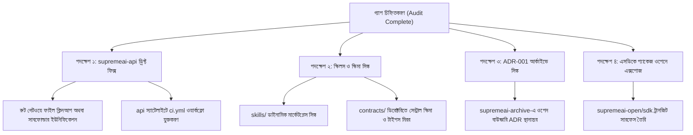

# 🛰️ SupremeAI Federation — Satellite Parity & Gap Audit Report

> **Date:** 2026-10-24  
> **Status:** Completed & Governed  
> **Target Scope:** `Supremeai-bd/supremeai-open` (Public SSOT Hub) ⟷ `Supremeai-bd/supremeai` (Central Monorepo) ⟷ 6 Active Satellite Repositories  
> **Governance SSOT:** [`FEDERATION_CHARTER.md`](./FEDERATION_CHARTER.md) & [`AGENTS.md`](../AGENTS.md)

---

## 1. Executive Summary (নির্বাহী সারসংক্ষেপ)

SupremeAI আর্কিটেকচারে `supremeai-open` হলো সমস্ত কাজের প্রবেশদ্বার (Public Front Door & Task Board) এবং `supremeai` হলো সেন্ট্রাল আমব্রেলা মোনোরিপো। এই দুই রিপোজিটারি থেকে কোড স্বয়ংক্রিয়ভাবে ৬টি সক্রিয় স্যাটেলাইট রিপোজিটারিতে ট্রানজিট হওয়ার কথা। 

আজকের (২৪ অক্টোবর ২০২৬) পূর্ণাঙ্গ হ্যাশ-লেভেল ও ফাইল-ট্রি অডিটে নিম্নলিখিত তথ্য উন্মোচিত হয়েছে:
1. **শতভাগ গ্রিন ও সিঙ্কড স্যাটেলাইট:** `supremeai-studio` (৬৪৩ ফাইল), `supremeai-browser` (৬০ ফাইল) এবং `supremeai-core` (১৪৬ ফাইল) ওপেন ও মোনোরিপোর সাথে শতভাগ প্যারিটিতে রয়েছে।
2. **মারাত্মক ড্রিফ্ট ও গ্যাপ:** `supremeai-api` স্যাটেলাইটের রুট ডিরেক্টরিতে ১১টি ফাইল সম্পূর্ণ মিসিং এবং ৯টি ফাইলের কনটেন্ট পুরনো (যদিও এর ভেতরের `gateway/` সাবফোল্ডার আপডেট হয়েছে)। এছাড়াও ডাইনামিক স্কিলস (`skills/`) ও সেন্ট্রাল স্কিমাস (`api-schemas/`) স্যাটেলাইটে পৌঁছায়নি।
3. **হিস্টোরিক্যাল ADR অসামঞ্জস্য:** `supremeai-archive`-এ কোর ডিসিশন `ADR-001-OPEN_FOUNDATION_BOUNDARY.md` মিসিং।
4. **SDK ডিস্ট্রিবিউশন গ্যাপ:** মোনোরিপোতে পাইথন ও টাইপস্ক্রিপ্ট এসডিকে ক্লায়েন্ট তৈরি থাকলেও তা কোনো স্যাটেলাইট বা পাবলিক সারফেসে ডিস্ট্রিবিউটেড নেই।

---

## 2. Federation Topology & Audit Matrix

| Satellite Repository | Role | Mirror Path in `supremeai-open` | Total Files | Parity Status | Detected Gaps / Action Required |
|---|---|---|---|---|---|
| **`Supremeai-bd/supremeai-studio`** | Web Dashboard (Vercel) | `studio/**` | 643 | **100% PARITY** | কোনো মিসিং ফাইল নেই; সর্বশেষ PR #1010 পর্যন্ত সিঙ্কড। |
| **`Supremeai-bd/supremeai-browser`** | Stealth Automation (Render) | `browser/**` | 60 | **100% PARITY** | কোনো মিসিং ফাইল নেই; PR #982 পর্যন্ত সিঙ্কড। |
| **`Supremeai-bd/supremeai-core`** | Decision Moat (Render) | `core/**` | 146 | **100% PARITY** | কোর প্ল্যানার ও ডেসিশন ইঞ্জিনের ৯টি ফাইল শতভাগ মিলেছে। |
| **`Supremeai-bd/supremeai-api`** | Gateway & MCP Tools (Render) | `gateway/**`, `mcp-control-plane` | 490 | **DRIFT & GAPS** | রুট ফোল্ডারে ১১টি ফাইল মিসিং; ৯টি ফাইল আউটডেটেড; স্কিলস ও স্কিমা গ্যাপ; CI টেস্ট অনুপস্থিত। |
| **`Supremeai-bd/supremeai-vscode`** | Client Hub & Extension | `vscode/**` | 45 | **SATELLITE CLEAN** | স্যাটেলাইট আধুনিক প্যাকেজ স্ট্রাকচারে ক্লিন; কিন্তু সেন্ট্রাল মোনোরিপোর রুটে পুরনো আনক্লিনড ফাইল রয়ে গেছে। |
| **`Supremeai-bd/supremeai-archive`** | Append-only Memory & ADRs | `docs/adrs/**` | 57 | **MISSING ADR** | ওপেন ফাউন্ডেশনের `ADR-001` মিসিং; কোনো অখণ্ডতা সিআই ওয়ার্কফ্লো নেই। |

---

## 3. Deep Dive: Discrepancies by Satellite

### 3.1. `Supremeai-bd/supremeai-api`

#### ক. Dual Gateway Root Drift (রুট ডিরেক্টরি অসঙ্গতি)
`supremeai-open/gateway/`-এর ফাইলগুলো যখন স্যাটেলাইটে সিঙ্ক হয়েছে, তা স্যাটেলাইটের `gateway/` সাবফোল্ডারে প্লেস হয়েছে। কিন্তু স্যাটেলাইটের **রুটে (`/`)** এখনো পুরনো ফাইলের অবশিষ্টাংশ রয়ে গেছে:
* **সম্পূর্ণ মিসিং ফাইল (১১টি):**
  1. `masking.py` — সংবেদনশীল ডেটা ও প্রম্পট মাস্কিং লজিক।
  2. `sanitization.py` — ইনপুট স্যানিটাইজার ও প্রম্পট ইনজেকশন ডিফেন্স।
  3. `security.py` — এডমিন কি অথেনটিকেশন ও সিগনেচার ভেরিফিকেশন।
  4. `SYSTEM_CHAT_AND_DEPLOYMENT_ARCHITECTURE.md` — আর্কিটেকচার স্পেক।
  5. `LICENSE` — প্রোপাইটারি লাইসেন্স ফাইল।
  6. `__init__.py`
  7. `tests/test_branding.py`
  8. `tests/test_model_cascades.py`
  9. `tests/test_reply_path_guards.py`
  10. `tests/test_stealth_dns_guards.py`
  11. `tests/test_storage_and_endpoints.py`
* **আউটডেটেড ফাইল (৯টি):**
  * `main.py` (ওপেন সাইজ: ৩৮.৮ KB, স্যাটেলাইট রুট সাইজ: ৩৫.৪ KB)
  * `admin_auth.py` (ওপেন সাইজ: ১২.৩ KB, স্যাটেলাইট রুট সাইজ: ১১.৪ KB)
  * `config.py`, `memory.py`, `provider_chain.py`, `requirements.txt`, `routing_policy.json`, `tests/test_admin_auth.py`, `README.md`।
* **প্রভাব:** প্রোডাকশন ডকার ইমেজে `service.app:app` ব্যবহৃত হলেও রুটের পুরনো কোডবেজ কনফিউশন ও টেকনিক্যাল ডেব্ট তৈরি করছে।

#### খ. Dynamic Skills Engine & Marketplace (`skills/`)
সেন্ট্রাল মোনোরিপো `supremeai/skills/`-এ ৭টি ডাইনামিক টুল ও মার্কেটপ্লেস হ্যান্ডলার রয়েছে যা স্যাটেলাইট `supremeai-api`-তে নেই:
1. `skills/dynamic/csv_exporter.py`
2. `skills/dynamic/text_summarizer.py`
3. `skills/dynamic/web_scraper.py`
4. `skills/installer.py`
5. `skills/marketplace.py`
6. `skills/registry.py`
7. `skills/schema.py`

#### গ. Firebase MCP Tooling (`infrastructure/mcp-control-plane/`)
মোনোরিপো `infrastructure/mcp-control-plane/`-এ Firebase-এর টুল ও অ্যাডাপ্টার রয়েছে, যা `supremeai-api/mcp/`-এ স্থানান্তরিত হয়নি:
1. `src/adapters/firebase/index.ts`
2. `src/tools/firebase.tools.ts`

#### ঘ. Central API Schemas & Generated Types (`api-schemas/`)
`supremeai-open/api-schemas/`-এর ১৯টি স্কিমা ও টাইপ স্যাটেলাইটের `contracts/`-এ অনুপস্থিত:
* `generated/gateway.types.ts` & `generated/gateway_types.py`
* `heartbeat.schema.json`
* `rate-limit.schema.json`
* `task-router.schema.json`
* `telemetry-log.schema.json`
* `websocket-events.schema.json`
* `guardian-evaluation.schema.json`
* `context-assembly.schema.json`
* `federated-ci-failure.schema.json`

#### ঙ. CI টেস্ট ও অটোমেশন অনুপস্থিতি
* স্যাটেলাইট `supremeai-api`-তে শুধুমাত্র `.github/workflows/secret-scan.yml` রয়েছে। গেটওয়ে ও সার্ভিসের টেস্ট রান করার কোনো টেস্ট পাইপলাইন (`ci.yml`) নেই।

---

### 3.2. `Supremeai-bd/supremeai-archive`

* **মিসিং ADR:** [`docs/adrs/ADR-001-OPEN_FOUNDATION_BOUNDARY.md`](./adrs/ADR-001-OPEN_FOUNDATION_BOUNDARY.md) ওপেন ও মোনোরিপোতে আছে, কিন্তু স্যাটেলাইট `supremeai-archive/adrs/`-এ নেই (সেখানে শুধু ADR-001 থেকে 007 ভিন্ন টপিকের ওপর সংরক্ষিত)।
* **সিআই গেট:** আর্কাইভের অখণ্ডতা, লিংক চেকিং ও মার্কডাউন লিন্টিংয়ের জন্য কোনো গভার্নেন্স সিআই পাইপলাইন নেই।

---

### 3.3. `Supremeai-bd/supremeai-vscode` ও মোনোরিপোর অসামঞ্জস্য

* স্যাটেলাইট `supremeai-vscode` আধুনিক মাল্টি-প্যাকেজ স্ট্রাকচারে বিভক্ত (`extension/`, `desktop/`, `mobile/`) এবং এটি `supremeai-open/vscode`-এর সাথে শতভাগ সামঞ্জস্যপূর্ণ।
* **মোনোরিপোর লিগ্যাসি রেসিডিউ:** মোনোরিপো `supremeai/vscode/`-এর রুটে পুরনো রিফ্যাক্টরিং-পূর্ববর্তী অবশিষ্ট ফাইল থেকে গেছে:
  * `vscode/src/` (পুরনো রুট সোর্স)
  * `vscode/media/chat.svg`
  * `vscode/tsconfig.json`
  * `vscode/.vscodeignore`
  এগুলো মোনোরিপো থেকে ক্লিন করা প্রয়োজন।

---

### 3.4. SDK Packages (পাইথন ও টাইপস্ক্রিপ্ট ক্লায়েন্ট)

* মোনোরিপো `supremeai/sdk/`-এ পাইথন ও টাইপস্ক্রিপ্ট ক্লায়েন্ট লাইব্রেরি রয়েছে:
  * `sdk/python/` (`pyproject.toml`, টেস্ট ও ক্লায়েন্ট)
  * `sdk/typescript/` (`package.json`, `client.ts`, `streaming.ts`, `types/`)
* **গ্যাপ:** এক্সটার্নাল ডেভেলপার বা স্যাটেলাইটের কনজিউমারদের জন্য এই এসডিকে লাইব্রেরিগুলো ওপেন ফাউন্ডেশনে বা এনপিএম/পিপ-এ বিতরণের ব্যবস্থা নেই।

---

## 4. Remediation Action Plan (সমাধানের রোডম্যাপ)

### সুনির্দিষ্ট সুপারিশসমূহ:
1. **API স্যাটেলাইট রুট ক্লিনআপ:** `supremeai-api`-এর রুটে থাকা পুরনো `main.py`, `config.py` আপডেট করা অথবা আর্কিটেকচার স্পেক অনুযায়ী শুধুমাত্র `service/` এবং `gateway/`-কে স্পষ্ট এন্ট্রি পয়েন্ট হিসেবে সংজ্ঞায়িত করা।
2. **CI Pipeline যুক্তকরণ:** `supremeai-api`-তে একটি পূর্ণাঙ্গ `ci.yml` যুক্ত করা যা প্রতিটি পিআরে `pytest tests/` এবং `gateway/tests/` রান করবে।
3. **স্কিলস ও স্কিমা পোর্ট:** সেন্ট্রাল মোনোরিপো থেকে মিসিং ৭টি স্কিল ফাইল এবং `api-schemas/` ফাইলগুলোকে স্যাটেলাইটের `contracts/` ও `skills/`-এ সিঙ্ক করা।
4. **ADR-001 আর্কাইভে সংরক্ষণ:** `ADR-001-OPEN_FOUNDATION_BOUNDARY.md` ফাইলটি `Supremeai-bd/supremeai-archive`-এ পুশ করা।
5. **মোনোরিপো VS Code আনক্লিনড ফাইল প্রুন:** `supremeai/vscode/src/` ও আনুষঙ্গিক পুরনো রুট ফাইলগুলো মোনোরিপো থেকে সরিয়ে ফেলা।
