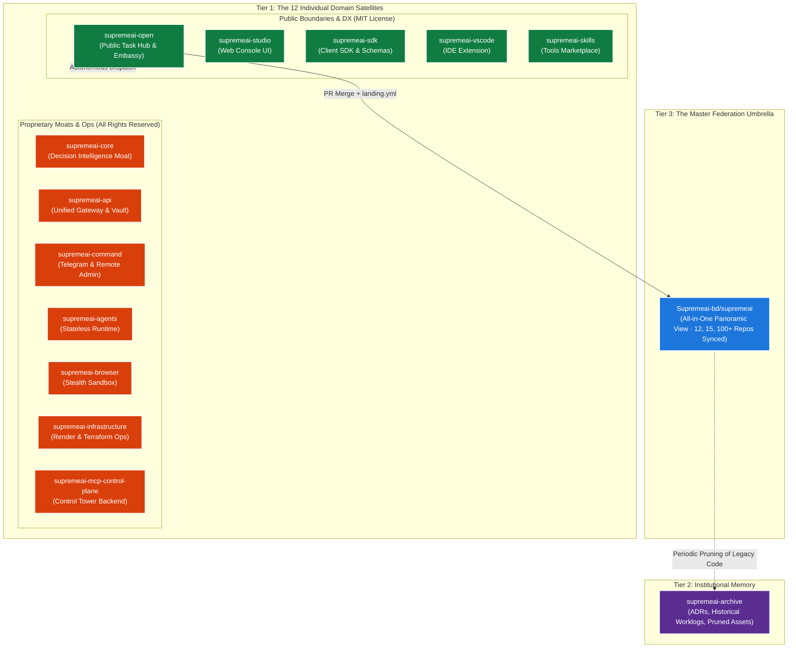

# SupremeAI Federation Taxonomy, Repository Architecture & Licensing SSOT

> **Canonical SSOT for SupremeAI Federation Topology**  
> **Host Repository:** [`Supremeai-bd/supremeai-open`](https://github.com/Supremeai-bd/supremeai-open)  
> **Status:** Active Standard · **Enforced by:** Federation Charter (#626) & Ingress Guards

---

## 1. Architectural Philosophy: The Three-Tier Federation Model

Calling the root repository `supremeai` simply a "core monorepo" is a misnomer. In the SupremeAI architecture, the decision intelligence is isolated in **`supremeai-core`**, while **`supremeai`** functions as the **Grand Federation Umbrella**:



---

## 2. Definitive Repository Directory & Licensing Matrix

| # | Repository | Tier | Visibility | License | Core Responsibility |
|---|---|---|---|---|---|
| 1 | **`supremeai-open`** | Tier 1 (Satellite) | **Public** | **MIT** | **Public Embassy & Task SSOT:** The single front door for all tasks, CI alerts, issues, and contributor PRs. |
| 2 | **`supremeai-studio`** | Tier 1 (Satellite) | **Public** | **MIT** | **Web Experience & Dashboard:** React/Vite live console for end-users and developers. |
| 3 | **`supremeai-sdk`** | Tier 1 (Satellite) | **Public** | **MIT** | **Client Contracts & Packages:** Type definitions, client SDKs (`pip`/`npm`) for seamless ecosystem adoption. |
| 4 | **`supremeai-vscode`** | Tier 1 (Satellite) | **Public** | **MIT** | **Developer Experience:** Official extension bringing autonomous agent pairing to the IDE. |
| 5 | **`supremeai-skills`** | Tier 1 (Satellite) | **Public** | **MIT** | **Capability Marketplace:** Community and agent tools, skill manifests, and dynamic extensions. |
| 6 | **`supremeai-core`** | Tier 1 (Satellite) | **Private** | **Proprietary** | **The Decision Moat:** Core planning, reasoning algorithms, execution intelligence, and orchestration models. |
| 7 | **`supremeai-api`** | Tier 1 (Satellite) | **Private** | **Proprietary** | **Unified Provider Gateway:** Key vault, multi-LLM routing, fallback chains, rate limiting, and cloaked air-gap. |
| 8 | **`supremeai-command`** | Tier 1 (Satellite) | **Private** | **Proprietary** | **Omnichannel Admin Dispatcher:** Telegram bot, webhook triggers, emergency halts, and remote control. |
| 9 | **`supremeai-agents`** | Tier 1 (Satellite) | **Private** | **Proprietary** | **Autonomous Agent Runtime:** Stateless agent worker harnesses, execution loops, and lifecycle hooks. |
| 10 | **`supremeai-browser`** | Tier 1 (Satellite) | **Private** | **Proprietary** | **Stealth Automation Sandbox:** High-fidelity anti-detect browser sandbox and scraping engine. |
| 11 | **`supremeai-infrastructure`** | Tier 1 (Satellite) | **Private** | **Proprietary** | **Cloud Operations:** Terraform blueprints, Cloudflare Workers, Render deployment configurations, and DR scripts. |
| 12 | **`supremeai-mcp-control-plane`** | Tier 1 (Satellite) | **Private** | **Proprietary** | **Governed Tool Plane:** MCP Tower backend, RBAC policy enforcement, JIT token leases, and the autonomy kill-switch. |
| 13 | **`supremeai-archive`** | Tier 2 (Memory) | **Private** | **Proprietary** | **Institutional Memory:** Append-only archive of ADRs, design decisions, retired legacy code, and milestone history. |
| 14 | **`supremeai`** | Tier 3 (Umbrella) | **Private** | **Proprietary** | **The Grand Federation Umbrella:** Master synchronization anchor unifying 12, 15, or 100+ repositories into one panoramic view. |

---

## 3. The 3 Core Architectural Invariants

### 3.1 `supremeai` (Umbrella) vs `supremeai-core` (Moat)
- **`supremeai-core`** contains the actual decision algorithms, logic, and planning intelligence.
- **`supremeai`** is the master aggregation hub. When leadership, auditors, or central CI need to see the entire platform synthesized together in one coherent state, `supremeai` provides that unified panoramic view.

### 3.2 Single Public Door & Zero Satellite Residue
- External contributors, autonomous AI agents (Claude, Cursor, Antigravity), and web bots enter exclusively via **`Supremeai-bd/supremeai-open`**.
- All 12 satellite repositories enforce the **Zero-Issue / Zero-PR Mandate** ([`FEDERATION_CHARTER.md`](./FEDERATION_CHARTER.md)).
- Contributors edit matching domain folders inside `supremeai-open` (`studio/`, `command/`, `core/`, `vscode/`, etc.). On merge into `main`, `landing.yml` automatically dispatches the changes to the target satellite repo and prunes ephemeral transit artifacts.

### 3.3 Boundary Security & Air-Gapping
- Non-admin agents cannot view `supremeai` (core monorepo) or `supremeai-api` (provider gateway).
- `supremeai-api` operates under **Ghost Cloaking** — non-admin MCP callers receive `Repository not found: 'supremeai-api'`, completely air-gapping the provider key vault from external inspection.

### 3.4 Decoupled Operations: Zero-Workload Passive Umbrella Mandate
`Supremeai-bd/supremeai` executes **zero active CI workloads, zero nightly cron jobs, and zero operational dependencies**:
- **Self-Contained Satellites:** Each of the 12 satellite repositories runs its own builds, unit tests, and CI/CD pipelines in total independence. No satellite depends on `supremeai` to test, deploy, or validate itself.
- **Ingress Telemetry:** Any federation-wide cross-satellite telemetry or health checks run exclusively through `supremeai-open` (the public front desk).
- **Pure Passive Master Mirror:** `supremeai` is strictly a passive, read-only panoramic mirror that receives mirror commits on merge to give an aggregated snapshot of the entire federation. No active workflows or scheduled cron jobs run on `supremeai`.

---

## 4. Standard Proprietary License Notice

All private repositories (`supremeai`, `supremeai-core`, `supremeai-api`, `supremeai-command`, `supremeai-agents`, `supremeai-browser`, `supremeai-infrastructure`, `supremeai-mcp-control-plane`, `supremeai-archive`) carry the canonical proprietary notice:

```text
Copyright (c) 2026 SupremeAI. All rights reserved.

This source code, documentation, workflows, and related intellectual property assets 
are proprietary and confidential to SupremeAI.

Unauthorized copying, modification, reverse engineering, decompilation, distribution, 
sublicensing, or publishing of this software, in whole or in part, via any medium, 
is strictly prohibited without prior written permission from SupremeAI.
```
