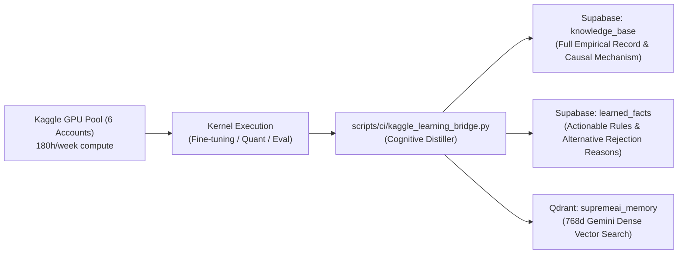

# Kaggle Intelligent Learning Bridge — Empirical ML to System Brain

## 1. Overview & Strategy

SupremeAI maintains a 6-account pool of Kaggle credentials (`KAGGLE_API_TOKENS`), providing access to **180 hours/week of free GPU (T4 / P100)** compute. 

Previously, this pool was only checked for liveness (`misc.kaggle`). With the **Kaggle Intelligent Learning Bridge**, the platform actively launches empirical experiments, fine-tuning evaluations, and quant benchmarks, and directly distills the causal **"WHY"** behind empirical findings into our long-term learning memory.

## 2. Core Philosophy: Learning "WHY", Not Just "WHAT"

Typical ML loggers store shallow metrics: `loss: 0.24`, `accuracy: 89%`. This provides zero architectural intuition for autonomous agents.

The Kaggle Learning Bridge enforces **Causal Cognitive Distillation**:
1. **Hypothesis Tested:** What specific architectural trade-off was evaluated.
2. **Causal Mechanism (Why It Worked):** The foundational reason the approach succeeded (e.g., preserving base representation in Q/K projections while avoiding rank collapse in MLP layers).
3. **Why Alternatives Failed:** Specific empirical reasons other hyperparameters, architectures, or prompt formats failed (counter-factual learning).
4. **Anti-Patterns Discovered:** Dangerous gotchas (e.g. gradient explosion when unfreezing embeddings on small token sets).
5. **Actionable Heuristics for Agents:** Permanent rules injected into agent system memory to guide code generation and architecture choices.

## 3. Storage & Memory Ingestion Pipeline



## 4. MCP Tools & CLI Interface

### Control Tower MCP Tools:
- `misc.kaggle`: Authenticated health check across pool.
- `misc.kaggle_push_kernel`: Push Python script or notebook to Kaggle GPU pool with automated authentication rotation.
- `misc.kaggle_kernel_status`: Monitor execution status, error logs, and completion states.

### Autonomous Bridge Script:
```bash
# Offline self-test
python scripts/ci/kaggle_learning_bridge.py --self-test

# Distill and ingest experimental results
python scripts/ci/kaggle_learning_bridge.py --ingest-file results.json

# Trigger kernel run
python scripts/ci/kaggle_learning_bridge.py --trigger --username <user> --slug <slug> --code-file <script.py>
```
