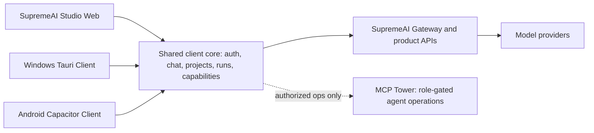

# SupremeAI Desktop ও Android App: পণ্য ও বাস্তবায়ন পরিকল্পনা

## সিদ্ধান্ত

SupremeAI-এর জন্য আলাদা, বিচ্ছিন্ন AI app না বানিয়ে বর্তমান web experience-কে কেন্দ্র করে দুটি companion client তৈরি করা উচিত: Windows-এ একটি পূর্ণ **AI Workstation**, আর Android-এ **AI Companion**—যেটি chat, capture, voice, চলমান কাজ দেখা এবং জরুরি agent supervision সহজ করবে। দুটোতেই একই SupremeAI account, conversation, project, gateway ও permission model থাকবে।

“বিশ্বের সেরা AI app-এর সব feature” একসঙ্গে নকল করাই লক্ষ্য নয়। বরং ব্যবহারকারীর কাছে ভালো AI মানে হবে: কাজ শুরু করা সহজ; আগের context হারায় না; উপযুক্ত model বেছে বা auto-route করতে পারে; research করলে উৎস দেখায়; voice/file/web কাজের সময় নিয়ন্ত্রণ ব্যবহারকারীর হাতে থাকে; এবং app না চললে বা upstream model ব্যর্থ হলে পরিষ্কারভাবে জানায়। পাঁচটি leading assistant-এর official documentation-এ cross-device continuity, project context, native quick-entry, multimodal input, inspectable research ও privacy controls বারবার দেখা যায়—কিন্তু platform ও plan অনুযায়ী feature আলাদা।[26] [27] [28] [30] [32] [33] [36] [38] [39] [40] [43] [44] [45] [48] [49] [50]

## SupremeAI-তে ইতিমধ্যে কী আছে

Studio-র React/Vite source-এ guest chat, account workspace, conversation history, `Supreme Auto`, `Reasoning Pro` ও `Fast Chat` mode, split workspace, Browser Preview, Mobile Simulator এবং Jarvis voice/Holo experience-এর route বা component দেখা যায়। Public surface-এ Files, Tools, Runs ও Workspace-এর প্রবেশপথ আছে। Workspace route registry-তে Projects, Files, Runs, Deep Research, Scheduled Tasks, Prompt Library, sharing, activity, settings এবং BYOK-এর পথ রয়েছে। Route বা dependency উপস্থিত থাকা মানেই feature-টি production-ready—এমন ধরে নেওয়া যাবে না; প্রতিটি flow backend ও integration test-এ যাচাই করতে হবে।[2] [3] [4] [5] [6]

Project README SupremeAI-কে React/Vite Studio এবং OpenAI-compatible multi-provider Gateway-সহ federation হিসেবে বর্ণনা করে। Provider credential server-side রাখার নীতি আছে; mobile বা desktop binary-তে vendor API key রাখা উচিত নয়।[1]

Native client hub-এ `extension`, `desktop` ও `mobile` workspace এবং build scripts আছে। Desktop package Tauri v2 ব্যবহার করে; Mobile package React/Vite ও Capacitor 6 ব্যবহার করে। এগুলো valuable starting points, কিন্তু বর্তমান status production app নয়। Desktop-এর `build` script শুধু TypeScript compile করে, অথচ Tauri config `../dist` frontend আশা করে এবং `npm run build`-কে frontend build হিসেবে ডাকে। Tauri config-এ icon list খালি। Native `secure_get/set/remove` command-গুলো placeholder: get সবসময় `None`, set/remove কোনো storage-এ লেখে না।[7] [8] [9] [10] [11]

Android package-এ Capacitor config ও `com.supremeai.mobile` identifier আছে; README-তে companion/supervisor লক্ষ্য বর্ণিত। কিন্তু `src/App.tsx` বর্তমানে React screen নয়—status interface ও string-returning helper; BottomNav component-এ Chat, Runs, Agents, Inbox, More tab-এর খসড়া আছে, তবে app flow হিসেবে wiring প্রমাণিত নয়। Repository view-তে Android Studio project directory-ও দেখা যায়নি। তাই বর্তমানে buildable APK আছে—এ দাবি করা যাচ্ছে না।[12] [13] [14] [15] [16]

**প্রথম কাজের acceptance condition:** reproducible Windows installer এবং install/run করা যায় এমন Android debug build হাতে না আসা পর্যন্ত store launch বা feature parity-র প্রতিশ্রুতি নয়।[8] [9] [10] [11] [12] [13] [15]

## পণ্যের অভিজ্ঞতা

### Windows AI Workstation

মূল window হবে workspace-কেন্দ্রিক: বাঁ পাশে conversation ও project navigation; মাঝখানে chat; ডানে context অনুযায়ী file, research report, generated artifact বা run status দেখা যাবে। ব্যবহারকারী চাইলে Chat Focused view-তে ডান পাশ গুটিয়ে নিতে পারবেন। বিদ্যমান split studio, code output, browser/mobile preview এবং conversation history এই workstation-এর ভিত্তি হতে পারে।[5] [6]

Desktop-এর নিজস্ব সুবিধা হবে configurable global shortcut দিয়ে quick ask, system tray, native notification, drag-and-drop file intake, একাধিক window এবং keyboard navigation। Quick panel থেকে প্রশ্ন শুরু করলে সেটি পূর্ণ conversation-এ হারিয়ে যাবে না—একই conversation ID-তে চলবে। Local file/folder access কেবল নির্দিষ্ট কাজের জন্য user consent-সহ হবে। শুরুতে arbitrary shell command বা unattended local agent execution চালু করা উচিত নয়।

### Android AI Companion

Android-এর home screen বা share sheet থেকে দ্রুত প্রশ্ন, ছবি বা link পাঠানোর পথ থাকবে। App খুললে মূলত Chat, Projects, Runs, Inbox এবং More—এই সরল navigation থাকবে; Agent controls admin/authorized account-এ সীমাবদ্ধ থাকবে। একই account-এ পুরোনো conversation ও project পুনরায় খোলা যাবে। Camera, microphone, file picker ও notification permission চাওয়ার আগে app কেন অনুমতি চাইছে তা বোঝাবে।[13] [14] [15] [16] [32] [38] [44]

Android-এ user task সম্পূর্ণ করাই প্রথম লক্ষ্য; desktop-এর ভারী split editor ছোট পর্দায় হুবহু বসানো নয়। Generated code বা document দেখা যাবে, কিন্তু বড় edit, terminal, local folder ও multi-pane কাজ desktop-এ চালিয়ে যাওয়ার পরিষ্কার handoff থাকবে।

### একই কথোপকথনে বহু modality

Text, voice dictation, spoken answer এবং অনুমোদিত image/file input একই conversation context-এ চলবে। Live voice, image, audio বা video support model/gateway অনুযায়ী না থাকলে UI স্পষ্টভাবে বলবে; কেবল icon দেখিয়ে feature আছে—এমন ধারণা তৈরি করবে না। ChatGPT, Claude, Gemini এবং Copilot-এর official docs voice বা multimodal use দেখায়, কিন্তু availability, usage, plan, region ও modality-ভেদে সীমা আলাদা।[27] [29] [33] [38] [39] [51]

### Project ও context

Project-এ chats, uploaded reference files, scoped instructions, saved outputs এবং project-specific history রাখা হবে। কোন project context AI পেয়েছে তা response বা composer-এর কাছে দেখা যাবে। Guest chat থেকে account-এ গেলে user-এর স্পষ্ট সম্মতি নিয়ে প্রয়োজনীয় conversation import হবে। Temporary chat/history off এবং persistent project আলাদা আচরণ করবে। ChatGPT, Claude ও Perplexity-র project documentation-এ chats, files, instructions বা connectors-কে পুনর্ব্যবহারযোগ্য project context হিসেবে গুছিয়ে রাখার pattern দেখা যায়; SupremeAI-তে সেটি gateway-নিরপেক্ষভাবে প্রয়োগ করা যায়।[28] [35] [36] [45]

### Research ও generated output

`Deep Research`-কে ordinary chat থেকে আলাদা workflow হিসেবে সাজানো উচিত: প্রশ্ন ও উৎস নির্বাচন, research plan দেখা/পরিবর্তন, চলমান কাজের progress, pause/cancel, report-এ citations/source links, export এবং কাজ শেষ হলে opt-in notification। বিদ্যমান `/research`, `/runs` ও artifact/preview path যাচাই করে একই job ID-তে desktop এবং Android থেকে resume করতে হবে। ChatGPT ও Gemini-র official docs পরিকল্পনা, progress, source/context এবং report export-এর মতো inspectable workflow দেখায়।[4] [30] [40]

Generated code, writing বা structured answer হলে desktop-এ artifact pane ও browser preview দেখাবে; mobile-এ readable preview, share/export এবং desktop-এ continue action থাকবে। Web Studio-র Browser Preview/Mobile Simulator logic-কে reuse করাই নতুন native editor তৈরির চেয়ে কম ঝুঁকির পথ।[5]

### Agent activity ও control

`Runs`/`Inbox`-এ চলমান বা সম্পন্ন কাজ, role, status, source issue এবং ফলাফল দেখা যাবে। `ecosystem-scout`, `human-eye`, `rules-breaker`, `platform-guardian`-এর findings mobile-এ digest/notification হিসেবে আসতে পারে। তবে permissioned approval বা জরুরি control-ই কেবল admin/authorized user-কে দেখাতে হবে। Stop, kill switch, failover এবং infrastructure mutation-এর মতো operation-এ server-side RBAC, স্পষ্ট confirmation, audit record ও post-action status আবশ্যক। Push notification-এ prompt/file content নয়, কেবল সীমিত event metadata থাকবে।

## সুপারিশকৃত প্রযুক্তিগত কাঠামো

**Windows-এর জন্য Tauri v2 রাখুন। Android-এর জন্য বর্তমান Capacitor package-কে একটিমাত্র mobile stack হিসেবে পরিণত করুন।** দুই client-এ shared design tokens, typed API client, auth/session, conversation schema, model capability map ও run-state logic ভাগ হবে; screen layout platform-উপযোগী থাকবে। Tauri-ও Android build করতে পারে, কিন্তু এখন Tauri-Mobile এবং Capacitor—দুটি আলাদা Android client একসঙ্গে চালু করলে release, plugin ও QA খরচ বাড়বে। Tauri-র Android পথ পরে পুনর্মূল্যায়ন করা যায়, প্রথম delivery-তে নয়।[7] [8] [12] [17] [20] [21]

Gateway হবে model-generation-এর একমাত্র public client boundary। Client model mode, supported capability, conversation, attachment reference, cancellation ও usage metadata একটি typed schema-তে পাঠাবে। Backend/server হবে project, account history, file permission এবং run status-এর source of truth; desktop ও mobile-এ শুধু bounded local cache থাকবে। Offline অবস্থায় draft ও আগে sync হওয়া history দেখা/লেখা যেতে পারে, কিন্তু প্রথম version-এ offline AI generation দাবি করা হবে না।

MCP Tower-কে সরাসরি unrestricted mobile control plane বানাবেন না। Tower operations আলাদা service/RBAC boundary-তে থাকবে; user token ও server entitlement দিয়ে নির্দিষ্ট status বা action অনুমোদিত হবে। Agent action, model generation এবং file access-এর permission একে অন্যের বিকল্প নয়।

## ধাপে ধাপে বাস্তবায়ন

নিচের সময়সীমা ছোট, পূর্ণকালীন product squad এবং স্থিতিশীল backend contract ধরে প্রাথমিক অনুমান; Phase 0 build spike-পরবর্তী estimate-কে সংশোধন করতে হবে।

### Phase 0 — Foundation ও runnable builds: 1–2 সপ্তাহ

Desktop build pipeline-এ Vite entrypoint/output, Tauri `frontendDist` এবং build command-কে একটি চুক্তিতে মিলিয়ে Windows CI-তে installer তৈরি করুন। `secure_*` stubs-কে OS credential store integration দিয়ে বদলান; icon, updater public key/signing ও release endpoint যাচাই করুন। Android-এ `npx cap add android`-এর মাধ্যমে native project তৈরি/সংরক্ষণ, React entrypoint/router, Android Studio build এবং device install পরীক্ষা করুন। Capacitor 6 dependency-কে Android API 36 target/Gradle compatibility-এর সঙ্গে যাচাই করে প্রয়োজন হলে supported version-এ upgrade করুন।[9] [10] [11] [12] [13] [19] [20] [21] [22] [23]

একটি page/service capability audit-এ কোন web feature desktop/mobile-এ চলবে, কোনটি backend endpoint চায়, কোনটির permission বা entitlement আছে তা নির্ধারণ করুন। Phase শেষের gate হবে: CI থেকে installable desktop build, device-এ চালানো যায় এমন Android debug APK, login, gateway request, error reporting এবং smoke test।

### Phase 1 — Cross-device chat MVP: 3–6 সপ্তাহ

দুই app-এ sign-in/guest entry, unified streaming chat, stop/regenerate, `Supreme Auto`/`Fast Chat`/`Reasoning Pro`, server-backed history, project list, share/export এবং settings চালু করুন। Web থেকে শুরু করা chat desktop ও Android-এ resume করা এবং mobile থেকে পাঠানো chat web-এ দেখা—এই round-trip integration test বাধ্যতামূলক হবে। Guest-to-account conversion-এ state হারাবে না।

Android-এ attachment picker, camera image, dictation এবং safe-area/back navigation যোগ করুন। Desktop-এ hotkey, tray, notification ও full-window handoff যোগ করুন। প্রথম beta-তে file type/size/capability backend support দিয়ে সীমাবদ্ধ রাখুন।[5] [6] [26] [27] [31] [33] [38] [43] [44] [48] [49]

### Phase 2 — Projects, research ও runs: 7–10 সপ্তাহ

Project instructions/files, per-project context indicator, conversation search, file summary, share links এবং Deep Research job lifecycle যোগ করুন। Research output-এ citation source যাচাইয়ের affordance থাকবে। Runs ও agent status দুই client-এ দেখাবে; mobile notification থেকে সংশ্লিষ্ট run-এ deep-link করা যাবে। Approve/stop action server-এর role policy মানবে এবং প্রতিটি action log হবে।

Desktop-এ Browser Preview, artifacts এবং split workspace polish করুন। Android-এ report reader, voice playback, share/export ও run inbox-এ ফোকাস করুন। জটিল editor বা terminal mobile-এ বানানো এই phase-এর লক্ষ্য নয়।[4] [5] [6] [28] [30] [35] [39] [40] [45] [50]

### Phase 3 — Native polish ও public beta: 11–14 সপ্তাহ

Accessibility, localization, privacy controls, low-bandwidth mode, resume/retry, signed update, crash reporting, release automation ও security review সম্পূর্ণ করুন। Bengali এবং English—দুই ভাষায় input/display, font, date/number formatting, screen reader label ও error state পরীক্ষা করুন। Windows keyboard/screen reader এবং Android TalkBack/large text/touch target দিয়ে usability test চালান।

Beta cohort-এ প্রথমে internal, পরে opt-in users, শেষে staged public release। Research, uploads, voice, notification এবং high-cost model feature entitlement/region/platform অনুযায়ী UI-তে প্রকাশ করুন; supported নয় এমন feature লুকাবেন বা reason দেখাবেন।

## নিরাপত্তা, privacy ও quality gate

- Provider credential কখনো APK, installer, source map, local config বা client log-এ থাকবে না। Auth/session token স্বল্পমেয়াদি হবে; refresh token platform secure storage-এ থাকবে। বর্তমান Tauri secure-store placeholder ঠিক না করা পর্যন্ত credential save feature চালু নয়।[1] [10] [11]
- Local file, clipboard, microphone, camera, notification, global shortcut ও app-startup access আলাদা opt-in permission হবে। Desktop local execution থাকলে folder-scoped, least-privilege sandbox এবং explicit per-run approval ছাড়া arbitrary shell execution নয়।
- User-visible data controls-এ history delete/export, temporary session, memory/context inspect/delete, sign out, device revoke এবং retention explanation থাকবে। AI training, history retention ও project access আলাদা controls হিসেবে লিখতে হবে; competitor policy SupremeAI-র policy নয়। ChatGPT, Gemini ও Copilot-এর documentation দেখায় history, temporary chat, activity, voice data এবং personal/work account-এর handling ভিন্ন হতে পারে।[31] [37] [42] [51] [53]
- Research citations, attachment permission, model/mode, usage/limit ও job state যাচাইযোগ্য হবে। Upstream failure-এ ভুল “successful” state নয়; retry idempotent, cancel কার্যকর এবং background run পুনরায় খোলা যাবে।
- Privacy-preserving telemetry-তে crash, performance, sync failure ও task success মাপুন; conversation content সংগ্রহের জন্য আলাদা, স্পষ্ট opt-in ছাড়া content telemetry নয়।

## Release ও Android APK পরিকল্পনা

Windows build Windows CI runner-এ Tauri CLI দিয়ে `.msi` বা NSIS `-setup.exe` তৈরি করবে। Windows installer-এর জন্য WebView2 runtime strategy এবং code-signing certificate ঠিক করতে হবে; update package/signature কীভাবে যাচাই হয় তা release gate হবে। GitHub Releases হবে প্রথম distribution channel; পরে Microsoft Store সিদ্ধান্ত নেওয়া যাবে।[17] [18] [19]

Android-এর জন্য অন্তত দুই artifact রাখুন: Play Console-এর জন্য signed **AAB**, এবং QA/সরাসরি download-এর জন্য signed **APK**। Android App Bundle থেকে Play device-উপযোগী APK তৈরি করে; sideload distribution-এর APK আলাদা করে build/sign/test করতে হবে। 2026-08-31 থেকে নতুন Play app এবং update-কে Android 16/API 36 বা তার বেশি target করতে হবে—অতএব বর্তমান পরিকল্পনায় API 36 release gate। Minimum supported Android API 24 রাখার সম্ভাবনা আছে, তবে Capacitor version, plugin compatibility ও test coverage দিয়ে নিশ্চিত করার পরেই নির্ধারণ করুন। Keystore/upload key CI secret manager-এ থাকবে; Play App Signing-এ upload key ও Play-managed app-signing key আলাদা রাখুন।[20] [21] [22] [23] [24] [25]

Play release-এর আগে package identifier, versionCode increment, icon, privacy policy, Data safety form, permission justification, account deletion flow, signed artifact checksum এবং closed-test feedback সম্পূর্ণ করুন। প্রথম APK-টি বাস্তব Android device-এ install, update, logout/login, offline recovery এবং upgrade path দিয়ে যাচাই করুন।

## সাফল্য কীভাবে মাপবেন

প্রথম release-এর আগে “সব feature আছে” নয়, বরং নিচের ফলাফলগুলো মাপুন: ব্যবহারকারী web-এ শুরু করা chat/project দুই app-এ resume করতে পারে; failed বা cancelled generation-এ duplicate send হয় না; attachment ও research source পরিষ্কারভাবে দেখা যায়; permitted user agent run বুঝতে ও ফিরতে পারে; Android থেকে PDF/image/voice input কয়েকটি ধাপে complete হয়; desktop quick ask main conversation-এ ফেরত যায়।

Beta dashboard-এ crash-free session, successful auth, chat completion/stream abort, p50/p95 first-token time, history sync conflict, file upload failure, push-notification open rate, research completion এবং support-reported security/accessibility issue আলাদা করে দেখুন। Target সংখ্যা production baseline মেপে নির্ধারণ করুন; upstream provider-এর latency-কে client crash বা app error হিসেবে গুলিয়ে ফেলবেন না।

## প্রধান সিদ্ধান্ত ও ঝুঁকি

সবচেয়ে বড় ঝুঁকি হলো native package আছে দেখে deliverable-ready ধরে নেওয়া। প্রথমে build pipeline, real UI, secure storage, Android project ও signing ঠিক করতে হবে। দ্বিতীয় ঝুঁকি হলো project/file/voice/research feature-এর surface route-কে backend guarantee ধরে নেওয়া; capability matrix এবং end-to-end test ছাড়া parity ঘোষণা নয়। তৃতীয় ঝুঁকি হলো mobile app-এ agent “kill switch” যোগ করে সেটিকে সাধারণ chat action-এর সঙ্গে মিশিয়ে ফেলা; এটি server-authorized, role-limited, confirmation-protected control হিসেবে আলাদা থাকবে।

প্রস্তাবিত default হলো: Windows-এ Tauri; Android-এ Capacitor; Gateway-এ provider abstraction; shared account/project model; Google Play-তে AAB এবং direct QA/download-এর জন্য signed APK; offline-এ cached history/drafts, কিন্তু offline AI inference নয়। এই সিদ্ধান্ত Phase 0 build/compatibility spike-এ ব্যর্থ হলে তবেই framework বিকল্প খোলা হবে।

## References

[1]: https://github.com/Supremeai-bd/supremeai-open/blob/main/README.md "SupremeAI Open Foundation README"
[2]: https://github.com/Supremeai-bd/supremeai-open/blob/main/studio/src/App.tsx "SupremeAI Studio application router"
[3]: https://github.com/Supremeai-bd/supremeai-open/blob/main/studio/src/pages/PublicPages.tsx "SupremeAI public pages and capability copy"
[4]: https://github.com/Supremeai-bd/supremeai-open/blob/main/studio/src/routes/workspaceFeatureRoutes.tsx "SupremeAI workspace feature routes"
[5]: https://github.com/Supremeai-bd/supremeai-open/blob/main/studio/src/pages/user/AIStudio.tsx "SupremeAI AI Studio"
[6]: https://github.com/Supremeai-bd/supremeai-open/blob/main/studio/src/components/chat/UnifiedChatPanel.tsx "SupremeAI unified chat panel"
[7]: https://github.com/Supremeai-bd/supremeai-open/blob/main/vscode/package.json "SupremeAI client hub workspace"
[8]: https://github.com/Supremeai-bd/supremeai-open/blob/main/vscode/desktop/package.json "SupremeAI desktop package"
[9]: https://github.com/Supremeai-bd/supremeai-open/blob/main/vscode/desktop/README.md "SupremeAI desktop README"
[10]: https://github.com/Supremeai-bd/supremeai-open/blob/main/vscode/desktop/src-tauri/tauri.conf.json "SupremeAI Tauri configuration"
[11]: https://github.com/Supremeai-bd/supremeai-open/blob/main/vscode/desktop/src-tauri/src/main.rs "SupremeAI Tauri Rust entrypoint"
[12]: https://github.com/Supremeai-bd/supremeai-open/blob/main/vscode/mobile/package.json "SupremeAI mobile package"
[13]: https://github.com/Supremeai-bd/supremeai-open/blob/main/vscode/mobile/capacitor.config.ts "SupremeAI Capacitor configuration"
[14]: https://github.com/Supremeai-bd/supremeai-open/blob/main/vscode/mobile/README.md "SupremeAI mobile README"
[15]: https://github.com/Supremeai-bd/supremeai-open/blob/main/vscode/mobile/src/App.tsx "SupremeAI mobile app source"
[16]: https://github.com/Supremeai-bd/supremeai-open/blob/main/vscode/mobile/src/components/BottomNav.tsx "SupremeAI mobile bottom navigation"
[17]: https://v2.tauri.app/distribute/ "Tauri distribution guide"
[18]: https://v2.tauri.app/distribute/windows-installer/ "Tauri Windows installer guide"
[19]: https://v2.tauri.app/start/prerequisites/ "Tauri system prerequisites"
[20]: https://capacitorjs.com/docs/android "Capacitor Android documentation"
[21]: https://v2.tauri.app/distribute/google-play/ "Tauri Google Play distribution"
[22]: https://v2.tauri.app/distribute/sign/android/ "Tauri Android code signing"
[23]: https://developer.android.com/google/play/requirements/target-sdk "Google Play target API level requirements"
[24]: https://developer.android.com/guide/app-bundle "About Android App Bundles"
[25]: https://developer.android.com/studio/publish/app-signing "Android app signing"
[26]: https://help.openai.com/en/articles/9982051-using-the-chatgpt-windows-app "Using the ChatGPT Windows app"
[27]: https://help.openai.com/en/articles/8142208-chatgpt-ios-and-android-app-faq "ChatGPT iOS and Android app FAQ"
[28]: https://help.openai.com/en/articles/10169521-projects-in-chatgpt "Projects in ChatGPT"
[29]: https://help.openai.com/en/articles/20001274-chatgpt-voice "ChatGPT Voice"
[30]: https://help.openai.com/en/articles/10500283-deep-research-in-chatgpt "Deep research in ChatGPT"
[31]: https://help.openai.com/en/articles/7730893-data-controls-in-chatgpt "Data controls in ChatGPT"
[32]: https://support.anthropic.com/en/articles/10065433-installing-claude-for-desktop "Install Claude Desktop"
[33]: https://support.anthropic.com/en/articles/10534883-using-the-claude-widget-on-android "Use the Claude widget on Android"
[34]: https://support.anthropic.com/en/articles/11101966-using-voice-mode-on-claude-mobile-apps "Use voice mode"
[35]: https://support.anthropic.com/en/articles/10684626-enabling-and-using-web-search "Enable and use web search in Claude"
[36]: https://support.anthropic.com/en/articles/9519177-how-can-i-create-and-manage-projects "Create and manage Claude Projects"
[37]: https://support.anthropic.com/en/articles/11817273-using-claude-s-chat-search-and-memory-to-build-on-previous-context "Claude chat search and memory"
[38]: https://support.google.com/gemini/answer/17171264?hl=en&ref_topic=17122162 "Gemini Apps release updates"
[39]: https://support.google.com/gemini/answer/14554984?hl=en&co=GENIE.Platform%3DAndroid "Get started with the Gemini mobile app"
[40]: https://support.google.com/gemini/answer/15719111?hl=en&co=GENIE.Platform%3DAndroid "Use Deep Research in Gemini Apps on Android"
[41]: https://support.google.com/gemini/answer/13666746?hl=en&co=GENIE.Platform%3DAndroid "Find and manage recent chats in Gemini Apps"
[42]: https://support.google.com/gemini/answer/13278892?hl=en&co=GENIE.Platform%3DAndroid "Manage and delete Gemini activity"
[43]: https://www.perplexity.ai/help-center/en/articles/19800002-get-started "Get started with Perplexity desktop apps"
[44]: https://www.perplexity.ai/help-center/en/articles/10450852-how-to-use-the-perplexity-android-assistant "Use the Perplexity Android Assistant"
[45]: https://www.perplexity.ai/help-center/en/articles/10352961-what-are-projects "What are Perplexity Projects"
[46]: https://www.perplexity.ai/help-center/en/articles/10352901-what-is-perplexity-pro "What is Perplexity Pro"
[47]: https://www.perplexity.ai/help-center/en/articles/10354807-file-uploads "Perplexity file uploads"
[48]: https://support.microsoft.com/en-us/microsoft-365-copilot/what-is-microsoft-copilot-app "Get started with the Microsoft Copilot app"
[49]: https://support.microsoft.com/en-us/microsoft-copilot/conversation-history-in-microsoft-copilot "Conversation history in Microsoft Copilot"
[50]: https://support.microsoft.com/en-us/microsoft-365-copilot/file-upload-in-microsoft-copilot "File upload in Microsoft Copilot"
[51]: https://support.microsoft.com/en-us/microsoft-365-copilot/get-started-with-voice-features-in-microsoft-365-copilot "Voice features in Microsoft Copilot"
[52]: https://support.microsoft.com/en-us/microsoft-copilot/deep-research-in-microsoft-copilot "Deep Research in Microsoft Copilot"
[53]: https://support.microsoft.com/en-us/privacy/microsoft-copilot/privacy-controls "Privacy controls in Microsoft Copilot"
