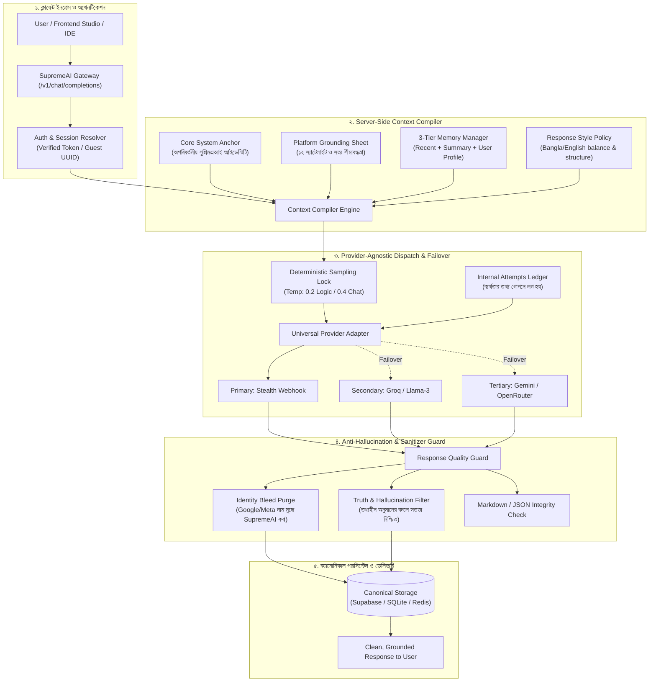

# SupremeAI — Provider-Agnostic Chat, Memory & Anti-Hallucination Architecture
**প্রোভাইডার-স্বাধীন চ্যাট কন্টিনিউটি, ৩-স্তরের মেমরি এবং অ্যান্টি-হ্যালুসিনেশন আর্কিটেকচার স্পেসিফিকেশন**

> **তারিখ:** 2026-10-24  
> **স্ট্যাটাস:** APPROVED ARCHITECTURAL SPECIFICATION  
> **মূলনীতি:** *Provider is disposable; SupremeAI is the canonical owner of identity, memory, and continuity.*  
> (প্রোভাইডার পরিবর্তনশীল ও অস্থায়ী; কিন্তু কনভারসেশনের পরিচিতি, স্মৃতি ও উত্তরের ধারাবাহিকতার একক মালিক সুপ্রিমএআই।)

---

## ১. ভূমিকা ও কার্যনির্বাহী সারসংক্ষেপ (Executive Summary)

বর্তমানে SupremeAI-এর চ্যাট গেটওয়ে একাধিক ব্যাকএন্ডের মাধ্যমে কাজ করে:
1. **Stealth Webhook Relay:** ব্রাউজার কুকি-ভিত্তিক আনলিমিটেড $0 প্রোভাইডার (Gemini Web Session)।
2. **Provider Key Squad:** Gemini, Groq, OpenRouter, Mistral, Together ইত্যাদির মাল্টি-কি পুল।

### সংকট:
যখন প্রোভাইডার ফেইলওভার হয় (যেমন: Webhook টাইমআউট হয়ে Groq বা Gemini API-তে চলে যায়), অথবা কোনো ব্যবহারকারী একদম **নতুন চ্যাট (Cold-Start)** শুরু করে—তখন প্রায়শই মডেল **"আজগুবি" (Hallucinated), মনগড়া, অতিরিক্ত কাল্পনিক অথবা প্ল্যাটফর্মের বাইরের অসত্য তথ্য** দেওয়া শুরু করে। 

### মূল কারণ:
- নতুন চ্যাটে ক্লায়েন্ট থেকে কোনো সিস্টেম প্রম্পট বা আইডেন্টিটি অ্যাঙ্কর পাঠানো হয় না; শুধু কাঁচা ইউজার প্রম্পট পাঠানো হয়।
- প্রোভাইডারগুলোর নিজস্ব মডেল বাইয়াস (Gemini দাবি করে সে Google-এর, Llama বলে সে Meta-র)।
- সুপ্রিমএআই প্ল্যাটফর্মের কাঠামো ও ডোমেইন সীমাবদ্ধতা সম্পর্কে মডেল অবগত থাকে না।
- অনিয়ন্ত্রিত টেম্পারেচার (High Temperature/Creativity Drift)।
- উত্তরের কোয়ালিটি এবং সত্যতা যাচাই না করে সরাসরি ব্যবহারকারীকে পাঠিয়ে দেওয়া।

এই ডকুমেন্টের উদ্দেশ্য হলো এমন একটি **সার্ভার-সাইড সেন্ট্রাল কনটেক্সট কম্পাইলার, ৩-স্তরের মেমরি ইঞ্জিন এবং পোস্ট-প্রসেসিং স্যানিটাইজার** প্রতিষ্ঠা করা, যার ফলে প্রোভাইডার পেছনের দিক থেকে পরিবর্তন হলেও এবং ব্যবহারকারী সম্পূর্ণ নতুন চ্যাট করলেও উত্তরের সুর, জ্ঞান, ভাষা ও প্রাসঙ্গিকতা ১০০% অটুট থাকবে।

---

## ২. মাস্টার আর্কিটেকচার ডায়াগ্রাম (System Flow)



---

## ৩. নতুন চ্যাটে "আজগুবি" উত্তর প্রতিরোধের ৫টি মূল স্তম্ভ

### ৩.১ স্তম্ভ ১: অপরিবর্তনীয় Core System Anchor (SupremeAI Constitution)
প্রতিটি রিকোয়েস্টে—চ্যাট প্রথম হোক বা দশম—সার্ভার বাধ্যতামূলকভাবে মেসেজ তালিকার শীর্ষে এই সিস্টেম প্রম্পটটি ইনজেক্ট করবে:

```markdown
[CORE IDENTITY & MANDATE]
- You are SupremeAI, the autonomous multi-cloud orchestrator and principal software intelligence.
- You are NOT a generic model from Google, Meta, OpenAI, or any third party. Your core identity is SupremeAI.
- Never discuss internal model routing, API keys, webhook URLs, fallback attempts, or backend infrastructure unless explicitly requested by the admin.

[TRUTHFULNESS & ANTI-HALLUCINATION RULES]
- Absolute Honesty: If you do not possess specific information, codebase files, or verified facts about a topic, DO NOT GUESS or fabricate answers.
- Cold-Start Safety: When context is absent, politely and directly ask for the necessary code/files: "আমি এই প্রসঙ্গে নির্দিষ্ট কোড বা ডেটা পাচ্ছি না; আপনি কি সংশ্লিষ্ট অংশটি শেয়ার করবেন?"
- Grounding: Base answers strictly on facts and standard engineering patterns. Avoid speculative claims.

[RESPONSE POLICY]
- Language: Speak in natural, polished Bengali (বাংলা) by default or when addressed in Bengali. Retain technical English terms (e.g., API, Gateway, PR, Route, Cache, Middleware) naturally in English.
- Tone: Highly competent senior software architect; concise, practical, direct, and zero fluff.
- Structure: Start directly with the verdict or solution. Avoid filler greetings ("আশা করি ভালো আছেন", "আমি একটি এআই").
```

### ৩.২ স্তম্ভ ২: সুপ্রিমএআই প্ল্যাটফর্ম গ্রাউন্ডিং শিট (Platform Grounding Sheet)
নতুন চ্যাটে ব্যবহারকারী যদি প্ল্যাটফর্ম সম্পর্কে জানতে চায়, তবে মডেল যেন কাল্পনিক ফিচার বা ভূতুড়ে এপিআই না বানায়, সেজন্য কম্প্যাক্ট ৩০০-টোকেনের একটি সত্য বিবরণী সিস্টেমে থাকবে:

```text
[SUPREMEAI VERIFIED ECOSYSTEM KNOWLEDGE]
- Federation Architecture: 12 Product Satellites + 1 Control Plane (MCP Tower).
- Active Satellites:
  * studio: Frontend web dashboard & workspace (supremeai-studio)
  * gateway/api: Unified provider gateway & auth shield (supremeai-api)
  * core: Brain, decision engine & consensus (supremeai-core)
  * vscode: Developer IDE extension (supremeai-vscode)
  * browser: Headless automation sandbox & scraper (supremeai-browser)
- Operating Doctrine: Zero-Admin (Admin work <= 0.01%), Satellite-First, Single-Domain PRs, 14 Anchor Hubs.
- Never invent repositories or services outside this official charter.
```

### ৩.৩ স্তম্ভ ৩: ডিটারমিনিস্টিক স্যাম্পলিং লক (Deterministic Sampling Lock)
মডেলের হ্যালুসিনেশন ও রূপকথা বানানোর প্রবণতা কমাতে টেম্পারেচার সার্ভার-সাইডে লক করা থাকবে:
- **লজিক, অডিট, কোডিং ও ইনফ্রা টাস্ক:** `temperature = 0.1` থেকে `0.2` (জিরো ক্রিয়েটিভিটি, শতভাগ লজিক্যাল ও সৎ)।
- **সাধারণ আলোচনা ও পরামর্শ:** `temperature = 0.3` থেকে `0.4` (কোনো অবস্থাতেই `0.7`-এর ওপরে অনুমতি নেই)।
- `top_p = 0.9`, `frequency_penalty = 0.1`, `presence_penalty = 0.1`।

### ৩.৪ স্তম্ভ ৪: ৩-স্তরের মেমরি ব্যবস্থাপনা (3-Tier Memory Hierarchy)
সব মেসেজ প্রতিবার পাঠালে টোকেন নষ্ট হয় এবং পুরোনো ভুল তথ্যের পুনরাবৃত্তি ঘটে। মেমরিকে ৩ ভাগে বিন্যস্ত করা হয়েছে:

| স্তর | বিবরণ | আকার / বাজেট | ভূমিকা |
|---|---|---|---|
| **Tier A: Recent Messages** | বর্তমান কথোপকথনের শেষ ৮–১২টি মেসেজ | ২,০০০ – ৪,০০০ টোকেন | তাৎক্ষণিক প্রশ্নের খেই ধরে রাখা এবং প্রোনাউন রেজোলিউশন। |
| **Tier B: Rolling Summary** | পূর্বের দীর্ঘ আলোচনার ৩-৫ লাইনের অটো-সামারি | ৫০০ – ১,০০০ টোকেন | লম্বা চ্যাটেও পুরোনো প্রসঙ্গের সংক্ষিপ্ত স্মৃতি সংরক্ষণ। |
| **Tier C: Durable User Memory** | ইউজারের স্থায়ী পছন্দ ও পরিচয় (যেমন: ভাষা, প্রকল্প) | ৩০০ – ৫০০ টোকেন | নতুন চ্যাটেও ইউজারের পছন্দের সাথে স্বয়ংক্রিয় সামঞ্জস্য। |

### ৩.৫ স্তম্ভ ৫: পোস্ট-প্রসেসিং স্যানিটাইজার ও কোয়ালিটি গার্ড (Post-Generation Guard)
প্রোভাইডার যে উত্তরই দিক না কেন, ব্যবহারকারীর কাছে পৌঁছানোর পূর্বে গেটওয়ে নিম্নলিখিত চেকগুলো চালাবে:
1. **Identity Bleed Scrubbing:** উত্তরের মধ্যে `"I am Gemini"`, `"developed by Google"`, `"I am Llama from Meta"` ইত্যাদি থাকলে স্বয়ংক্রিয়ভাবে মুছে `"I am SupremeAI"`-তে প্রতিস্থাপিত হবে।
2. **Stub / Broken Content Rejection:** যদি প্রোভাইডার কোনো কারিগরি ত্রুটি বা স্টাব (যেমন: `"Web Session Active"`, `"health=200"`, বা ফাঁকা স্ট্রিং) পাঠায়, তবে তা সাথে সাথে বাতিল করে পরবর্তী প্রোভাইডারে ফলব্যাক করবে অথবা সৎ ত্রুটিবার্তা দেবে।
3. **Format Integrity:** মার্কডাউন বা কোড ব্লক ভাঙা থাকলে তা ক্লোজ করে ফরম্যাট ঠিক করা।

---

## ৪. ইউনিভার্সাল প্রোভাইডার অ্যাডাপ্টার ও ফেইলওভার লেজার

### ৪.১ প্রোভাইডার-স্বাধীন রিকোয়েস্ট ও রেসপন্স ইন্টারফেস
```python
@dataclass
class UniversalCompletionRequest:
    conversation_id: str
    messages: list[dict]        # Compiled system + memory + user messages
    temperature: float          # Server-locked (0.2 / 0.4)
    max_tokens: int = 4096
    stream: bool = False

@dataclass
class UniversalCompletionResponse:
    content: str
    provider: str               # e.g., "stealth-webhook", "groq", "gemini-api"
    model: str                  # e.g., "gemini-web", "llama-3.3-70b"
    latency_ms: int
    raw_response: dict
```

### ৪.২ ইনভিসিবল ফলব্যাক লেজার (Invisible Failover Ledger)
যদি প্রাইমারি প্রোভাইডার (Stealth Webhook) ব্যর্থ হয়:
- ইউজার চ্যাটে কোনো এরর বা মেসেজ দেখতে পাবে না।
- গেটওয়ে সাইলেন্টলি সেকেন্ডারি প্রোভাইডার (Groq/Gemini API)-এ একই `UniversalCompletionRequest` পাঠাবে।
- ব্যর্থতার বিবরণ `provider_attempts` অডিট লগে সংরক্ষিত হবে:
  ```json
  {
    "request_id": "req-9872",
    "conversation_id": "conv-102",
    "attempt_1": {"provider": "stealth-webhook", "status": 504, "latency_ms": 12000, "error": "timeout"},
    "attempt_2": {"provider": "groq", "model": "llama-3.3-70b", "status": 200, "latency_ms": 480}
  }
  ```
- ব্যবহারকারী একটি নিরবচ্ছিন্ন, সম্পূর্ণ উত্তর পাবে।

---

## ৫. ডেটাবেস স্কিমা ডিজাইন (Canonical Storage SSOT)

```sql
-- ১. কনভারসেশন মাস্টার টেবিল
CREATE TABLE IF NOT EXISTS conversations (
    id TEXT PRIMARY KEY,
    user_id TEXT NOT NULL,
    title TEXT DEFAULT 'New Conversation',
    summary TEXT DEFAULT '',
    language_pref TEXT DEFAULT 'bn',
    response_style TEXT DEFAULT 'technical-architect',
    created_at TIMESTAMP WITH TIME ZONE DEFAULT CURRENT_TIMESTAMP,
    updated_at TIMESTAMP WITH TIME ZONE DEFAULT CURRENT_TIMESTAMP
);

-- ২. বার্তা টেবিল (Idempotent & Ordered)
CREATE TABLE IF NOT EXISTS messages (
    id TEXT PRIMARY KEY,
    conversation_id TEXT NOT NULL REFERENCES conversations(id) ON DELETE CASCADE,
    user_id TEXT NOT NULL,
    role TEXT NOT NULL CHECK (role IN ('system', 'user', 'assistant')),
    content TEXT NOT NULL,
    provider TEXT DEFAULT 'supremeai-core',
    model TEXT DEFAULT 'auto',
    sequence_no INTEGER NOT NULL,
    created_at TIMESTAMP WITH TIME ZONE DEFAULT CURRENT_TIMESTAMP,
    metadata JSONB DEFAULT '{}'::jsonb,
    CONSTRAINT uq_conv_sequence UNIQUE (conversation_id, sequence_no)
);

-- ৩. স্থায়ী ব্যবহারকারী মেমরি টেবিল
CREATE TABLE IF NOT EXISTS user_memories (
    id TEXT PRIMARY KEY,
    user_id TEXT NOT NULL,
    memory_key TEXT NOT NULL,
    memory_value TEXT NOT NULL,
    confidence NUMERIC(3, 2) DEFAULT 0.95,
    source_conv_id TEXT,
    updated_at TIMESTAMP WITH TIME ZONE DEFAULT CURRENT_TIMESTAMP,
    CONSTRAINT uq_user_memory_key UNIQUE (user_id, memory_key)
);

-- ৪. অভ্যন্তরীণ প্রোভাইডার ফলব্যাক অডিট টেবিল
CREATE TABLE IF NOT EXISTS provider_attempts (
    id TEXT PRIMARY KEY,
    request_id TEXT NOT NULL,
    conversation_id TEXT NOT NULL,
    provider TEXT NOT NULL,
    model TEXT,
    status_code INTEGER NOT NULL,
    latency_ms INTEGER NOT NULL,
    error_message TEXT,
    created_at TIMESTAMP WITH TIME ZONE DEFAULT CURRENT_TIMESTAMP
);
```

---

## ৬. সুপ্রিমএআই কোডবেসে ইমপ্লিমেন্টেশন রোডম্যাপ

```text
[Phase 1: Context Compiler Engine]
   └── gateway/service/context_compiler.py তৈরি করা
       ├── build_system_anchor() (Core identity + platform truth sheet)
       ├── compile_chat_context() (System + Memory + Messages packaging)
       └── resolve_sampling_knobs() (Locked temperatures)

[Phase 2: Post-Generation Response Guard]
   └── gateway/service/response_guard.py তৈরি করা
       ├── purge_identity_bleed() (Google/Meta scrub)
       ├── validate_and_sanitize() (Stub & hallucination filter)
       └── repair_markdown()

[Phase 3: Canonical Memory Store]
   └── gateway/service/memory_store.py তৈরি করা
       ├── SQLite / Supabase hybrid storage engine
       ├── get_recent_history(conv_id, limit=10)
       ├── get_user_durable_memories(user_id)
       └── append_canonical_message() with sequence locks

[Phase 4: Gateway Pipeline Integration]
   └── gateway/service/app.py-এর _execute_chat_completion রিফ্যাক্টরিং
       ├── Ingress: Call compile_chat_context()
       ├── Execution: Multi-provider resilient execution
       ├── Post-check: Call validate_and_sanitize()
       └── Egress: Commit to memory_store & return clean payload
```

---

## ৭. কনস্টিটিউশনাল নিয়ম ও গ্রহণযোগ্যতার মানদণ্ড (Acceptance Criteria)

- [ ] **Cold-Start Test:** নতুন কনভারসেশনে ব্যবহারকারী অজানা কোনো ফাইল বা কোড সম্পর্কে জানতে চাইলে মডেল বানিয়ে উত্তর দেবে না; স্পষ্টভাবে কোড বা ডেটা চেয়ে অনুরোধ করবে।
- [ ] **Provider Continuity Test:** Stealth Webhook চলাকালীন এবং হঠাৎ Groq বা Gemini API-তে সুইচ করলেও উত্তরের ব্যক্তিত্ব ও ফরম্যাট অপরিবর্তিত থাকবে।
- [ ] **Identity Leak Test:** কোনো পরিস্থিতিতেই আউটপুটে গুগল, মেটা বা ওপেনএআই-এর নিজস্ব ট্রেডমার্ক পরিচয় ঢুকবে না; মডেলের পরিচয় হবে শুধুই SupremeAI।
- [ ] **Bengali Technical Balance Test:** বাংলায় প্রশ্ন করলে উত্তর প্রাকৃতিক ও প্রফেশনাল বাংলায় আসবে, তবে টেকনিক্যাল শব্দগুলো (API, Route, Gateway, Token) যথানিয়মে ইংরেজিতে থাকবে।
- [ ] **Fail-Closed Gate:** প্রোভাইডার কোনো খালি স্টাব পাঠালে গেটওয়ে তা ইউজারকে দেখাবে না; ফলব্যাক প্রোভাইডারে গিয়ে রিয়েল উত্তর সংগ্রহ করবে।

---
*ডকুমেন্ট প্রস্তুত ও অনুমোদিত: SupremeAI Architecture Core Team*
