# 🌐 ৩য়-পক্ষ সার্ভিসসমূহের পারস্পরিক সংযোগ আর্কিটেকচার (Interconnection of All 3rd-Party Services)

আমাদের সিস্টেমে ব্যবহৃত সমস্ত থার্ড-পার্টি সার্ভিস একে অপরের সাথে কীভাবে ডেটা, ক্রেডেনশিয়াল এবং ইভেন্ট আদান-প্রদান করে, তার সরাসরি আন্তঃসংযোগ ডায়াগ্রাম।

---

```mermaid
flowchart TD
    %% ========================================================
    %% INFRASTRUCTURE & EDGE
    %% ========================================================
    subgraph EDGE_LAYER [" 🛡️ এজ ও গেটওয়ে নেটওয়ার্ক "]
        CF["Cloudflare<br/>(DDoS Guard / DNS / Edge Proxy)"]
    end

    %% ========================================================
    %% CORE HOSTING & RUNTIMES
    %% ========================================================
    subgraph HOSTING_LAYER [" ☁️ অ্যাপ্লিকেশন ও ব্যাকএন্ড হোস্টিং "]
        Vercel["Vercel<br/>(Studio Frontend UI)"]
        Render["Render<br/>(supremeai-api & MCP Control Tower & Workers)"]
    end

    %% ========================================================
    %% SECRETS VAULT
    %% ========================================================
    subgraph SECURITY_LAYER [" 🔐 সিকিউরিটি ও ক্রেডেনশিয়াল হাব "]
        Infisical["Infisical Vault<br/>(API Keys, DB Credentials, Tokens)"]
    end

    %% ========================================================
    %% AI PROVIDERS (LLM HUB)
    %% ========================================================
    subgraph AI_HUB [" 🤖 AI প্রোভাইডার্স হাব (ai-providers) "]
        direction TB
        Gemini["Google Gemini (Flash / Pro)"]
        Groq["Groq (Llama-3 / Mixtral)"]
        OpenRouter["OpenRouter (Universal Failover)"]
        HuggingFace["Hugging Face (Embeddings / Tokenizers)"]
    end

    %% ========================================================
    %% DATA & MEMORY LAYER
    %% ========================================================
    subgraph DATA_LAYER [" 🗄️ ডেটাবেজ, ক্যাশ ও ভেক্টর স্টোর "]
        Supabase["Supabase (PostgreSQL / Auth / RLS)"]
        Redis["Redis / Upstash (Queue / Quota / Lock)"]
        Qdrant["Qdrant (Semantic Memory & Vectors)"]
        MinIO["MinIO (S3-Compatible Object Store)"]
    end

    %% ========================================================
    %% TOOLS & SPECIALIZED COMPUTE
    %% ========================================================
    subgraph COMPUTE_TOOLS [" ⚙️ বিশেষায়িত টুলস ও স্ক্র্যাপার "]
        Firecrawl["Firecrawl (Web to Markdown Scraper)"]
        Kaggle["Kaggle (GPU/TPU Heavy Training)"]
    end

    %% ========================================================
    %% SOURCE CONTROL & NOTIFICATIONS
    %% ========================================================
    subgraph COLLAB_NOTIFY [" 🐙 সোর্স কন্ট্রোল, মনিটরিং ও অ্যালার্ট "]
        GitHub["GitHub (Repo, Issues, PRs, Actions)"]
        GitLab["GitLab (Secondary Repo Mirror)"]
        Sentry["Sentry (Crash & Error Monitoring)"]
        Telegram["Telegram Bot (Instant Alerts & Audit)"]
    end

    %% ========================================================
    %% INTERCONNECTIONS (Cross-Service Links)
    %% ========================================================
    
    %% Traffic Ingress
    CF --> Vercel
    CF --> Render

    %% Frontend to Backend
    Vercel -->|API Requests| Render

    %% Secrets Injection (One-Way Security)
    Infisical -.->|Injects Keys & Secrets| Render
    Infisical -.->|Injects Client Secrets| Vercel

    %% Render Backend to AI Providers
    Render -->|Inference Call| Gemini
    Render -->|Fast Inference| Groq
    Render -->|Failover Chaining| OpenRouter
    Render -->|Local Embeddings| HuggingFace

    %% Render Backend to Data Layer
    Render <-->|SQL / User Auth| Supabase
    Render <-->|Rate Limit / Task Queue| Redis
    Render <-->|Vector Memory Query| Qdrant
    Render <-->|Artifacts / Media Logs| MinIO

    %% Render to Specialized Tools
    Render -->|Docs Scraping| Firecrawl
    Render -->|Dispatch ML Kernels| Kaggle

    %% Observability & Alerts
    Render -->|Exception Logging| Sentry
    Vercel -->|UI Crash Logging| Sentry
    Render -->|Incident Webhooks| Telegram

    %% Source Control Sync
    GitHub <-->|CI Triggers / Dispatch| Render
    GitHub -->|Mirror Sync| GitLab
```

