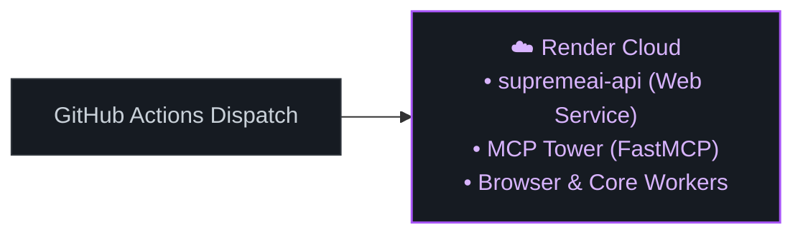

# ☁️ Render ক্লাউড সার্ভিস আর্কিটেকচার

- **ক্যাটাগরি:** Cloud Hosting (Web Services & Background Workers)
- **ব্যবহার:** `supremeai-api`, `MCP Control Tower`, `browser` ও `core` ওয়ার্কার্স হোস্ট করা

