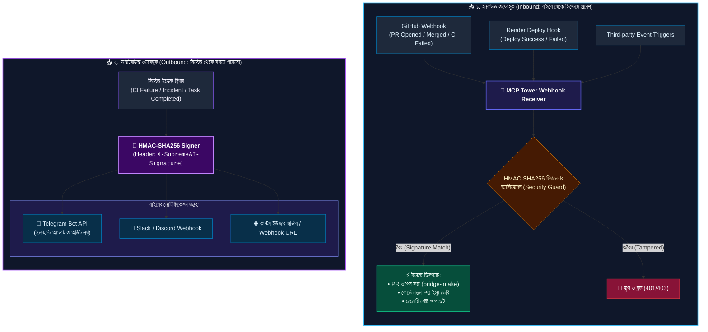

# 🔗 SupremeAI ওয়েবহুক আর্কিটেকচার (Inbound & Outbound Webhook Flow)

আমাদের সিস্টেমে ওয়েবহুক কীভাবে কাজ করে—বাহির থেকে আসা ইভেন্ট (Inbound) এবং আমাদের সিস্টেম থেকে বাহিরে পাঠানো অ্যালার্ট (Outbound)—তার স্পষ্ট ডায়াগ্রাম।

---

