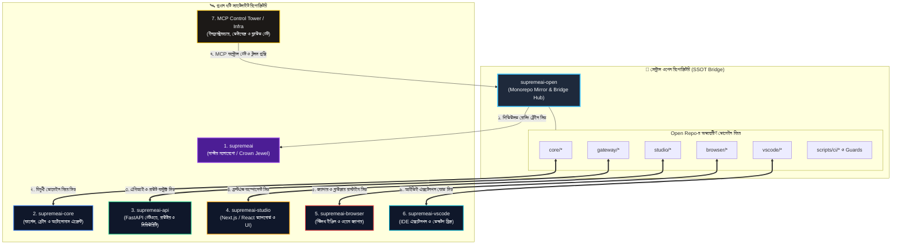

# 🗺️ SupremeAI রিপোজিটরি আর্কিটেকচার ডায়াগ্রাম

এই ফোল্ডারে SupremeAI ইকোসিস্টেমের বিভিন্ন আর্কিটেকচার, ডোমেইন সম্পর্ক এবং সিস্টেম ডিজাইনের ভিজ্যুয়াল ডায়াগ্রামগুলো সংরক্ষিত আছে।

---

## 📑 সূচিপত্র
1. **১. ৭টি প্রধান রিপোজিটরির সাথে supremeai-open এর সম্পর্ক**
2. **২. রিপোজিটরিগুলোর বিস্তারিত ভূমিকা**
3. **৩. ডেটা ফ্লো ও সিঙ্ক মেকানিজম**

---

## 🚀 ১. ৭টি প্রধান রিপোজিটরির সাথে `supremeai-open` এর সম্পর্ক

`supremeai-open` হলো আমাদের সেন্ট্রাল ওপেন হাব (Central Open Hub / Bridge)। এটি বাইরের এজেন্ট ও ডেভেলপারদের কাজের একক প্রবেশদ্বার (Single Door Gateway) হিসেবে কাজ করে এবং বাকি ৭টি স্যাটেলাইট রিপোজিটরির সাথে সংযুক্ত থাকে।

---

## 📦 ২. রিপোজিটরিগুলোর বিস্তারিত ভূমিকা

| ক্রমিং | রিপোজিটরির নাম | প্রধান ভূমিকা | ওপেন হাবের ডিরেক্টরি |
|---|---|---|---|
| ১ | **`supremeai`** | মূল প্রাইভেট মাস্টার মনোরেপো। সমস্ত কোডের চূড়ান্ত রূপ এখানে কনসোলিডেট হয়। | - |
| ২ | **`supremeai-core`** | সিস্টেমের মস্তিষ্ক—কার্নেল, অটোনোমাস লুপ ও ডিসপ্যাচার লজিক। | `core/*` |
| ৩ | **`supremeai-api`** | সেন্ট্রাল গেটওয়ে, ব্যাকএন্ড এন্ডপয়েন্ট, অথেনটিকেশন ও রেট লিমিটিং। | `gateway/*` |
| ৪ | **`supremeai-studio`** | ইউজার এবং অ্যাডমিন ড্যাশবোর্ড, মনিটরিং ইন্টারফেস (Next.js/React)। | `studio/*` |
| ৫ | **`supremeai-browser`** | ব্রাউজার অটোমেশন, অ্যান্টি-ডিটেকশন স্টিলথ ইঞ্জিন এবং ডেটা কালেকশন। | `browser/*` |
| ৬ | **`supremeai-vscode`** | ডেভেলপারদের জন্য VSCode এক্সটেনশন এবং ডেস্কটপ/মোবাইল ব্রিজ। | `vscode/*` |
| ৭ | **`MCP Control Tower / Infra`** | ইনফ্রাস্ট্রাকচার, Supabase ডেটাবেজ, Redis ক্যাশ ও MCP সিকিউরিটি ভেরিফিকেশন গেট। | `infrastructure/*` |

---

## 🔄 ৩. ডেটা ফ্লো ও সিঙ্ক মেকানিজম

১. **একক প্রবেশদ্বার (Single Door Invariant):** 외부 এক্সটার্নাল এজেন্ট এবং ডেভেলপাররা প্রথমে `supremeai-open` এ কাজ জমা দেয়।  
২. **স্বয়ংক্রিয় ভেরিফিকেশন (CI Guards):** কোড পরিবর্তন হলে স্বয়ংক্রিয় গার্ডস ও টেস্ট দ্বারা সততা নিশ্চিত করা হয়।  
৩. **রোলিং ট্রেইন সিঙ্ক (Rolling Train Sync):** ১০ মিনিট পর পর শিডিউল অনুযায়ী স্বয়ংক্রিয়ভাবে সংশ্লিষ্ট স্যাটেলাইট রিপোতে কোড পৌঁছে যায়।
