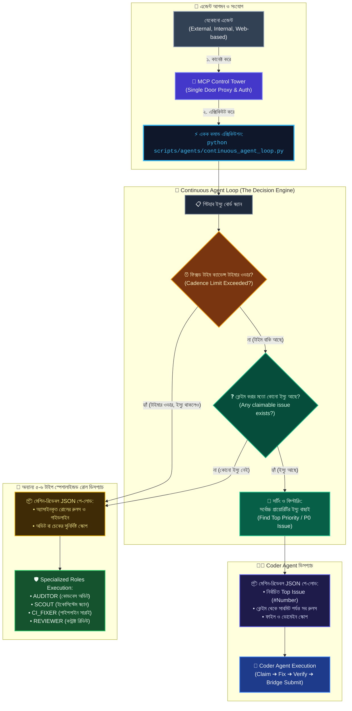

# 🔄 Continuous Agent Loop লাইফসাইকেল ও ডিসপ্যাচ ডায়াগ্রাম

এই ফাইলে SupremeAI অটোনোমাস এজেন্ট লুপের ডিসপ্যাচ লজিক, ইস্যু প্রায়োরিটাইজেশন এবং স্পেশালাইজড রোল অ্যাসাইনমেন্টের নিয়মাবলী তুলে ধরা হয়েছে।

---

## 📑 সূচিপত্র
1. **১. এজেন্ট লুপ ও ডিসপ্যাচ আর্কিটেকচার**
2. **২. লুপের সিদ্ধান্ত অ্যালগরিদম (Decision Steps)**
3. **৩. স্পেশালাইজড রোল ও ক্যাডেন্স টাইমার**

---

## 🚀 ১. এজেন্ট লুপ ও ডিসপ্যাচ আর্কিটেকচার

---

## ⚙️ ২. লুপের সিদ্ধান্ত অ্যালগরিদম (Decision Steps)

1. **একক কমান্ড:** যেকোনো এজেন্ট (External/Internal/Web-based) শুধুমাত্র `python scripts/agents/continuous_agent_loop.py` রান করে।
2. **ক্যাডেন্স টাইমার চেক:** বোর্ডে ইস্যু থাকা সত্ত্বেও যদি কোনো রোলের নির্দিষ্ট সময়সীমা (Cadence Timer) অতিক্রান্ত হয়, তবে লুপ সরাসরি সেই স্পেশালাইজড রোল ডিসপ্যাচ করে (অ্যান্টি-স্টারভেশন নীতি)।
3. **ইস্যু উপস্থিতি যাচাই:** টাইমার ঠিক থাকলে লুপ দেখে — "ক্লেইম করার মতো কোনো ইস্যু আছে কি না?"
4. **সর্বোচ্চ প্রায়োরিটি বাছাই:** একাধিক ইস্যু থাকলে স্বয়ংক্রিয়ভাবে সর্বোচ্চ প্রায়োরিটি (P0/Top) ইস্যু বাছাই করে।
5. **মেশিন-রিডেবল পে-লোড:** কোডার বা স্পেশালাইজড এজেন্টকে কাজের বিস্তারিত, নিয়মাবলী এবং স্কোপ সম্পূর্ণ JSON আকারে দেওয়া হয় যাতে এজেন্ট কোনো অনুমান ছাড়াই নিখুঁত কাজ করতে পারে।

