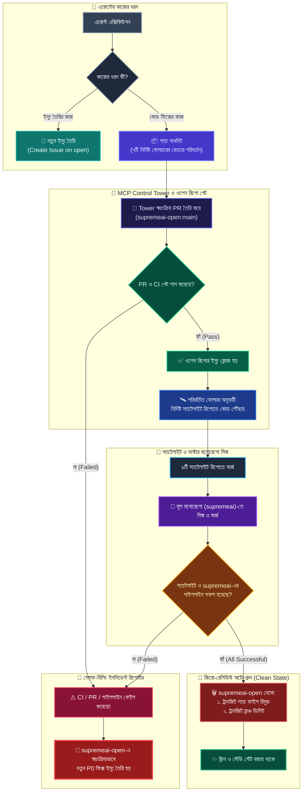
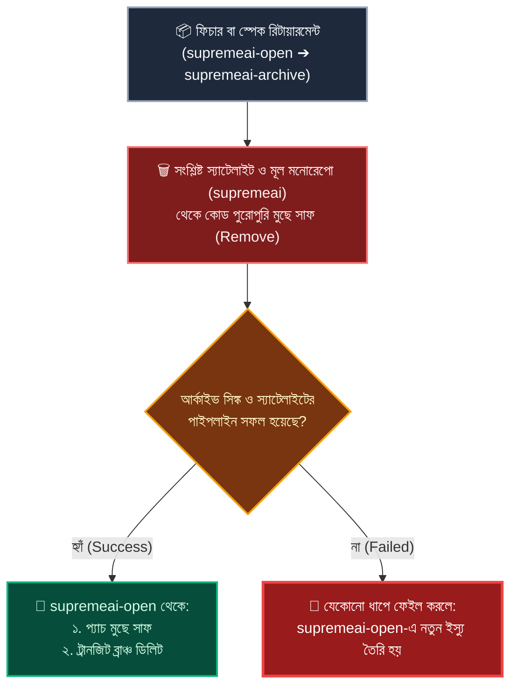

# 🔁 SupremeAI ট্রানজিট, অটো-প্রুন ও রিটায়ারমেন্ট পাইপলাইন ডায়াগ্রাম

এই ফাইলে এজেন্টদের প্যাচ সাবমিশন, মাল্টি-রিপো ডিসপ্যাচ, সেলফ-হিলিং ফেইলিউর হ্যান্ডলিং এবং আর্কাইভ/জিরো-রেসিডিউ ক্লিনআপের পূর্ণাঙ্গ জীবনচক্র ডায়াগ্রাম আকারে সংরক্ষিত আছে।

---

## 📑 সূচিপত্র
1. **১. এন্ড-টু-এন্ড ট্রানজিট ও প্যাচ লাইফসাইকেল ডায়াগ্রাম**
2. **২. আর্কাইভ ও রিটায়ারমেন্ট ফ্লো (Zero Residue Flow)**
3. **৩. সেলফ-হিলিং মেকানিজম (Fail-Closed Issue Creation)**

---

## 🚀 ১. এন্ড-টু-এন্ড ট্রানজিট ও প্যাচ লাইফসাইকেল ডায়াগ্রাম

---

## 📦 ২. আর্কাইভ ও রিটায়ারমেন্ট ফ্লো (Zero-Residue Retirement)

যখন কোনো ফিচার বা লিগ্যাসি কোড রিটায়ার করে সরাসরি `supremeai-archive`-এ স্থানান্তর করা হয়:

---

## 🛡️ ৩. নিয়মের মূল সারসংক্ষেপ:
1. **টাস্ক স্প্লিট:** এজেন্টের কাজ যদি ইস্যু তৈরির হয় তবে সে কেবল ইস্যু বানাবে; আর কোড ফিক্সের কাজ হলে সে ৭টি নির্দিষ্ট ফোল্ডারের ভেতরে প্যাচ দেবে।
2. **অটো PR ও ক্লোজার:** MCP Tower নিজে PR বানাবে। PR পাস করার সাথে সাথে ওপেন রিপোর সংশ্লিষ্ট ইস্যু ক্লোজ হয়ে যাবে এবং ফাইলগুলো নির্দিষ্ট স্যাটেলাইটে ছড়িয়ে যাবে।
3. **দ্বৈত মার্জ ও পাইপলাইন ভেরিফিকেশন:** স্যাটেলাইটে মার্জের পর মূল `supremeai`-তেও মার্জ হবে। দুটি জায়গাতেই পাইপলাইন সাকসেসফুল হতে হবে।
4. **অটো-প্রুন (জিরো রেসিডিউ):** সমস্ত পাইপলাইন গ্রিন হলে `supremeai-open` থেকে ওই প্যাচ এবং ব্রাঞ্চ সম্পূর্ণ মুছে ফেলা হবে।
5. **ইউনিভার্সাল সেলফ-হিলিং:** PR, CI বা স্যাটেলাইট পাইপলাইনের যেকোনো একটি ধাপে যদি ব্যর্থ (Fail) হয়, সাথে সাথে স্বয়ংক্রিয়ভাবে `supremeai-open`-এ একটি নতুন P0 ইস্যু ক্রিয়েট হয়ে যাবে।
6. **আর্কাইভ রুল:** আর্কাইভে কোড যাওয়ার পর অ্যাক্টিভ স্যাটেলাইট ও মনোরেপো থেকে তা রিমুভ হবে এবং পাইপলাইন গ্রিন হওয়ার পরই ওপেন রিপোর ট্রানজিট ক্লিন হবে।

