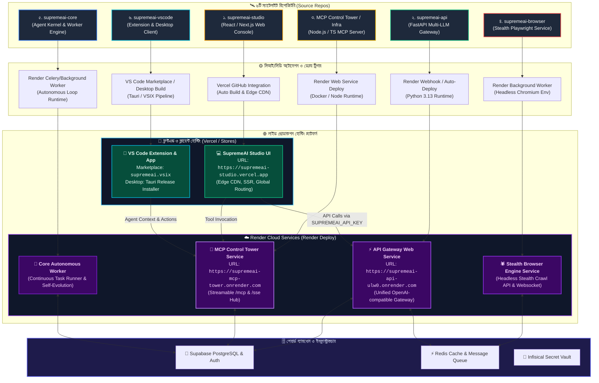

# 🚀 SupremeAI মাল্টি-রিপো ডেপ্লয়মেন্ট ও হোস্টিং ডায়াগ্রাম (Render & Frontend Deploy)

এই ডায়াগ্রামে আমাদের ৬টি স্যাটেলাইট রিপোজিটরি থেকে Render ক্লাউড এবং ফ্রন্টএন্ড হোস্টিং প্ল্যাটফর্মে (Vercel / Marketplaces) কীভাবে স্বয়ংক্রিয়ভাবে লাইভ সার্ভিস ডেপ্লয় হয়, তা তুলে ধরা হয়েছে।

---

---

### 📌 ৬টি রিপোজিটরি ডেপ্লয়মেন্টের সংক্ষিপ্ত ছক:

| ক্রমিং | সোর্স রিপোজিটরি | ডেপ্লয় প্ল্যাটফর্ম | সার্ভিসের ধরন / আউটপুট | লাইভ URL / আউটপুট |
|---|---|---|---|---|
| ১ | **`supremeai-studio`** | **Vercel** (Frontend) | React / Vite Web Console | `https://supremeai-studio.vercel.app` |
| ২ | **`supremeai-api`** | **Render** (Cloud) | FastAPI Web Service | `https://supremeai-api-ulw0.onrender.com` |
| ৩ | **`MCP Control Tower`** | **Render** (Cloud) | Node.js MCP Proxy Web Service | `https://supremeai-mcp-tower.onrender.com` |
| ৪ | **`supremeai-browser`** | **Render** (Cloud) | Headless Browser Runtime Service | Private Internal Service |
| ৫ | **`supremeai-core`** | **Render** (Cloud) | Background Worker / Task Runner | Autonomous Background Worker |
| ৬ | **`supremeai-vscode`** | **VS Code Marketplace / Desktop** | Extension Bundle (VSIX) / Desktop App | VS Code Marketplace / Tauri Desktop |

