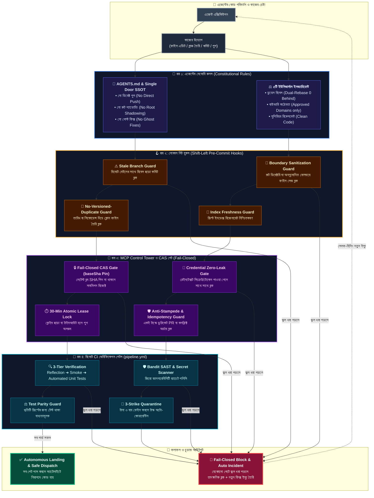

# 🛡️ SupremeAI অ্যান্টি-এরর গার্ড, হুক ও রুলস আর্কিটেকচার (Error Prevention & Guard System)

এজেন্টরা (বা যে কোনো ডেভেলপার) কোড করার সময় যাতে কোনো ধরণের ভুল, সিকিউরিটি লিকেজ, বাউন্ডারি লঙ্ঘন বা ডুপ্লিকেট কাজ করতে **না পারে**, সেজন্য আমাদের ৪-স্তরের মেকানিক্যাল ডিফেন্স সিস্টেমের পূর্ণাঙ্গ ডায়াগ্রাম নিচে দেওয়া হলো।

---

---

### 🛡️ ৪-স্তরের মেকানিক্যাল ডিফেন্সের বিস্তারিত ব্যাখ্যা:

1. **স্তর ১: ইন-মেমোরি ও কনস্টিটিউশন রুলস (`AGENTS.md`):**
   - **উদ্দেশ্য:** এজেন্ট কাজ শুরু করার আগেই তার কনটেক্সটে রুলস ঢুকিয়ে দেওয়া।
   - **কীভাবে ঠেকায়:** সরাসরি পুশ করা নিষিদ্ধ, রুট ফোল্ডারে ফাইল রাখা নিষিদ্ধ, এবং পুরোনো ভুল কোড জোড়াতালি দেওয়া নিষিদ্ধ।

2. **স্তর ২: লোকাল প্রি-কমিট হুকস (Shift-Left Hooks):**
   - **উদ্দেশ্য:** ভুল কোড লোকাল মেশিন থেকেই যাতে গিট-এ কমিট হতে না পারে।
   - **কীভাবে ঠেকায়:**
     - *Stale Branch Guard:* রিমোট `origin/main`-এর থেকে পিছিয়ে থাকলে কমিট বন্ধ করে দেয়।
     - *Boundary Guard:* অনুমোদিত ৭টি ফোল্ডার ছাড়া অন্য কোথাও ফাইল পরিবর্তন করলে আটকে দেয়।
     - *No-Versioned-Duplicate Guard:* তারিখ দেওয়া কপি ফাইল বানালে সাথে সাথে আটকে দেয়।

3. **স্তর ৩: MCP Control Tower ও Fail-Closed CAS গেট:**
   - **উদ্দেশ্য:** ভুল বা পুরনো কোড দিয়ে অন্য কারো নতুন কোড ওভাররাইট হওয়া ঠেকানো।
   - **কীভাবে ঠেকায়:**
     - *CAS Gate (`baseSha` Pin):* এডিটেড ফাইলের ফ্রেশ কমিট SHA না মিললে রিজেক্ট করে (Stale-Base Error)।
     - *Zero-Leak Rule:* পাসওয়ার্ড বা এপিআই কি থাকলে রিজেক্ট করে।
     - *Atomic Lease:* ক্লেইম ছাড়া বা ৩০ মিনিটের বেশি দেরি করলে স্বয়ংক্রিয়ভাবে লক করে দেয়।

4. **স্তর ৪: রিমোট সিআই ভেরিফিকেশন গেটস (`pipeline.yml`):**
   - **উদ্দেশ্য:** সার্ভারে কোড মার্জ হওয়ার শেষ প্রতিরক্ষা।
   - **কীভাবে ঠেকায়:**
     - *3-Tier Verify:* রিফ্লেকশন ➔ স্মোক টেস্ট ➔ অটোমেটেড টেস্ট পাস হতে হবে।
     - *Test Parity:* নতুন কোডের সাথে টেস্ট না থাকলে বিল্ড লাল হয়ে যাবে।
     - *3-Strike Quarantine:* ৩ বার ফেইল করলে টাস্কটি কোয়ারেন্টিনে পাঠিয়ে দেয়।

