# 🌌 SupremeAI ১০০% পূর্ণাঙ্গ ইউনিফাইড মাস্টার আর্কিটেকচার (100% Complete Unified Grand Master)

এই ডায়াগ্রামটি আমাদের সম্পূর্ণ ইকোসিস্টেমের **একক পূর্ণাঙ্গ চিত্র** (Single Source of Truth)। এখানে এজেন্টের আগমন থেকে শুরু করে ৪-স্তরের এরর প্রিভেনশন গার্ডস, লুপ সিদ্ধান্ত, প্যাচ ট্রানজিট, স্যাটেলাইট ও মনোরেপো সিঙ্ক, লাইভ Render/Vercel ডেপ্লয়মেন্ট, এবং চূড়ান্ত জিরো-রেসিডিউ ক্লিনআপ/আর্কাইভ—সবকিছু একটি মাত্র মাস্টার ডায়াগ্রামে অন্তর্ভুক্ত করা হয়েছে।

---

```mermaid
flowchart TD
    %% ========================================================
    %% PHASE 1: AGENT INGRESS & CONSTITUTIONAL RULES
    %% ========================================================
    subgraph PHASE1 [" 🤖 ধাপ ১: এজেন্ট আগমন ও একক এন্ট্রি পয়েন্ট "]
        AnyAgent["যেকোনো এজেন্ট<br/>(External, Internal, Web-based)"]
        TowerProxy["🏰 MCP Control Tower<br/>(Zero-Credential Proxy & Auth)"]
        SingleCmd["⚡ একক কমান্ড এক্সিকিউশন:<br/><code>python scripts/agents/continuous_agent_loop.py</code>"]

        AnyAgent -->|১. কানেক্ট করে| TowerProxy
        TowerProxy -->|২. এক্সিকিউট করে| SingleCmd
    end

    %% ========================================================
    %% PHASE 2: LOOP DECISION ENGINE & DISPATCH
    %% ========================================================
    subgraph PHASE2 [" 🔄 ধাপ ২: লুপ ডিসিশন ও রোল অ্যাসাইনমেন্ট "]
        ScanBoard["📋 গিটহাব ইস্যু বোর্ড স্ক্যান"]
        CadenceCheck{"⏰ ফিক্সড টাইম ক্যাডেন্স টাইমার ওভার?<br/>(Cadence Limit Exceeded?)"}
        
        IssueExist{"❓ ক্লেইম করার মতো ইস্যু আছে কি?<br/>(Any claimable issue exists?)"}
        PickTop["🎯 সর্বোচ্চ প্রায়োরিটি (P0/Top) ইস্যু বাছাই"]

        CoderPayload["📦 Coder Payload (JSON):<br/>Top Issue (#N) + রুলস + ফাইল স্কোপ"]
        RolePayload["📦 Specialized Role Payload (JSON):<br/>AUDITOR, SCOUT, CI_FIXER, REVIEWER"]

        SingleCmd --> ScanBoard
        ScanBoard --> CadenceCheck
        
        CadenceCheck -- "না (টাইম বাকি আছে)" --> IssueExist
        IssueExist -- "হ্যাঁ (ইস্যু আছে)" --> PickTop
        PickTop --> CoderPayload

        CadenceCheck -- "হ্যাঁ (টাইমার ওভার)" --> RolePayload
        IssueExist -- "না (বোর্ড খালি)" --> RolePayload
    end

    %% ========================================================
    %% PHASE 3: AGENT ACTION & SHIFT-LEFT DEFENSE
    %% ========================================================
    subgraph PHASE3 [" 🛡️ ধাপ ৩: এজেন্টের কাজ ও ৪-স্তরের অ্যান্টি-এরর গার্ডস "]
        AgentActionType{"কাজের ধরন কী?"}
        ActionCreateIssue["📝 নতুন ইস্যু তৈরি<br/>(Create Issue on open)"]
        ActionSubmitPatch["📦 প্যাচ তৈরি<br/>(৭টি নির্দিষ্ট ফোল্ডারের মধ্যে পরিবর্তন)"]

        CoderPayload --> AgentActionType
        RolePayload --> AgentActionType
        AgentActionType -- "ইস্যু তৈরি" --> ActionCreateIssue
        AgentActionType -- "কোড ফিক্স" --> ActionSubmitPatch

        subgraph GUARDS [" 🚧 ৪-স্তরের মেকানিক্যাল ডিফেন্স সিস্টেম "]
            G1["📜 স্তর ১: AGENTS.md মেমোরি রুলস (No Direct Push, Boundary Invariant)"]
            G2["🪝 স্তর ২: লোকাল প্রি-কমিট হুকস (Stale Branch, No-Duplicate, Boundary Guard)"]
            G3["🏰 স্তর ৩: Tower Fail-Closed CAS গেট (baseSha Pin, 30m Lease, Anti-Stampede)"]
            G4["🧪 স্তর ৪: রিমোট CI ভেরিফিকেশন (3-Tier Verify, SAST, Test Parity, Quarantine)"]
            G1 --> G2 --> G3 --> G4
        end

        ActionSubmitPatch --> G1
    end

    %% ========================================================
    %% PHASE 4: TOWER GATE & MULTI-REPO DISPATCH
    %% ========================================================
    subgraph PHASE4 [" 🚀 ধাপ ৪: Tower PR ও স্যাটেলাইট ডোমেইন ডিসপ্যাচ "]
        TowerPR["🏰 Tower অটো-PR ওপেন করে<br/>(supremeai-open:main)"]
        CloseOpenIssue["✅ supremeai-open-এর ইস্যু ক্লোজ হয়"]
        
        subgraph SATELLITE_REPOS ["🛰️ ৬টি স্যাটেলাইট রিপোজিটরিতে কোড পৌঁছায়"]
            R_Core["supremeai-core<br/>(core/*)"]
            R_API["supremeai-api<br/>(gateway/*)"]
            R_Studio["supremeai-studio<br/>(studio/*)"]
            R_Browser["supremeai-browser<br/>(browser/*)"]
            R_VSCode["supremeai-vscode<br/>(vscode/*)"]
            R_Infra["MCP Tower / Infra<br/>(infrastructure/*)"]
        end

        G4 -- "সব গার্ড সফল (Pass)" --> TowerPR
        TowerPR --> CloseOpenIssue
        CloseOpenIssue --> SATELLITE_REPOS
    end

    %% ========================================================
    %% PHASE 5: MONOREPO CONSOLIDATION & LIVE DEPLOYMENT
    %% ========================================================
    subgraph PHASE5 [" 👑 ধাপ ৫: মনোরেপো কনসোলিডেশন ও লাইভ ডেপ্লয়মেন্ট "]
        RollingTrain["🚂 Rolling Train সিঙ্ক (১০ মি: পর পর)"]
        Monorepo["👑 সেন্ট্রাল মাস্টার মনোরেপো (supremeai)"]
        MonoPipeline{"মনোরেপোর ফাইনাল পাইপলাইন গ্রিন?"}

        SATELLITE_REPOS --> RollingTrain
        RollingTrain --> Monorepo
        Monorepo --> MonoPipeline

        %% Live Deployments
        subgraph LIVE_HOSTS [" 🌐 লাইভ প্রোডাকশন ডেপ্লয়মেন্ট (Render & Frontend) "]
            Dep_Studio["💻 <b>Studio Web UI</b><br/>(Vercel Edge CDN)"]
            Dep_VSCode["🧩 <b>VS Code Extension</b><br/>(Marketplace / Desktop)"]
            Dep_API["⚡ <b>API Gateway Service</b><br/>(Render Web Service)"]
            Dep_Tower["🏰 <b>MCP Tower Service</b><br/>(Render Web Service)"]
            Dep_Browser["🕷️ <b>Browser Runtime</b><br/>(Render Worker)"]
            Dep_Core["🧠 <b>Core Autonomous Worker</b><br/>(Render Worker)"]
        end

        MonoPipeline -- "হ্যাঁ (All Green)" --> LIVE_HOSTS
    end

    %% ========================================================
    %% PHASE 6: ZERO-RESIDUE CLEANUP & RETIREMENT
    %% ========================================================
    subgraph PHASE6 [" 🧹 ধাপ ৬: জিরো-রেসিডিউ ক্লিনআপ ও রিটায়ারমেন্ট "]
        DecisionDest{"কোডের গন্তব্য কী?"}
        
        NormalPrune["✨ সাধারণ প্যাচ ক্লিনআপ:<br/>supremeai-open থেকে প্যাচ ফাইল ও ব্রাঞ্চ ডিলিট"]
        
        ArchiveFlow["📦 রিটায়ারমেন্ট ফ্লো:<br/>১. supremeai-archive-এ জমা<br/>২. স্যাটেলাইট ও মনোরেপো থেকে মুছে সাফ<br/>৩. open থেকে ট্রানজিট ও ব্রাঞ্চ ডিলিট"]
        
        CleanState["💎 সিস্টেম ১০০% ক্লিন ও রেডি স্টেটে ফিরে আসে"]

        LIVE_HOSTS --> DecisionDest
        DecisionDest -- "অ্যাক্টিভ কোড" --> NormalPrune
        DecisionDest -- "রিটায়ার্ড কোড" --> ArchiveFlow
        NormalPrune --> CleanState
        ArchiveFlow --> CleanState
    end

    %% ========================================================
    %% SELF-HEALING / ERROR BUS
    %% ========================================================
    subgraph SELF_HEAL [" 🚨 সার্বজনীন সেলফ-হিলিং বাস (Universal Defect Ownership) "]
        FailTrigger["⚠️ যেকোনো গেট / হুক / পাইপলাইন ফেইল করেছে!"]
        AutoP0Issue["🚨 supremeai-open-এ স্বয়ংক্রিয়ভাবে<br/>নতুন P0 ফিক্স ইস্যু তৈরি হয়"]

        G1 -- "ভুল ধরা পড়লে" --> FailTrigger
        G2 -- "ভুল ধরা পড়লে" --> FailTrigger
        G3 -- "ভুল ধরা পড়লে" --> FailTrigger
        G4 -- "ভুল ধরা পড়লে" --> FailTrigger
        MonoPipeline -- "না (Failed)" --> FailTrigger
        
        FailTrigger --> AutoP0Issue
        AutoP0Issue -.->|পুনরায় লুপে প্রবেশ| ScanBoard
    end

    %% Styling
    style AnyAgent fill:#334155,stroke:#94a3b8,stroke-width:2px,color:#f8fafc
    style TowerProxy fill:#4338ca,stroke:#818cf8,stroke-width:2px,color:#f8fafc
    style SingleCmd fill:#0f172a,stroke:#38bdf8,stroke-width:3px,color:#38bdf8
    
    style ScanBoard fill:#1e293b,stroke:#64748b,stroke-width:2px,color:#f8fafc
    style CadenceCheck fill:#78350f,stroke:#f59e0b,stroke-width:2px,color:#fef3c7
    style IssueExist fill:#064e3b,stroke:#10b981,stroke-width:2px,color:#d1fae5
    style PickTop fill:#065f46,stroke:#34d399,stroke-width:2px,color:#ecfdf5

    style CoderPayload fill:#1e1b4b,stroke:#6366f1,stroke-width:2px,color:#e0e7ff
    style RolePayload fill:#3f2c06,stroke:#eab308,stroke-width:2px,color:#fef08a
    style AgentActionType fill:#1e293b,stroke:#64748b,stroke-width:2px,color:#f8fafc
    style ActionCreateIssue fill:#0f766e,stroke:#14b8a6,stroke-width:2px,color:#f0fdfa
    style ActionSubmitPatch fill:#4338ca,stroke:#818cf8,stroke-width:2px,color:#e0e7ff

    style GUARDS fill:#0f172a,stroke:#f59e0b,stroke-width:2px,color:#f8fafc
    style G1 fill:#1e1b4b,stroke:#6366f1,stroke-width:1px,color:#e0e7ff
    style G2 fill:#451a03,stroke:#d97706,stroke-width:1px,color:#fef3c7
    style G3 fill:#3b0764,stroke:#9333ea,stroke-width:1px,color:#f5d0fe
    style G4 fill:#083344,stroke:#0891b2,stroke-width:1px,color:#cffafe

    style TowerPR fill:#1e1b4b,stroke:#6366f1,stroke-width:2px,color:#e0e7ff
    style CloseOpenIssue fill:#065f46,stroke:#34d399,stroke-width:2px,color:#ecfdf5
    
    style R_Core fill:#0f172a,stroke:#3b82f6,stroke-width:2px,color:#f8fafc
    style R_API fill:#0f172a,stroke:#10b981,stroke-width:2px,color:#f8fafc
    style R_Studio fill:#0f172a,stroke:#f59e0b,stroke-width:2px,color:#f8fafc
    style R_Browser fill:#0f172a,stroke:#ef4444,stroke-width:2px,color:#f8fafc
    style R_VSCode fill:#0f172a,stroke:#06b6d4,stroke-width:2px,color:#f8fafc
    style R_Infra fill:#1c1917,stroke:#eab308,stroke-width:2px,color:#f8fafc

    style RollingTrain fill:#1e293b,stroke:#38bdf8,stroke-width:2px,color:#f8fafc
    style Monorepo fill:#4c1d95,stroke:#a855f7,stroke-width:2px,color:#f8fafc
    style MonoPipeline fill:#78350f,stroke:#f59e0b,stroke-width:2px,color:#fef3c7

    style LIVE_HOSTS fill:#0f172a,stroke:#a855f7,stroke-width:2px,color:#f8fafc
    style Dep_Studio fill:#064e3b,stroke:#10b981,stroke-width:1px,color:#ecfdf5
    style Dep_VSCode fill:#064e3b,stroke:#06b6d4,stroke-width:1px,color:#ecfdf5
    style Dep_API fill:#3b0764,stroke:#a855f7,stroke-width:1px,color:#f5d0fe
    style Dep_Tower fill:#3b0764,stroke:#c084fc,stroke-width:1px,color:#f5d0fe
    style Dep_Browser fill:#3b0764,stroke:#9333ea,stroke-width:1px,color:#f5d0fe
    style Dep_Core fill:#3b0764,stroke:#7e22ce,stroke-width:1px,color:#f5d0fe

    style DecisionDest fill:#1e293b,stroke:#64748b,stroke-width:2px,color:#f8fafc
    style NormalPrune fill:#064e3b,stroke:#10b981,stroke-width:2px,color:#d1fae5
    style ArchiveFlow fill:#475569,stroke:#94a3b8,stroke-width:2px,color:#f8fafc
    style CleanState fill:#047857,stroke:#10b981,stroke-width:3px,color:#ffffff

    style FailTrigger fill:#881337,stroke:#f43f5e,stroke-width:2px,color:#fff1f2
    style AutoP0Issue fill:#991b1b,stroke:#ef4444,stroke-width:3px,color:#ffffff
```

