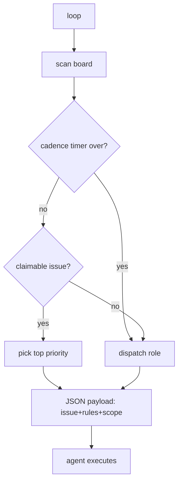
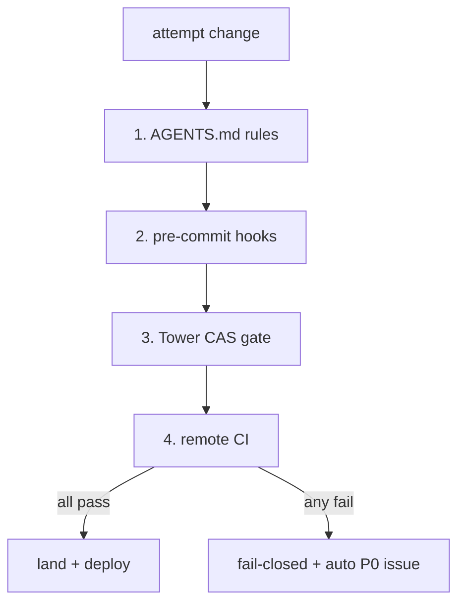

# Simple Agent System (lean)

সহজ অংশগুলো (keep): single door (MCP Tower), একক কমান্ড লুপ, মেকানিক্যাল গার্ড, সেলফ-হিলিং।
বাদ দিন (drop): ৭-স্যাটেলাইট রোলিং-ট্রেইন, মনোরেপো কনসোলিডেশন, আর্কাইভ/রিটায়ারমেন্ট ফ্লো।

Files: `MASTER.md`, `LOOP.md`, `GUARDS.md`.
---
## MASTER.md
```mermaid
flowchart LR
    A[Agent] --> T[MCP Tower (single door)]
    T --> L[continuous_agent_loop.py]
    L --> D{board scan + cadence}
    D -->|issue exists & cadence ok| P[pick top P0 issue]
    D -->|cadence over or no issue| R[specialized role]
    P --> X[coder: claim→fix→verify→submit]
    R --> X
    X --> G[4-tier guards]
    G -->|pass| PR[Tower auto-PR]
    G -->|fail| I[auto P0 fix issue]
    PR --> LAND[land + deploy]
    LAND --> CLEAN[prune transit]
    I --> L
```

## LOOP.md


## GUARDS.md

