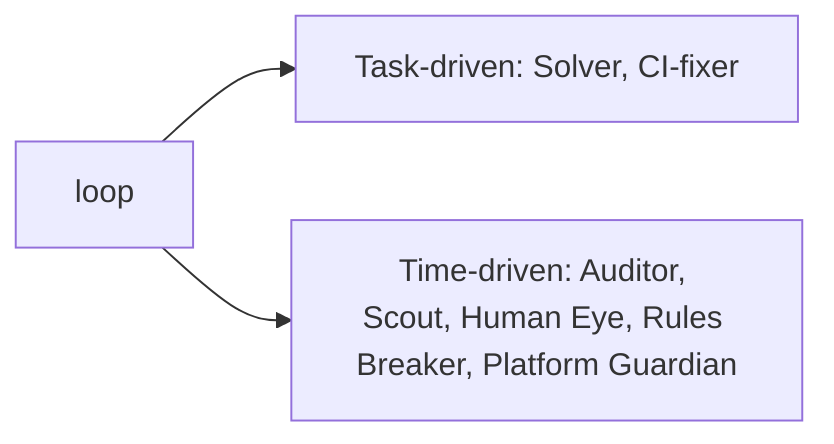

# 02 Roles & RBAC

## Current
```mermaid
flowchart LR
    LOOP[loop] --> SOLVER[Solver: Coder+CI-fixer (knife+defib)]
    LOOP --> AUDITOR[Auditor (microscope)]
    LOOP --> SCOUT[Scout (telescope)]
    LOOP --> HE[Human Eye (camera)]
    LOOP --> RB[Rules Breaker (sledgehammer)]
    LOOP --> PG[Platform Guardian (circuit breaker)]
```

## Simple

Keep all 6 roles; group into two dispatch classes so the loop only checks two cadence buckets.
