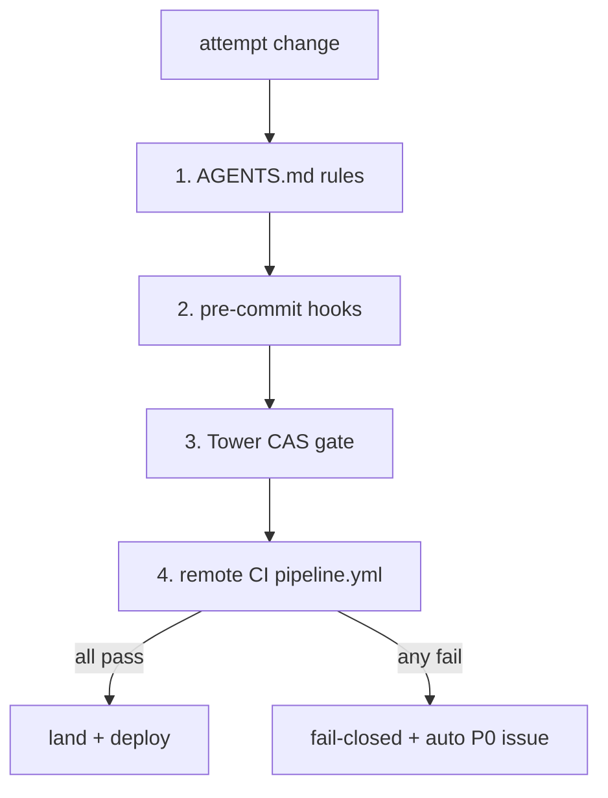

# 03 Guards (4 tiers)

## Current


## Simple
```mermaid
flowchart TD
    A[attempt change] --> G[mechanical gate (single entry: run_all_guards)]
    G -->|pass| OK[land + deploy]
    G -->|fail| FAIL[fail-closed + auto P0 issue]
```
Same 4 tiers internally, but one entry point and one report; no per-guard scattered scripts in the hot path.
