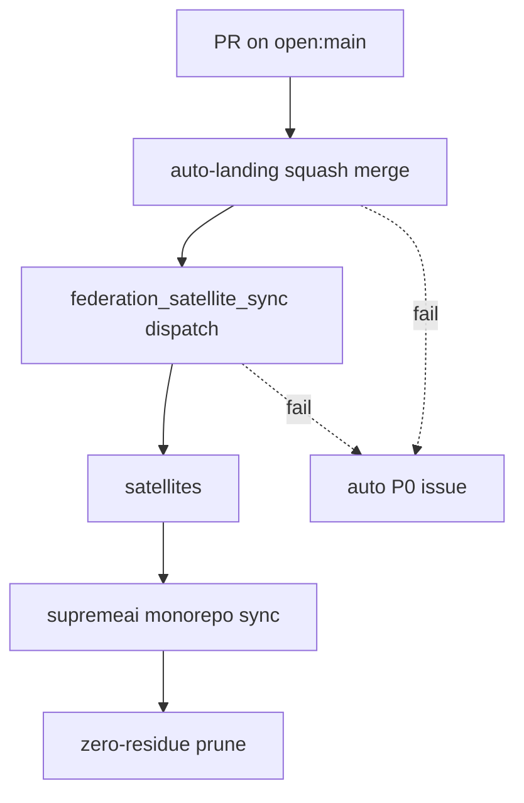

# 04 Bridge & Transit

## Current


## Simple
```mermaid
flowchart TD
    PR[PR on open:main] --> GATE{gate pass?}
    GATE -- pass --> ATOMIC[land→dispatch→prune (atomic)]
    GATE -- fail --> P0[auto P0 issue]
    ATOMIC --> SATS[satellites + monorepo]
```
Collapse landing/dispatch/prune into one atomic step with a single failure exit.
