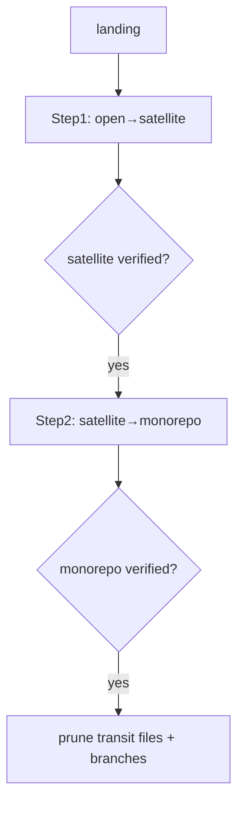

# 05 Landing & Satellite Sync

## Current


## Simple
```mermaid
flowchart TD
    LAND[landing] --> ATOMIC[sync all targets + verify + prune (one job)]
    ATOMIC -->|ok| CLEAN[clean steady state]
    ATOMIC -->|fail| P0[auto P0 issue]
```
One job, one verification, one prune; no separate Step1/Step2 gates in the hot path.
