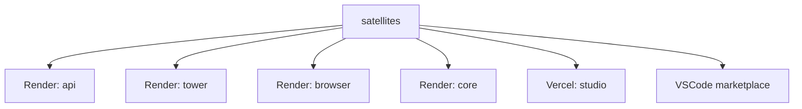

# 06 Deploy Topology

## Current


## Simple
```mermaid
flowchart TD
    SATS[satellites] --> DEPLOY[deploy router (detect changed targets)]
    DEPLOY --> RENDER[Render services]
    DEPLOY --> VERCEL[Vercel studio]
    DEPLOY --> MKT[Marketplace]
```
Keep all 6 targets; add a change-detect router so only touched services redeploy.
