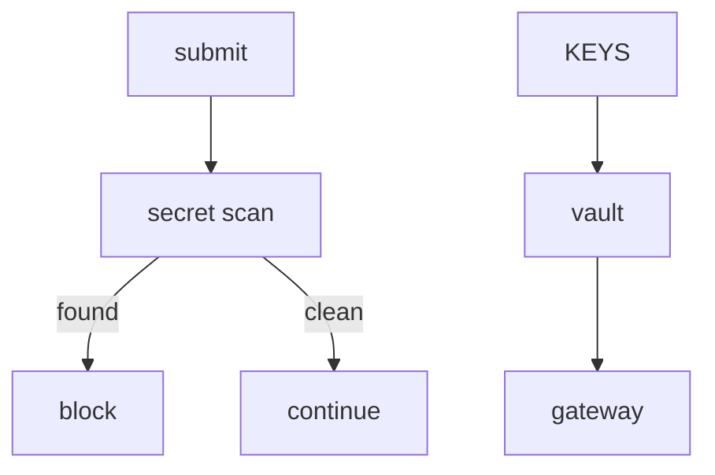

# 10 Secrets & Zero-Leak

## Current
```mermaid
flowchart TD
    A[agent submit] --> SCAN[secret scan (gitleaks + SAST)]
    SCAN -- found --> BLOCK[fail-closed block]
    SCAN -- clean --> OK[continue]
    KEYS[provider keys] --> VAULT[Infisical vault only]
    VAULT --> API[supremeai-api gateway]
```

## Simple

Same zero-leak; scan stays a single gate inside the mechanical gate.
