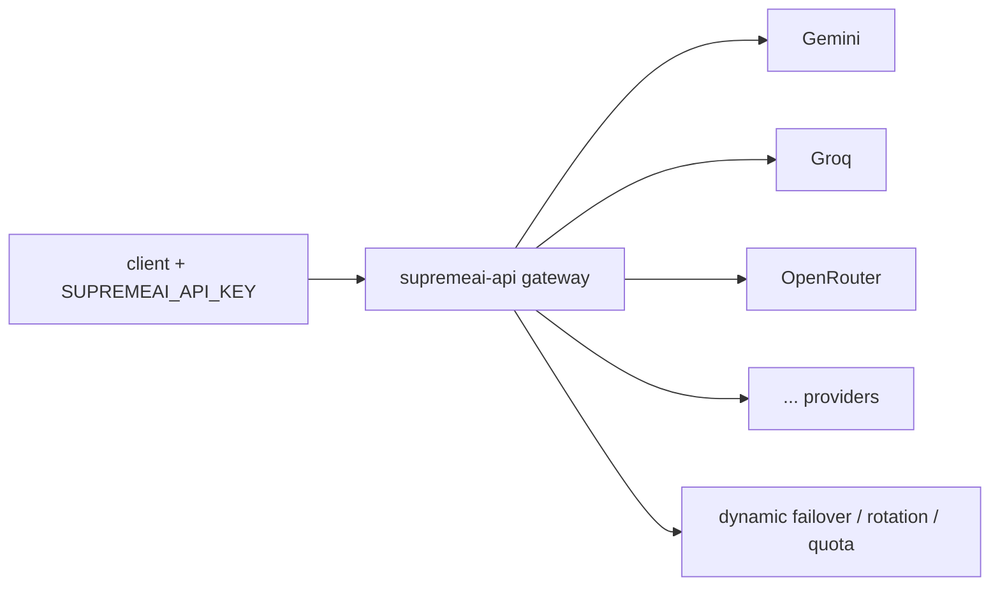

# 12 Gateway (Provider Routing)

## Current


## Simple
```mermaid
flowchart LR
    CLIENT[client] --> GW[gateway (OpenAI-compatible)]
    GW --> POOL[provider pool + failover]
```
Same gateway; pool/failover collapsed into one node in the diagram.
