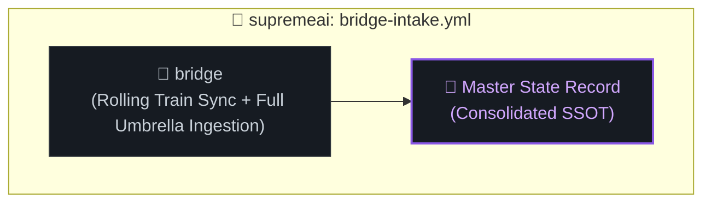

# 👑 supremeai (Master Monorepo) পাইপলাইন (bridge-intake.yml)

- **ইভেন্ট:** `repository_dispatch`, `schedule` ও `workflow_dispatch`
- **জবস:** `bridge` (Rolling Train Consolidation ও মাস্টার ইনজেশন)

