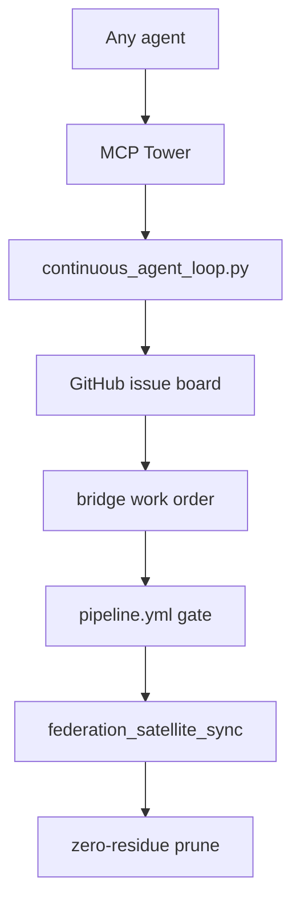

# supremeai-open (Embassy / Public Boundary)

## Current


## Simple
```mermaid
flowchart TD
    AGENT[agent] --> TOWER[Tower] --> LOOP[loop]
    LOOP --> BOARD[board]
    BOARD --> PIPE[gate + dispatch + prune (atomic)]
```
Single door + loop + one atomic pipeline; no scattered bridge scripts in hot path.
