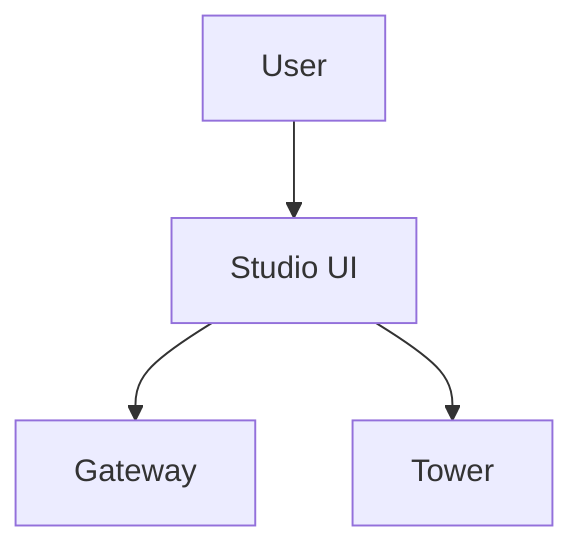

# supremeai-studio (Web UI)

## Current
```mermaid
flowchart TD
    USER[User] --> STUDIO[React/Vite UI (Vercel)]
    STUDIO --> API[supremeai-api gateway]
    STUDIO --> TOWER[MCP Tower]
    STUDIO --> TOKENS[design tokens]
    STUDIO --> MKT[skill marketplace]
```

## Simple

Keep marketplace + tokens as internal modules, not top-level flow nodes.
