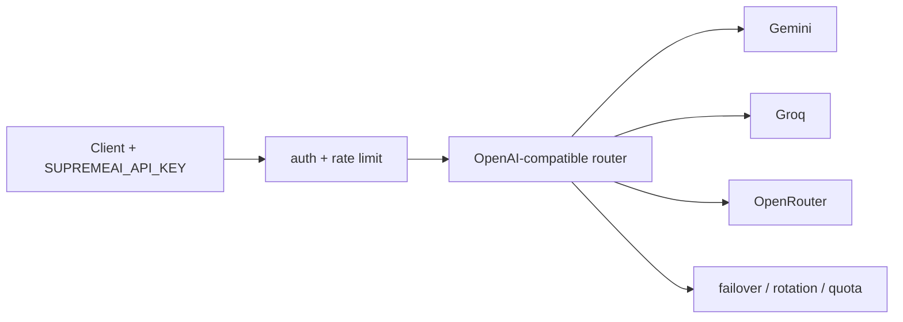

# supremeai-api (Gateway)

## Current


## Simple
```mermaid
flowchart LR
    CLIENT[client] --> GW[Gateway (OpenAI-compatible)]
    GW --> POOL[provider pool + failover/quota]
```
Same gateway; pool collapses providers into one node with internal failover.
