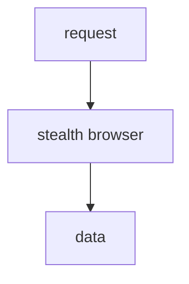

# supremeai-browser (Stealth Runtime)

## Current
```mermaid
flowchart TD
    REQ[scrape request] --> STEALTH[anti-detect stealth engine]
    STEALTH --> PW[Playwright (headless)]
    PW --> DATA[extracted data]
    PW --> WS[websocket stream]
```

## Simple

Same stealth+playwright; internal anti-detect stays inside the browser node.
