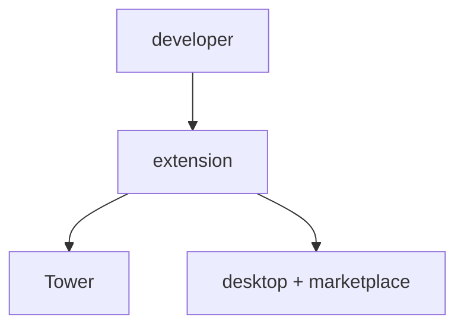

# supremeai-vscode (Extension)

## Current
```mermaid
flowchart TD
    DEV[Developer] --> EXT[VS Code extension]
    EXT --> TOWER[MCP Tower]
    EXT --> DESKTOP[Tauri desktop app]
    EXT --> MKT[Marketplace (VSIX)]
```

## Simple

Same channels; collapse dist targets into one node.
