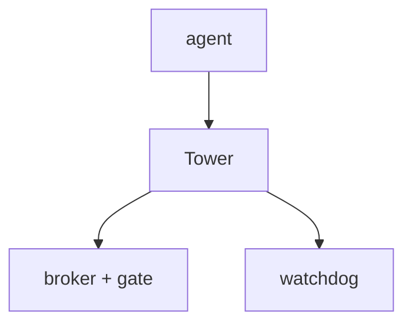

# MCP Control Tower (Infra)

## Current
```mermaid
flowchart TD
    AGENT[agent] --> TOOLS[tool plane: bridge.work_queue / work_order / submit_patch]
    TOOLS --> BROKER[credential broker (zero-leak)]
    BROKER --> KILL[kill-switch]
    TOWER --> WATCH[federated CI watcher]
    WATCH --> EVENTS[event gateway / incident dispatch]
```

## Simple

Same tower; tool plane + broker + watchdog collapsed to 3 nodes.
