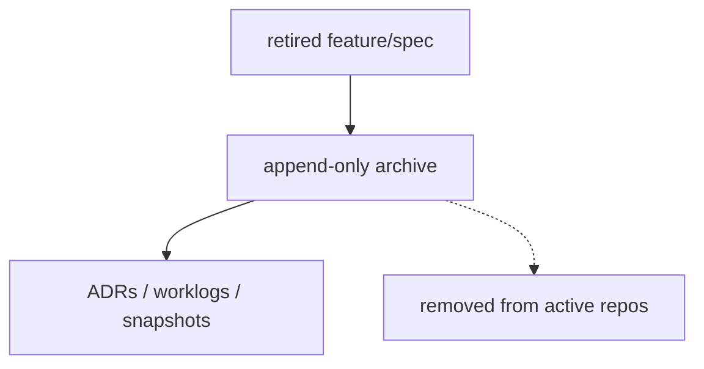

# supremeai-archive (Cold Storage)

## Current


## Simple
```mermaid
flowchart TD
    RETIRE[retire] --> ARCH[archive (append-only)]
```
Same append-only memory; removal from active repos is a side effect, not a flow node.
