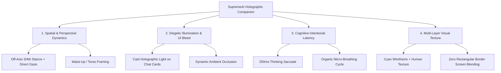
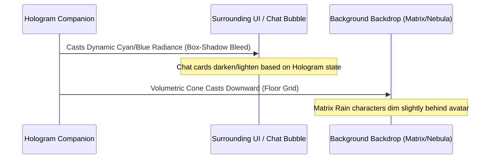

# SupremeAI Hologram: Human & Technology Fusion Architecture Blueprint
> **Research Domain:** Spatial Presence (HCI), Diegetic User Interfaces, Cognitive Load Dynamics & Embodied Conversational Agents (ECA).  
> **Target Platform:** SupremeAI Workstation (Desktop & Web Cockpit).

---

## Executive Summary
Creating an AI hologram that evokes a genuine sense of **Human-Technology Fusion**—rather than a static gimmick or an uncanny robotic cutout—requires a disciplined convergence of cognitive psychology, spatial presence, and volumetric lighting physics.

Based on industry research (*Blade Runner 2049* diegetic interfaces by Territory Studio, cognitive load optimization in spatial computing, and MIT Media Lab's embodied agent paradigms), this document codifies the exact structural requirements for SupremeAI's holographic companion.

---

## 1. Spatial Positioning & Camera Framing

### A. The "Off-Axis 3/4th" Rule
* **The Failure Mode (Frontal Flat Lock):** Positioning a model directly facing the screen (0° rotation) triggers the *ID-card/CCTV camera effect*. The human subconscious immediately categorizes it as a 2D digital billboard.
* **The Fusion Solution:**
  * **Body Vector:** Angled at approximately 15° to 25° (three-quarter profile). This creates perspective depth, revealing neck, shoulder, and facial contour lines.
  * **Gaze Vector:** The head and eyes turn back toward the user's cursor (`relative gaze tracking`).
  * **Result:** Communicates that the digital being has its own autonomous physical presence in a digital space, but its attention is actively dedicated to you.

### B. Optimal Framing: Waist-Up (Torso & Head)
* **Full Body Failure:** When rendering a full human body inside an application window, the head occupies less than 15% of the vertical space. Micro-expressions, blinks, and eye contact become illegible noise.
* **Close-up Face Failure:** Extreme close-up feels invasive and resembles a video call avatar rather than a projected holographic entity.
* **The Fusion Standard:** Framing from mid-torso to crown. This captures:
  1. Subtle chest and shoulder heave during natural respiration (4.2s breathing curve).
  2. Clear eye tracking and pupil dilation luminescence.
  3. Spatial relationship with the projector floor underneath.

---

## 2. Diegetic Lighting & UI Bleed (Environmental Grounding)

The single greatest differentiator between an "overlay sticker" and an "integrated digital being" is **Diegetic Environmental Lighting**:

1. **Light Casting on Workstation UI:**
   * When the hologram speaks or activates, nearby interface elements (e.g., the chat bubble, admin dashboard cards, and navigation header) should subtly receive specular highlights matching the hologram's neon wavelength (`rgba(0, 240, 255, 0.15)`).
2. **Backdrop Occlusion:**
   * Behind the hologram, background elements like the **Digital Matrix Rain** should drop in opacity by 40%–60%. This establishes a definitive focal plane, preventing visual clutter while maintaining futuristic ambient motion.

---

## 3. Behavioral Dynamics: Micro-Hesitation & Organic Breathing

Robotic agents respond in 0.001ms upon receiving a packet. Humans do not. A true technological-human fusion embodies natural physiological timing:

| State | Duration / Frequency | Visual / Kinematic Behavior |
| :--- | :--- | :--- |
| **Idle Micro-Sway** | 4.2s to 4.8s cycle | Natural chest elevation, slight shoulder roll (1.2px vertical, 0.5° tilt). |
| **Spontaneous Blink** | Every 3.8s - 5.2s | Non-periodic double-blink and micro-saccades to avoid artificial metronome feel. |
| **Pre-Speech Saccade** | 180ms - 280ms | Before broadcasting synthesized audio, eyes shift slightly upward or sideways (visual thinking cue). |
| **Active Speech Sync** | Dynamic audio-driven | Non-linear lip and facial luminescence wave synchronized with TTS amplitude. |

---

## 4. Visual Texture: Cybernetic Duality

To prevent slipping into the **Uncanny Valley** (where a photorealistic digital face looks like a corpse):
1. **Luminescent Cybernetics:** Keep the anatomy recognizably human (facial features, hair contours, expressive eyes), but render the skin and clothes with holographic wireframes, glowing nodes, and chromatic aberrations.
2. **True Transparency:** Eliminate any enclosing dark rectangle (`mix-blend-mode: screen`, radial edge dissipation). The avatar must bleed directly into the dark aesthetic of the cockpit.

---

## 5. Architectural Checklist for Implementation

- [x] **Zero-Box Clipping:** Radial gradient masking and high-contrast color grading to dissolve the image card perimeter.
- [x] **Dynamic Ambient Backdrops:** Integrated canvas-based Matrix rain and CSS-driven Cosmic Nebula.
- [x] **Responsive Mouse Gaze:** Real-time 3D rotation matrix tracking the user's focus plane across desktop bounds.
- [ ] **Ambient UI Radiance:** Wire surrounding chat panels to dynamically pulse in luminescence when the companion switches to `speaking` state.
- [ ] **Off-Axis Camera Mode:** Default camera angle adjusted to a 15° angle with eye-tracking convergence toward center.
